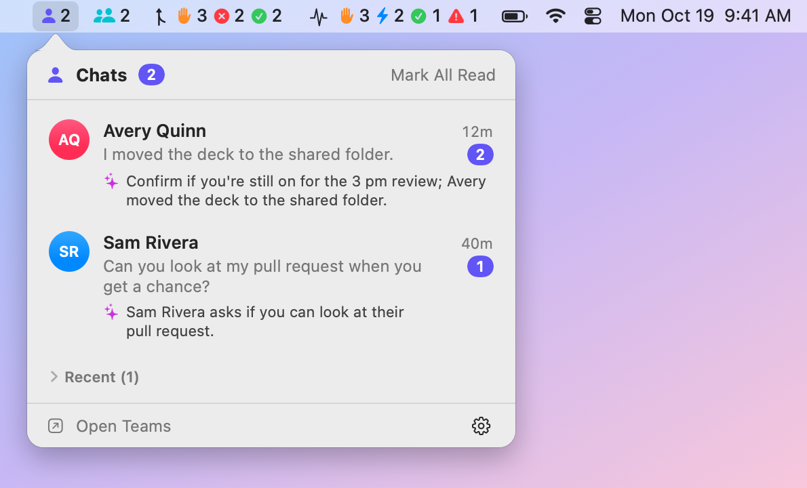
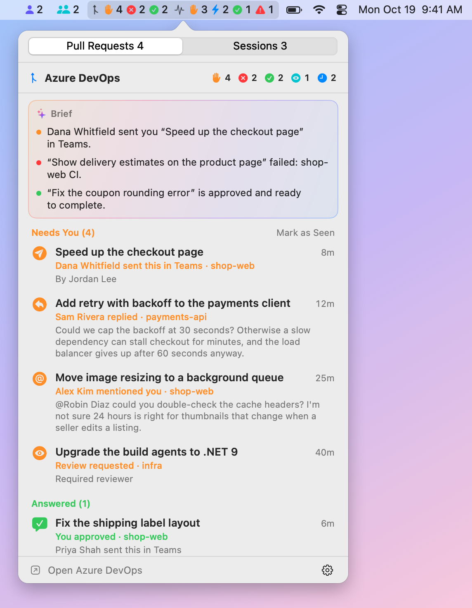
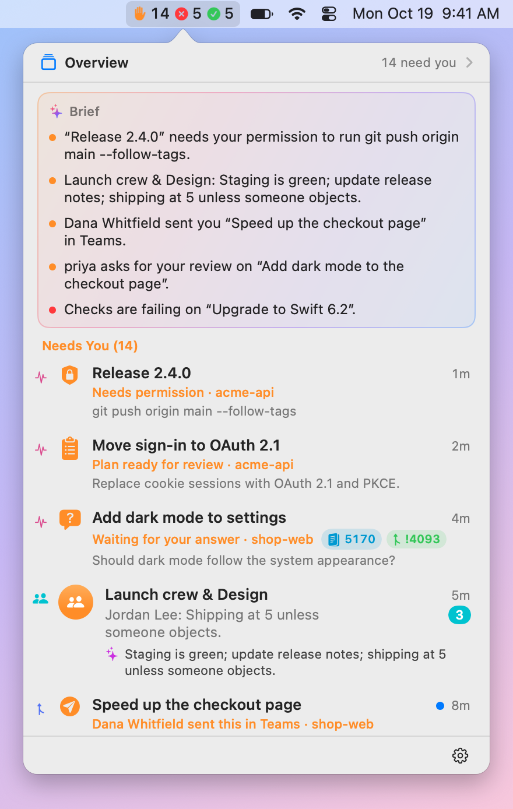
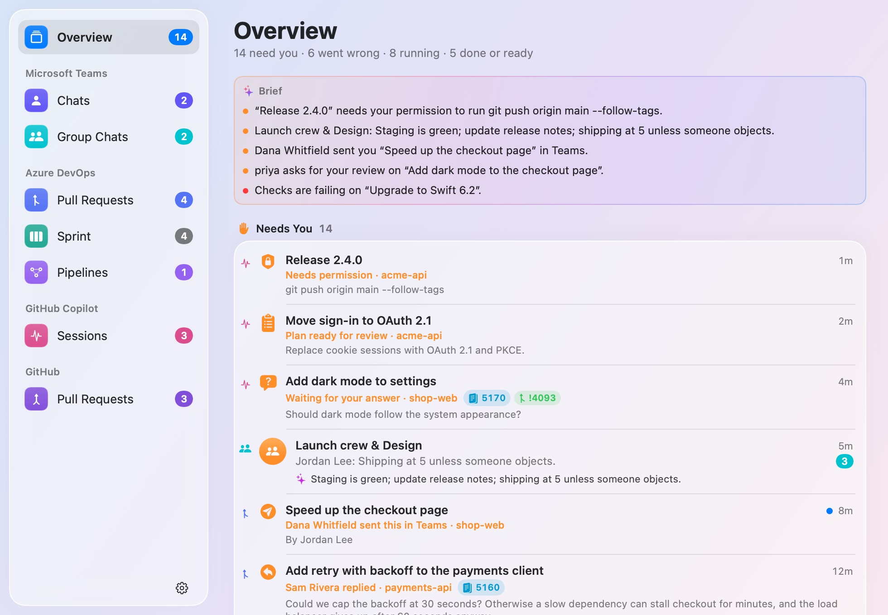
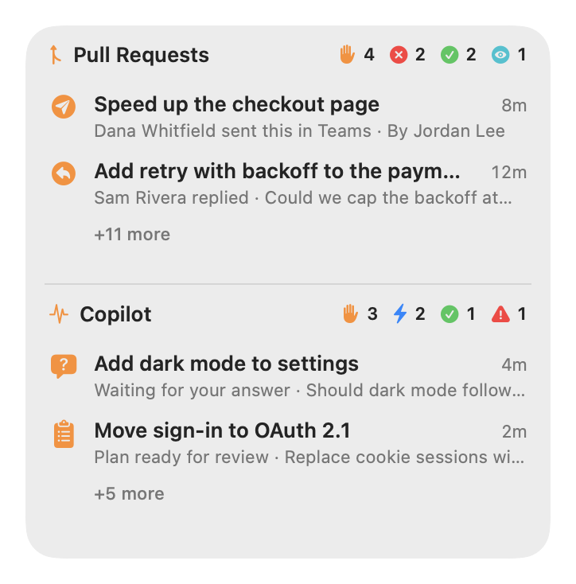
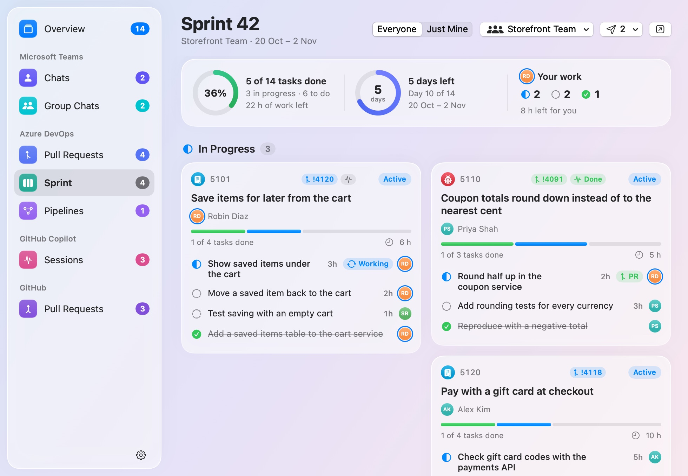

# BriefBar

[](https://github.com/mnsn/brief-bar/actions/workflows/ci.yml)
[](LICENSE)

A macOS menu-bar app that shows what needs you, from the apps you choose:

- your unread **Microsoft Teams** chats,
- your **Azure DevOps** pull requests, your team's sprint and the pipelines you follow,
- what your **GitHub Copilot** app sessions are doing,
- your **GitHub** pull requests: reviews requested from you, and yours that need changes, are failing
  or are approved.

Every source is off until you turn it on, and each one first says what it reads.

BriefBar brings Teams Pulse, ADO Pulse and Copilot Pulse together in one app: one install, one login
item, and permissions that macOS grants once. Full Disk Access for Teams and notifications for Azure
DevOps cover later sources too, but only the ones you turn on. Several sources can share a menu-bar
item, a desktop widget or a window, and you can hide what you don't need. An item they share can add
up their counts, ✋ needs you, ✕ something's wrong, ✓ done or ready, and list
everything together by state under a brief of what matters; the window and a widget give you the same
overview. And if you let them, agents, such as the Copilot CLI, can ask it what needs you, and work
from what it knows ([Agents](#agents)), and its plugin brings **/briefbar** to the GitHub Copilot app
([In the GitHub Copilot app](#in-the-github-copilot-app)).

<p align="center">
  <picture>
    <source media="(prefers-color-scheme: dark)" srcset="docs/images/menubar-teams.chats-dark.png">
    
  </picture>
</p>

> [!NOTE]
> BriefBar is an independent project. It isn't affiliated with or endorsed by Microsoft or GitHub.

## Sources

| Source | Shows | Reads | Needs | Network |
|---|---|---|---|---|
| **Microsoft Teams** | Unread 1:1 chats, and group and meeting chats, in two items | The notifications Teams sends to Notification Center, from its database on your Mac; and how far you've read each chat, from Teams' own data on your Mac | Full Disk Access | None |
| **Azure DevOps** | Pull requests that need you, are failing, are ready to complete, or wait on someone else; your team's sprint, with each work item's details, and the pipelines you pin | Azure DevOps, with the Azure CLI's sign-in; and, only if you turn on **Pull Requests Sent in Chats**, every app's notifications in Notification Center, for links to pull requests; and, only if you turn on **Send Work to Copilot** and send a work item or a pull request, the repository you choose, Copilot's log of that session, and the Copilot app's sessions it could go to instead; and, only if you turn on **Show Links**, the work items and pull requests linked to yours and to the sprint's | The Azure CLI, signed in; notifications; Full Disk Access for pull requests sent in chats; the Copilot CLI to send work to Copilot | `dev.azure.com` and `app.vssps.visualstudio.com`, GET requests only; and, only if you turn on **Summaries**, choose a Copilot model and click **✨ Summarize with Copilot**, a work item's, pull request's or session's details and what's linked to it go to GitHub Copilot, through the Copilot CLI |
| **GitHub Copilot** | Which Copilot app sessions are running, need you, or have finished or stopped; and, with Show Links, what Copilot recorded of a linked session's work, in a work item's details | The Copilot app's own files under `~/.copilot` | Nothing | None |
| **GitHub** | Pull requests that ask for your review by name, and yours that need changes, are failing, are approved or wait on someone else | github.com, with the GitHub CLI's sign-in: those open pull requests, with their checks, reviews, branches and whether they can merge | The GitHub CLI, signed in; no personal access token | `api.github.com`, one read-only GraphQL query each refresh |

Only the Azure DevOps and GitHub sources talk to the network for what you see, each only to its own
service. BriefBar's
own requests are for its updates, from this project's GitHub releases, and only if you allow them. No
telemetry.

## Turning a source on

Open **Settings** from BriefBar's icon in the menu bar (it opens by itself the first time), and choose a
source. Its page says what it reads, where it connects and what it needs, and **Turn On** is your
consent.

- **Teams** needs Full Disk Access to read Notification Center's database. macOS has no prompt for
  it, so a window walks you through System Settings:
  1. Click **Open Privacy Settings**.
  2. Turn on BriefBar. If it isn't in the list, click **+** and choose it, or drag it there. If it's on
     already, remove it with **−** and add it again.
  3. Choose **Quit & Reopen** if macOS offers it.

  macOS gives the access to all of BriefBar, once. A later source that reads Notification Center
  (Outlook, say) would use it too, but only if you turn that source on.
- **Azure DevOps** signs in with the Azure CLI: `brew install azure-cli`, then `az login`, or click
  **Sign In…**, which opens Terminal to run it. macOS asks whether BriefBar may post notifications.
  **Pull Requests Sent in Chats**, off until you turn it on in its settings, also needs Full Disk
  Access, the same window as Teams'.
- **Copilot** needs nothing.
- **GitHub** signs in with the GitHub CLI: `brew install gh`, then `gh auth login`, or click
  **Sign In…**, which opens Terminal to run it. BriefBar asks `gh` for its token and keeps it in memory
  only; it never asks for a personal access token. It lists only pull requests that ask for your review
  by name, not those asked of a team you're in. If your organization uses SAML single sign-on,
  authorize the GitHub CLI for it, and the list says so when it can't see an organization's pull
  requests.

Because macOS asks only once, BriefBar never turns a source on by itself. A source that an update adds
starts off. If an update makes a source read more than what you agreed to, it pauses until you've
looked at what it reads now.

Turning a source off stops it and deletes what it saved, such as Teams' unread chats; its settings
stay. When no source that needs Full Disk Access is on anymore, BriefBar offers to open the list so you
can remove it.

## Menu bar, widgets and windows

Each source has sections: **Chats** and **Group Chats** for Teams, **Pull Requests**, **Sprint** and
**Pipelines** for Azure DevOps, **Sessions** for Copilot, and **Pull Requests** for GitHub. BriefBar
shows them in three places, each arranged in Settings:

- **The menu bar** (Settings › Menu Bar): each section starts with an item of its own, but Sprint and
  Pipelines start hidden there. Click one for its list.
- **Desktop widgets** (Settings › Widgets): Azure DevOps' pull requests, Copilot and GitHub each start
  with a widget, behind your windows or floating above them, in three sizes. Teams' widgets, Sprint and
  Pipelines start hidden, and so does the **Overview** widget: every source's counts, the brief's
  first line and what needs you. Drag a widget by its header, and right-click it for its settings.
- **Windows** (Settings › Windows): one BriefBar window, which opens on an **Overview** of everything
  by state, with the brief, then has a page for every section, and a sidebar with their counts. Open
  it from the top of any list: **Overview** opens it on the Overview, with how many things need you
  there, and the list's title, such as **Pull Requests ›**, at the list's page. A widget's menu has
  **Open in Window** too. BriefBar shows a Dock icon while a window or Settings is open. With
  **Notifications Page** on, it also lists what BriefBar notified you of, after the Overview (see
  [Notifications](#notifications)).

Everywhere, you can put sections together, such as Azure DevOps with Copilot, or all of them in one
item, widget or window, then give each its own again: in Settings, each item is a card with a chip for
each of its sections, and you drag a chip onto another card. Items that share sections show their
counts side by side, with a tab for each in the list. The list opens at the tab you looked at last,
even after BriefBar restarts, and the first time at the one that needs you. You can also hide a section
you don't need, such as Group Chats, from any of them: its source stays on, and shows wherever you
didn't hide it. To move menu-bar items, hold ⌘ and drag them.

A menu-bar item that shows several sections can instead add its counts up by state, the same for
every source: set its **Counts** to **Added Up** in Settings › Menu Bar. With everything in one
item, that's one ✋, one ✕ and one ✓ rather than nine symbols.

| | Teams | Azure DevOps | Copilot | GitHub |
|---|---|---|---|---|
| ✋ Needs you | Unread chats, 1:1 and group | Needs You, and To Review while it shows in the menu bar | Questions, plans and permission prompts | To Review, and Changes Requested |
| ✕ Something's wrong | | Failing pull requests, failed pipelines | Sessions that stopped | Failing checks or merge conflicts |
| ✓ Done or ready | | Ready to complete | Finished sessions | Approved, ready to merge |
| ⚡ Running | | Running pipelines | Running sessions | |

⚡ is off until you turn it on there. A source that can't show what it should, such as Teams without
Full Disk Access or Azure DevOps without a sign-in, adds a small ⚠, and the item's tooltip says
what's in each count. Its **List** can also show **Everything by State**: under a brief, what needs
you, what's wrong, what's running, then what's done or ready, from every section, the newest first,
each with the actions its own list has. Each item keeps its counts and its list as they were until you
switch them.

<p align="center">
  <picture>
    <source media="(prefers-color-scheme: dark)" srcset="docs/images/menubar-combined-dark.png">
    
  </picture>
</p>

<p align="center">
  <picture>
    <source media="(prefers-color-scheme: dark)" srcset="docs/images/menubar-by-state-dark.png">
    
  </picture>
</p>

<p align="center">
  <picture>
    <source media="(prefers-color-scheme: dark)" srcset="docs/images/window-overview-dark.jpg">
    
  </picture>
  &nbsp;
  <picture>
    <source media="(prefers-color-scheme: dark)" srcset="docs/images/widget-all-medium-dark.png">
    
  </picture>
</p>

## Optional appearance improvements

**Settings › Appearance** has seven independent options. **All start off**, including after an
update. Turn on only the changes you want; none enables a source, grants permissions or starts an agent.

**Text Size in Windows**, at the top of the page, makes the text on the pages of BriefBar's windows
bigger, from its usual size up to 150%, for reading long descriptions and comments. In a window, hold
**⌘** and scroll up to make it bigger, or down to make it smaller. The menu bar's lists, the widgets
and Settings keep their size.

| Option | When you turn it on |
|---|---|
| **Compact Briefs** | Moves the brief below the first group and shows two highlights, with **Show All** for the rest. A completed chat summary replaces the duplicate message preview, without hiding unread counts or changing preview permissions. |
| **Quieter Colors and Surfaces** | Uses neutral navigation, avatars and backgrounds, with less decorative color. Status symbols keep their meaning. |
| **Aligned, Easier-to-Read Rows** | Aligns titles across sources and makes reasons and previews larger. Widgets grow slightly to fit complete rows. |
| **Compact Menu Bar** | Temporarily combines the sections already visible in the menu bar into one BriefBar icon. Its count adds **Needs You** and failures; a warning also flags failures or missing access. Choose **All Activity** or a source from its list. |
| **Clearer States and Counts** | Separates **Ready to Merge** from **Finished** in the overview. Sidebar badges and list headers count items needing you or failing, while remaining sprint work is labeled **left**. |
| **Visible Row and Widget Actions** | Adds a row's **…** menu with explicitly named destinations and its existing actions. Widgets offer **View All**; if a section is hidden from windows, **Show in a Window…** opens layout settings instead. |
| **Simple Layout Choices** | Starts Menu Bar, Widgets and Windows settings with **Together**, **Separate** and **Custom**. Custom keeps the full arrangement editor. |

Turning an appearance option off restores its usual presentation. Compact Menu Bar never rewrites
your saved grouping or unhides sections: turning it off restores your saved arrangement. Choosing a
layout in **Simple Layout Choices** is an explicit layout change, just like using the existing editor.
Opening an item retains its source's existing read/seen behavior; these options never approve or
complete work for you.

## The brief

A list by state and the window's Overview start with a brief, and the Overview widget with its first
line: a few lines about what needs you, what's wrong and what's done or ready, from every source
that has something to say, each opening its thing. BriefBar picks the lines, and says each in its
own words. With Apple Intelligence, Apple's on-device model rewords those with something to
condense, such as a chat or a review comment (✨), on your Mac, as it does for Azure DevOps' brief
and Teams' summaries:

- Teams' lines say who wrote and how many messages. What a message says shows only while **Show
  Message Previews** is on, and the model reads a chat only while **Summarize with Apple
  Intelligence** is on too.
- Azure DevOps' lines condense a comment only while its **Summaries** setting is on.
- Copilot's lines stay in BriefBar's own words.

The model only words the lines BriefBar picked, and only while a list or the window shows them, never
for the widget. Without Apple Intelligence (macOS 15, Apple Intelligence turned off or
still getting ready), the brief stays in BriefBar's own words, without ✨, and Settings › Menu Bar says
why.

## Links

**Show Links**, in **Settings › General**, shows which work items, pull requests and Copilot sessions
go together, on their own rows: small capsules next to what's going on, for a pull request's work items
and the sessions working on it, a work item's pull requests and their sessions, and a session's pull
request and work item. A capsule shows a number, or how many, and the sessions' capsule says how the
one that needs you most stands, in its color, so you see when the session on a pull request is waiting
for your answer. It's off until you turn it on. Widgets' rows stay as they are.

Links come from where they already are:

| Link | From |
|---|---|
| A pull request and its work items | Azure DevOps: the work items linked to each of your pull requests, and the pull requests linked to the sprint's work items, a teammate's too |
| A session and the work item or pull request it started from, and the pull request it opened | The tasks you send to Copilot, and what the Copilot app records of its own sessions |
| A session and a pull request on its branch | The session's branch in the Copilot app, in the pull request's repository, unless everybody works on it, as on `main` |
| Anything else | You: right-click a row, then **Link Work Items or Sessions…**, **Link Pull Requests or Sessions…** or **Link Work Items or Pull Requests…** |

A work item's sessions include its pull requests' sessions, and a session's work items its pull
request's. Right-click a row, or click a capsule on a sprint card, to open what it's linked to, link
more, or unlink. The window that links things suggests what's on the same branch, names the same
number or shares words with the title, and takes a pasted link to a pull request, a work item or a
session.

A work item's details on the Sprint page list what's linked to it, with what's known of each, under
**Where It Stands** ([Azure DevOps](#azure-devops)).

What you link or unlink stays in BriefBar: Azure DevOps, GitHub and Copilot never see it, so a policy
that requires linked work items still sees only Azure DevOps' own. Unlinking what Azure DevOps or
Copilot links hides it in BriefBar, until you choose **Show Hidden Links**. While it's on, Azure DevOps
reads the links of your pull requests and, while the sprint is on screen, of its work items, and the
Copilot source reads which pull request each session started from or opened, and, when a work item's
details show a session, the checkpoints and last words Copilot keeps in that session's folder, in
memory only.

## Notifications

Azure DevOps posts notifications for what's new on your pull requests, and for the work you send to
Copilot, as it starts and when it ends ([below](#azure-devops)). Clicking one opens what it's about,
such as the comment or the run, in front of BriefBar.

**Notifications Page**, in **Settings › General**, lists what BriefBar notified you of on a page of
its own in BriefBar's window, right after the Overview, so you can see what you missed: a banner that
went away, a notification macOS didn't show, during a Focus or with notifications off for BriefBar,
and each update of a refresh that had more than its notifications show ("3 more pull request
updates", which opens the page). It's off until you turn it on. Each entry says what it means for
you, ✋, ✕ or ✓, when it came, and with a dot, that you haven't seen it yet. Click one to open what
it's about, as its notification would, or right-click it to remove it; **Clear All** empties the
page. The page shows only while it lists something. BriefBar keeps the entries for a day, or for 4
hours or 3 days (**Keep Notifications For**), in memory only: the page starts empty when BriefBar
restarts or updates.

## What each source shows

### Microsoft Teams

Each chat shows its newest unread message (with the sender in group chats), how long ago it arrived
and how many are unread; hover for the last few. Click a chat to open it in Teams at its oldest unread
message. Click ✨ for a one-sentence summary from Apple's on-device model (macOS 26 or later).

Notification Center doesn't record what you've read, so BriefBar decides:

| A chat becomes | When |
|---|---|
| **Unread** | Teams posts a notification for a new message, while BriefBar runs or while it doesn't |
| **Read** | You open it from BriefBar, or choose **Mark as Read** or **Mark All Read** |
| | You read it in Teams: BriefBar reads how far you've read each chat from Teams' own data on your Mac (you can turn this off) |
| | You click or clear its notification in Notification Center |
| | Teams' dock badge clears, as it does once you've read everything in Teams (you can turn this off) |
| | Its newest unread message is older than **Keep Unread For** (1 day by default) |

Reading a chat in Teams reads it in BriefBar too, within a second or so, up to the newest message you
saw there; a message that arrives later is unread again. **Mark as Unread** in Teams doesn't make it
unread in BriefBar.

Reactions and channel posts aren't unread chats, so they aren't counted. Read chats stay under
**Recent** for a day.

Teams must post notifications for BriefBar to see them. Check that **System Settings › Notifications ›
Microsoft Teams** allows them, with **Show in Notification Center** on, and keep **Badge application
icon** on too: BriefBar watches Teams' dock badge to tell when you've read everything in Teams. In
Teams' own settings, under **Notifications and activity**, chat notifications must be on. Muted chats,
and messages that arrive while Teams' status is **Do not disturb** or while you're looking at the
chat, don't produce notifications. A macOS Focus is fine: notifications are still stored.

### Azure DevOps

The item shows a symbol and count for each group you can act on: orange ✋ needs you, red ✕ failing,
green ✓ ready to complete, and, if you turn it on, teal 👁 to review. At the top of the list, a brief by
Apple Intelligence sums up the newest of each.

| Group | When |
|---|---|
| **Needs You** | Something new you haven't seen: a reply to your comment, a mention, a comment on your pull request, a review request, new commits since your vote, a reviewer who's waiting for you or rejected it, or a link to it someone sent you (if you turned that on). And comments you've seen that still wait on you |
| **Answered** | Something that needed you that you've since taken care of in Azure DevOps, such as "You approved · Dana sent this in Teams", until you've seen it in the list |
| **Failing** | Your pull request has a failed build or status check, merge conflicts, or a build that expired. A failed build says where it failed, and its first error. And your merged pull request, when a pipeline that ran after it merged failed |
| **Ready to Complete** | Your pull request is approved and every required policy passes (or it completes automatically) |
| **To Review** | Review requests you've seen but haven't voted on |
| **Waiting** | Your pull requests waiting for reviewers, a build or a requirement, and reviews you're waiting on the author for |
| **Done** | Completed or abandoned in the last day, and while the pipelines that run after it merged are still going or wait for an approval |
| **Idle** | Drafts, pull requests without activity for two weeks, and reviews you've approved or declined |

**Needs You** is what waits on you, and a dot marks what's new. Opening a pull request from BriefBar, or
**Mark as Seen**, sees it: what's new moves on until something new happens, but a comment that waits on
you, such as a reply to you, a mention or a comment on your pull request, stays there and in the menu
bar's count, no longer marked new. It leaves once you reply in its thread or the thread is resolved,
once you send the comments to Copilot with **Fix Comments** or **Push & Reply**, or when you choose
**Remove from Needs You** in its menu (right-click it, or **Actions** in the window); anything after
that needs you again. A pull request without activity for two weeks goes to Idle, as before. The first
time, only the last three days count as new, and each account you sign in to the Azure CLI with has its
own. Notifications announce new replies, mentions, comments, review requests, votes, new commits, failed
builds, pull requests that become ready or complete, and, after you merge one, a pipeline that fails or
waits for an approval, or all of them passing. Clicking one opens the comment, or the run, it's about.
The first time, BriefBar finds the organizations where you have pull requests; **Organizations** in its
settings changes them.

**Watch a Pull Request…**, in its settings, follows a pull request you're not on, such as one your team
was asked to review, by its link: it's listed as if you reviewed it, under **To Review** as
**Watching**, with replies and mentions needing you there as on any review, until it closes or you stop
watching it (right-click it, or **Watched Pull Requests** in its settings). Once you vote on it, you're
its reviewer.

**Pipelines after your merges.** When a pull request of yours completes, BriefBar follows the pipelines
that run on its merge commit, and the ones those start, such as a deployment, for as long as Done keeps
it. Its row says how they're going ("Merged into main · 2 pipelines running"), moves to **Failing** if
one fails, saying where, and to **Waiting for approval** while a stage waits for one; the Pipelines page
lists them under **After Your Merges**. **Follow Pipelines After You Merge**, in its settings, turns it
off.

**Pull Requests Sent in Chats**, off by default, lists a pull request as needing you when someone
sends you a link to it, in Teams, Slack, an email or any other app, as "Dana sent this in Teams",
even if you're not on it. In Teams, only chat messages count, not channel posts or reactions, and
emails from Azure DevOps itself don't count. It reads the notifications that every app posts to
Notification Center, keeps only the links, with who sent them, in which app and when, never the
messages, and needs Full Disk Access, like Teams. Right-click the pull request to open the message. A
link needs you until you open the pull request from BriefBar, vote or comment on it, it closes, or a
week goes by. BriefBar keeps the links in memory only, so after it restarts, it finds only those whose
notifications Notification Center still has (for Teams, about a couple of days' worth), and one you'd
opened but not voted or commented on needs you again.

**Sprint** shows your team's current sprint at a glance: how much is done, how many days are left and
where your own work stands, then each story and bug with its tasks, in **In Progress** (when they, or
any of their tasks, have started), **Not Started** and **Done**. Tasks without a story in the sprint
are in a card of their own, and your avatar has a blue ring. **Just Mine** shows only yours, and the
team menu shows another team's sprint. Its widget and menu-bar item list your own work; in the list,
its title opens this page, and **Open Task Board** the sprint's task board in Azure DevOps.

Click a story, bug or task to see its details beside the board, without leaving BriefBar: its state,
who has it, its description, acceptance criteria or repro steps, its fields, its tasks and related work
items, its attachments and its discussion. Its parent, its tasks and related work items open the same
way, and **‹** goes back.

With [Show Links](#links) on, the details start with **Where It Stands**: the pull requests, their
pipelines and the Copilot sessions that go with the work item, what needs you first, each saying where
it stands in a sentence. Under its title, **Waiting on** says who it all waits on, you first, such as
**you, to complete !4091 · Copilot, on task 5103**; click the title to fold it to just that line. Click
one, and its page shows what's known of it, right in the details: a pull request's reviewers and their
votes, its open comments and the ones waiting on you, conflicts, and each build or check that ran on it,
with where a failed one failed; a Copilot session's question or plan, and what Copilot recorded of its
work as it went: the story so far, a line for each of its checkpoints, what it did, what's next, and
what it said last, with what else is linked to it, such as a pull request's sessions. The header shows
the way back, such as **Bug 5110 › !4091**, and **‹**, **⌘[** or **Esc** goes back. BriefBar doesn't
write or reword any of it: Copilot's notes show as Copilot wrote them, and nothing more is read from
Azure DevOps for it.

Turn on **Summaries** in **Settings › General**, under Show Links, and, once there's something
to sum up, two things linked or more, or a story's or a bug's tasks and one thing linked, **✨ Summarize
with Apple Intelligence** summarizes the work item and what's linked to it on your Mac:
where it stands in a line, leading with what the rows don't say, and what's next
and for whom, with what's been done and what's left behind **Show More**. It runs only when you click
it. Apple Intelligence is the default unless you've already chosen a model, requires macOS 26 or later
and Apple Intelligence enabled and ready, and uses no Copilot requests or subscription. It never uses
Private Cloud Compute. You can instead choose a Copilot model: **Summarize with Copilot** sends those
details through the Copilot CLI to GitHub Copilot, using one request on your plan each time.
Neither provider gets tools, so it can only write. The card says when it was written, and its
tooltip by which model and from what; once something it summed up changes, it says **Out of date**,
and what changed, with **Summarize Again**. When a provider can't write one, it says why and what would
help: Apple Intelligence isn't available or the item is too long, the Copilot CLI isn't signed in,
the model isn't on your plan (**Choose Model…**), or your premium requests ran out.
BriefBar never switches from Apple Intelligence to Copilot automatically.

The lists have it too: point at a pull request or a Copilot session, in Azure DevOps', GitHub's or
Copilot's list, and **✨** takes its time's place, or right-click it for **Summarize** with your chosen provider.
Its summary shows under its row in two lines, as a chat's does, from what's known of it and what's
linked to it, leading with what its row doesn't say; **Show More** shows the rest. **✕** hides it, and
**Show Summary**, in its menu, shows it again without generating another. The same summary shows on its
page. Widgets never show one.

**Open in Azure DevOps** opens the work item there, to change it; right-clicking it on the board does
too. Drag the details' left edge to make them wider, to read a long description or summary, or
narrower again: BriefBar keeps the width, as far as the window has room for it beside the board, and
double-clicking the edge brings back the usual one. In a narrow window the details cover the board,
until **✕** or Esc closes them. Clicking one of your work items in the Sprint list or widget opens its
details here, in BriefBar's window.

**Pipelines** shows the pipelines that ran after your merges, then the pipelines you pin, from any of
your projects: how each one's latest run is going stage by stage, where it failed, and how its recent
runs went. **Add Pipeline** searches a project's pipelines by name or number, or takes a link to a
pipeline or to one of its runs, which pins the pipeline showing that run's branch; a pinned pipeline's
menu shows only one branch's runs, moves it, or unpins it.

Both start in BriefBar's window only, and read Azure DevOps only while something shows them on screen:
the window's page while it isn't minimized or hidden behind other windows, a widget that isn't
covered, a menu-bar item or its list. The pipelines after your merges are the exception: they're read
with your pull requests, so that you hear when one fails. Click a pipeline or a run to open it in Azure
DevOps, and a work item to see its details.

<p align="center">
  <picture>
    <source media="(prefers-color-scheme: dark)" srcset="docs/images/window-azureDevOps.sprint-dark.jpg">
    
  </picture>
</p>

**Send Work to Copilot**, off by default, hands a sprint's work item to the
[Copilot CLI](https://docs.github.com/copilot/how-tos/copilot-cli) on your Mac, the way you'd ask
Copilot yourself, with your sign-in, tools, MCP servers and instructions. Point at a task and click ✈︎ to
see the prompt, which you can change, and choose the model, how hard it thinks and the repository the
change goes in, then **Send**. Or right-click a task to send it right away, with your model or with the
one for easy work. BriefBar fetches the repository, makes a new worktree of it at the latest base
branch, in `copilot-worktrees` next to it, and starts Copilot there, on its own: in autopilot, with
every tool allowed and no questions. Nothing opens, so a notification says Copilot is on it as you send
it. The task shows Copilot working, then **PR** once it has opened a pull request, published and linked
to the work item, which you'll find under Pull Requests as your own; a notification says when it's
done, or why it stopped. While **GitHub Copilot** is on, each task you sent is listed with your Copilot
sessions too, marked ✈︎ ([below](#github-copilot)). The badge's menu opens the pull request, goes on
with the session in Terminal, shows the worktree, stops Copilot or removes the worktree, and the ✈︎
menu at the top of the Sprint page lists every task you sent. Copilot keeps going if BriefBar quits.

The standard prompt asks Copilot to read the work item with your Azure DevOps tools, branch the way the
repository does, build and test what it changed, then push and open the pull request. A work item's
text is written by whoever wrote it, and goes to an agent that may run any command: send only work you'd
hand to Copilot yourself.

With it on, **your pull requests' menus send them to Copilot too** (right-click one):

| Action | On | What Copilot does |
|---|---|---|
| **Fix Comments with Copilot…** | your pull request with unresolved comments | addresses each one that waits on you, quoted word for word, with its file and line, then builds and tests; it doesn't commit, push or reply |
| **Fix the Build with Copilot…** | your pull request whose build failed | reproduces the failure, from where it failed and the run's errors, and fixes it, or says it's infrastructure or flaky; it doesn't push, or touch pipelines |
| **Resolve Conflicts with Copilot…** | your pull request with merge conflicts | merges the target branch in and resolves the conflicts; it doesn't push |
| **Push & Reply with Copilot…** | your pull request, once one of those is done | goes on in the same session: commits, pushes the branch (never with force), replies on the threads it addressed and resolves them |
| **Pre-review with Copilot…** | a pull request you review | reads the change and drafts your review, with each comment's file, line and how much it matters; it changes and posts nothing |

The Copilot CLI refuses what an action shouldn't do, whatever a comment asks: only Push & Reply may push,
and a review can't change files or commit. Each works in a worktree detached at the pull request's latest
commit (`copilot-worktrees/<repository>/pr-<id>`),
in the clone of its repository you choose the first time, and a later one goes on with the last one's
session, in its worktree, unless you start a new one. As with a work item, a notification says Copilot is
on it, and the task is listed with your Copilot sessions. The pull request's row shows how its task is
going, and its menu has the task's own menu. Once **Fix Comments** or **Push & Reply** starts, or you open
it in Copilot ([below](#sending-to-a-session-thats-already-there)), the comments its prompt quotes are
off **Needs You**; one that comes while you check the prompt, in a thread you take out of it, or in one
reopened meanwhile, still needs you. Comments are written by whoever wrote them, and go to an agent that
may run any command: send only what you'd hand to Copilot yourself.

#### Sending to a session that's already there

A task doesn't have to start a new session. The window's **Session** menu lists the ones it can go to
instead: BriefBar's earlier tasks on the work item or pull request, and the task of the work item that
opened the pull request; then your Copilot app's sessions that go with it, such as the one on the pull
request's branch, one the app records with it, one you linked to it with [Show Links](#links), or one
whose log links to it; and, under **Other Copilot Sessions**, the rest, the most recently active first.
A pull request's task goes on with its last task's session, as before; without one, it goes to the
session of the work item's task that opened it, or to the app's session that likely did. Choose
**New Session** for a new worktree instead.

| Send | What happens |
|---|---|
| **Open in Copilot** | BriefBar copies the prompt and opens the session in the Copilot app: paste it there and send it. Copilot works on it in that session, with the session's own model, mode and permissions, where you can follow it. The default for the app's sessions. |
| **Run with the CLI** | The Copilot CLI goes on with the session now, on its own, in the folder it works in, and BriefBar follows it as it does a new task, with the same limits on what the action may do. The default for BriefBar's own tasks. |

**Run with the CLI** is only there while the Copilot app doesn't have the session open: the app keeps an
open session's history in memory and wouldn't see a turn the CLI runs in it, so the session's history
would fork. For the same reason, don't open the session in the app until Copilot is done; and a session
that a task of BriefBar's still works in, or one that shares its checkout, shows as working, and can't be
chosen until it's done. Nor is **Run with the CLI** there while another of the app's sessions runs a turn in
the same checkout, wherever in it each works. The window looks again every few seconds while it's open, and BriefBar
once more as the task starts. For a pull request, the session's folder has to be a clone of its repository. **Open in Copilot** needs the
Copilot app, and the comments its prompt quotes leave **Needs You** only once the session has opened.

The prompt fits where Copilot works. In a session that's already there, which may be on another branch
or hold work of its own, a pull request's prompt asks Copilot to check out the pull request's latest
commit only if that's safe, and to ask you first otherwise; a work item's is BriefBar's own, which checks
the same way before it branches, rather than the one in Settings, which is for a new worktree. Once you
choose a session or change the prompt, BriefBar doesn't change where it goes. A prompt you changed stays
as you wrote it when you choose another session, and **Reset** goes back to the one for that session.

### GitHub Copilot

| Group | Status | When |
|---|---|---|
| **Needs you** | Waiting for your answer, Plan ready for review, Needs permission | The agent asked a question, finished a plan, or waits for a tool call's permission |
| **Running** | Working, Starting…, Answer in “…” | A turn is in progress (the current step is shown), or, with **Show Relayed Questions Once**, the session coordinating it asks you its question or plan for it |
| **Done** | Finished | The turn ended normally; shows the agent's summary if there is one |
| **Stopped** | Interrupted, Error, Stopped responding | You cancelled the turn, it failed, or it went silent mid-turn for 90 s |
| **Idle** | Idle | Everything else |

**Done** and **Stopped** sessions stay highlighted until you click **Clear** on their group or
**Keep Finished Sessions For** passes. **Move Viewed Sessions to Idle**, off by default, also hides
them after you open or view them in Copilot; turning it off shows recent viewed completions again,
but never ones you explicitly cleared. Click a session to open it in the
Copilot app.

Without the Copilot app, as on a Mac with only the Copilot CLI, the list has the CLI's sessions that
changed in the last day, and there's no app database to miss. Click one to open it in a terminal: one
the CLI still has open brings up the app it runs in, such as Terminal, and any other opens in Terminal
with `copilot --resume`, in the folder it worked in. With the app installed, nothing changes.

When a session that another session started and coordinates has a question or a plan for you, the app
tells the coordinating session, which then asks you too. Answer where it asks: it passes your answer
on, while a plan you approve in the session itself leaves the coordinating session's question waiting,
and its approval then fails. **Show Relayed Questions Once**, off by default, shows such a question
once: as soon as the coordinating session asks, it's in **Needs you** on that session's row only. The
session it's for moves to **Running** as **Answer in “…”**, naming the coordinating session, and
clicking it opens that session; right-click it to open the session itself. Until the coordinating
session asks, the session needs you on its own. Off, both need you once both ask, and a session
passing on a question shows as **Working**.

The Copilot app's sidebar shows the sessions that a session started under it. **Nest Sessions Under
Their Parents**, off by default, does the same within each group: a session in the same group as the
session that started it shows right under it, indented, and the two move together to where the one
waiting longest, or the most recent, would be. A session whose parent is in another group stays in its
place, with a **↳** tag that names the session that started it; click the tag to open that session.
Counts don't change. **Everything by State** mixes every section's items, so it doesn't nest sessions,
and shows the tag on each one that another session started.

The list has the tasks you sent to Copilot from Azure DevOps too, with ✈︎ before their names, such as
"Fix Comments: !4071 Fix the checkout total": they run in the Copilot CLI, not the Copilot app, so the
app doesn't list them. Each is in **Running** while it gets ready and works, then in **Done** or
**Stopped**, as a session is; one you stopped yourself goes straight to **Idle**. Click one to open its
pull request, or its work item; right-click it for the task's own menu. The same **Move Viewed Sessions
to Idle** setting controls whether opening a finished task dismisses it.

### GitHub

The item shows a symbol and count for each group you can act on: orange 👁 to review, orange ✋ changes
requested, red ✕ failing, and green ✓ ready to merge. It lists open pull requests on github.com that
ask for your review by name, and your own open pull requests, up to 50 of each, the most recently
changed first.

| Group | When |
|---|---|
| **To Review** | Someone asked you, by name, to review it |
| **Changes Requested** | Yours, and a reviewer asked for changes |
| **Failing** | Yours, and its checks fail or it has merge conflicts |
| **Ready to Merge** | Yours, and approved, with its checks passing or none |
| **Waiting** | Yours, and a draft, waiting for its checks to finish, or waiting for reviews |

A pull request that's both yours and asks for your review shows once, as yours. Click one to open it on
GitHub. If an organization uses SAML single sign-on and the GitHub CLI isn't authorized for it, the
list says to authorize it, and shows the rest.

## Agents

Agents can ask BriefBar too, once you let them. `BriefBar --mcp` is a
[Model Context Protocol](https://modelcontextprotocol.io) server, so the Copilot CLI, or any agent that
speaks the protocol, can answer "what needs me?" or fix a pull request's comments with what BriefBar
knows. It's off until you turn it on in **Settings › Agents**, which says what agents get first.
Turning agents on adds BriefBar to the Copilot CLI's MCP servers (`copilot mcp add briefbar`), which
the GitHub Copilot app's sessions use too, and turning them off removes it. **Install**, on the same
page, adds BriefBar to Visual Studio Code or Cursor, whichever are on your Mac, with each app's own
install link: the app shows what it would add and asks you first. Its **GitHub Copilot** adds BriefBar
to the Copilot CLI, as turning agents on does, and is checked once it's there. For any other agent,
**Copy Command** copies the command to add.

| Tool | What the agent gets |
|---|---|
| `needs_me` | What the menu bar counts, in each source: pull requests that need you, fail or are ready to complete, pinned pipelines that failed, Copilot sessions waiting for you |
| `pull_requests` | Your pull requests by group, each with why it's there and its link |
| `pull_request` | One pull request: votes, checks and where a build failed, conflicts, the pipelines after its merge, what's new, and its unresolved threads word for word |
| `pull_request_prompt` | The prompt of **Fix Comments**, **Fix the Build**, **Resolve Conflicts**, **Pre-review** or **Push & Reply**, for the agent to follow where it works |
| `pipelines` | Your pinned pipelines, and the ones after your merges |
| `sprint` | Your team's sprint, or only your part of it |
| `work_item` | One work item and what goes with it: where it stands and who it waits on, its tasks, each pull request linked to it with its votes, comments and pipelines, the Copilot sessions on those pull requests with what Copilot recorded of their work, the work BriefBar sent to Copilot for it, and its description and latest comments |
| `copilot_tasks` | The work BriefBar sent to the Copilot CLI, and how it's going |
| `copilot_sessions` | Your Copilot app sessions, as BriefBar shows them |
| `watch_pull_request`, `stop_watching_pull_request` | Watches a pull request by its link, or stops |
| `pin_pipeline`, `unpin_pipeline` | Pins a pipeline by its link, or a run's, or unpins one |

It serves only the sources that are on in BriefBar, reads as the app does, with your Azure CLI sign-in
and only GET requests, and changes nothing in Azure DevOps: only BriefBar's own lists of the pull
requests you watch and the pipelines you pin, which a running BriefBar picks up at once. It leaves
Teams and GitHub out. A source's tool asks the others what they know of what it names, and each
answers only while it's on: `work_item` gets the Copilot sessions on a work item's pull requests from
Copilot, on their branches or as the Copilot app records them, or a line saying Copilot is off. What it
answers goes to the agent's model, which may run in the cloud, so let only agents you'd show your pull
requests to use it. Titles, comments and Copilot's notes come word for word from whoever wrote them,
and an agent may act on what they say: keep its permissions to what you'd allow anyway. If an update gives agents more, they wait until you've seen what they get now, as a source
does. `BriefBar --mcp --demo` answers with made-up data, whatever your settings.

### In the GitHub Copilot app

Once agents are on, **Install** in **Settings › Agents › Copilot plugin** adds BriefBar's plugin to
the Copilot CLI, which the GitHub Copilot app loads too. It's off until you install it, and turning
agents off removes it; if Copilot can't, the page says so, with **Try Again**. Its one skill,
**/briefbar**, works in the app and the CLI:

- **/briefbar** on its own, or "what needs me?", shows what the menu bar counts, in the app as an
  inbox you can search, sort and group, with each pull request's and pipeline's link, and a link to
  each Copilot session that waits for you. A source that's off in BriefBar is listed as off.
- "Fix the comments on !4102", or its build, its conflicts or a review, starts a session of its own
  in the app, in a worktree of your clone of that repository, which you can follow and steer. It asks
  BriefBar for the prompt of the same Copilot action, and does what it allows: it changes files there,
  resolving conflicts commits the merge, and only **Push & Reply**, sent to that same session, pushes
  and replies as you. In the Copilot CLI, the work happens where you are.
- **/briefbar 5101**, or "how's 5101 going?", answers in four short lines, with their links: where the
  work item stands and what you can do now, what's done, by people and by Copilot, what's left and who
  has it, and who it waits on. Then it offers a next step, and starts nothing until you say so.
- It never answers a session's question, plan or permission for you: it offers to open the session.

The plugin comes with BriefBar.app, which the Copilot CLI loads it from, so it updates with BriefBar
and nothing is copied. It gives agents nothing BriefBar didn't already: it uses BriefBar's MCP server,
so add BriefBar to the Copilot CLI too. BriefBar changes only its own plugin marketplace, by the
bundle identifier of the app it's in, and leaves any other named `briefbar`, with its plugins.

## Install

BriefBar needs macOS 15 or later, on Apple silicon (M1 or later). Intel Macs aren't supported.

1. Download [**BriefBar.zip**](https://github.com/mnsn/brief-bar/releases/latest/download/BriefBar.zip)
   from the [latest release](https://github.com/mnsn/brief-bar/releases/latest) and unzip it.
2. Drag **BriefBar** to your Applications folder before you open it. Opened from Downloads, macOS runs
   it from a temporary location, and Full Disk Access, Launch at Login and updates may not work.
3. Open it. The app isn't notarized by Apple, so the first time, macOS won't open it because it can't
   verify it. Click **Done**, then go to **System Settings › Privacy & Security**, scroll down to the
   message that BriefBar was blocked, click **Open Anyway** and confirm.
4. Settings opens: turn on the sources you want, as [above](#turning-a-source-on). Changing the Full
   Disk Access list asks for your password or Touch ID, and an administrator's on a standard account.
5. Turn on **Launch BriefBar at Login** in Settings. If macOS asks you to allow it, use
   **Allow in Login Items Settings…**.

The second time you open it, BriefBar asks whether to check for updates automatically. If you allow
it, it checks once a day and offers each new version, which it installs and reopens without the
Gatekeeper step. Updates keep its Full Disk Access. **Check for Updates…**, in Settings and in each
list's gear menu, checks right away. To remove BriefBar, quit it, move it to the Trash and remove it
from the Full Disk Access list.

On a Mac that your organization manages, check your organization's policy first: security software
may flag an app that reads Notification Center's database. If **Open Anyway** is missing, [build
BriefBar from source](#build-from-source) instead: an app you build yourself opens without the
Gatekeeper step. If a profile keeps you from granting Full Disk Access, your IT department can grant
it for you, as described below. For a copy you build, that grant applies once it has updated itself
to a release.

### Moving from the Pulse apps

BriefBar doesn't read the Pulse apps' settings: each source starts fresh. Quit Teams Pulse, ADO Pulse
and Copilot Pulse before you turn on the same source in BriefBar (two copies of Azure DevOps would
notify you twice), turn off their Launch at Login, and remove them from the Full Disk Access list.

### For organizations: no Full Disk Access step

On Macs your organization manages, IT can grant BriefBar Full Disk Access ahead of time, so its users
never see that step. With this repository cloned, `scripts/make-pppc-profile.sh /Applications/BriefBar.app`
writes a configuration profile for a release, to deploy with your MDM (for example, in Intune, as a
custom macOS configuration profile). macOS ignores it if it's installed by hand. The profile names the
app's signing certificate, which every release shares, so it covers later versions too. For copies
you build yourself with a certificate of your own ([below](#keeping-full-disk-access-across-rebuilds)),
`make pppc-profile` writes one for it instead. The access is the app's, but BriefBar reads nothing
with it until someone turns on a source that needs it.

### Build from source

You need Swift 6, from Xcode or the Command Line Tools (`xcode-select --install`). An app you build
yourself opens without the Gatekeeper step.

```sh
git clone https://github.com/mnsn/brief-bar.git
cd brief-bar
make install     # builds BriefBar.app, copies it to ~/Applications and opens it
```

Then turn on the sources you want, as above: BriefBar is in `~/Applications` (press ⌘⇧G in the file
dialog to type the folder). To remove it, run `make uninstall` and remove it from the Full Disk
Access list.

It's signed ad hoc, so macOS ties Full Disk Access to that exact build, and you allow each rebuild
again. Turning BriefBar off and on in the list keeps the old build's signature, so first run
`tccutil reset SystemPolicyAllFiles com.asaf.BriefBar`, which resets only BriefBar's entry (or remove
it with −), then add it again with +, and choose **Quit & Reopen**. If you have unread Teams chats
saved, macOS may also ask whether the new build may use BriefBar's keychain item: **Always Allow** is
fine there, since it covers only that build.

A copy you build updates itself too, to the release builds, unless you turn off
**Check for Updates Automatically** in Settings and build each new version yourself. Releases are
signed with the project's certificate, not ad hoc or with a certificate of yours, so after that first
update, allow Full Disk Access once more the same way. Later updates keep it.

### Keeping Full Disk Access across rebuilds

macOS ties Full Disk Access to the app's code signature. An ad-hoc signature is identified by the
hashes of the app's code, so every rebuild looks like a new app. If you rebuild often,
`make signing-identity` creates a self-signed certificate, **BriefBar Signing**, in your login
keychain. Every build is then signed with it, and keeps the access you granted.

That makes the certificate's key as powerful as the access: any program that can sign with it can sign
itself as BriefBar, and get the Full Disk Access you gave BriefBar. So no app may use the key without
asking, not even `codesign`, and it can't be exported: each build asks for your login password. Click
**Allow** only while a build of yours is signing, since any program can make `codesign` ask, and never
**Always Allow**, which would let any program running as you use the key silently. `make app` refuses
to sign with a key that some app may use without asking, and checks again after signing.
`scripts/make-signing-identity.sh --replace` swaps such a certificate for a new one, and `--delete`
deletes it, so that builds are signed ad hoc again. Either way, allow the next build again as above.

Releases are signed the same way, with a certificate of the project's own that only GitHub's release
workflow can use, which is why updates keep the access. [How it works](docs/how-it-works.md#signing)
has the details.

## Settings

Each source has its settings on its page in **Settings**, and in the gear menu of its list (or the
right-click menu of its widget), next to **Launch BriefBar at Login**, **Check for Updates…**,
**BriefBar Settings…** and **Quit BriefBar**. **Settings › General** also has
**Check for Updates Automatically**, **Show Links**, off by default (see [Links](#links)),
**Summaries**, off by default (see [Azure DevOps](#azure-devops)), and
**Notifications Page**, off by default, with how long it keeps what it lists: 4 hours, 1 day (default)
or 3 days (see [Notifications](#notifications)).

| Source | Setting | Options |
|---|---|---|
| Teams | Keep Unread For | 4 hours, 1 day (default), 3 days, until I read it |
| | Show Message Previews | on/off: off shows only how many messages are new, for screen sharing |
| | Summarize with Apple Intelligence | on/off: the ✨ button on each chat, and chats worded in [the brief](#the-brief), while previews are shown |
| | Mark Chats Read When You Read Them in Teams | on by default: reads how far you've read each chat from Teams' own data, read-only, and keeps only that, in memory |
| | Mark All Read When Teams' Badge Clears | on by default |
| Azure DevOps | Notifications, Summaries by Apple Intelligence, Show To Review in the Menu Bar | on/off |
| | Follow Pipelines After You Merge | on by default: the pipelines that run after your pull requests merge, while Done keeps them |
| | Pull Requests Sent in Chats | off by default: reads every app's notifications for links to pull requests, and keeps only the links, in memory. Needs Full Disk Access |
| | Refresh | every 1, 2 or 5 minutes |
| | Keep Done For | 4 hours, 1 day, 3 days |
| | Idle After No Activity For | 1 week, 2 weeks, 1 month, never |
| | Organizations | which to watch; **Add Organization…** takes a name or any link from it |
| | Watch a Pull Request | a pull request you're not on, by its link: listed as if you reviewed it, until it closes or you stop watching it |
| | Sprint | on its page: **Everyone** or **Just Mine**, and which team's sprint |
| | Pipelines | on its page: the pipelines you pin, in your order, each with all its branches' runs or one branch's |
| | Send Work to Copilot | off by default: a button on the sprint's work items that sends one to the Copilot CLI on your Mac, and your pull requests' Copilot actions. Its **Model** (Claude Opus 5.5, Max by default), **Model for Easy Work** (Claude Sonnet 5.5, Medium), **Prompt**, and where **Worktrees** go (in `copilot-worktrees` next to each repository by default) |
| Copilot | Keep Finished Sessions For | 15 minutes, 1 hour, 4 hours, 1 day |
| | Move Viewed Sessions to Idle | off by default: when on, opening or viewing a finished or stopped session moves it to Idle |
| | Show Relayed Questions Once | off by default: a question or plan that a coordinating session asks you for another session shows once, on the coordinating session (see [GitHub Copilot](#github-copilot)) |
| | Nest Sessions Under Their Parents | off by default: a session that another session started shows under it, as in the Copilot app's sidebar, or with a ↳ tag when it's in another group (see [GitHub Copilot](#github-copilot)) |
| | Show Context Usage | off by default: how full each session's context window is |
| GitHub | Refresh Every | 1, 2 (default), 5 or 15 minutes: one request each time |

**Settings › Agents** lets agents use BriefBar, off by default, and installs its Copilot plugin only
when you ask (see [Agents](#agents)).

In **Settings › Menu Bar**, **Widgets** and **Windows**, each item is a card with a chip for each
section it shows. Drag a chip onto another card to put them together, onto **New Item** (or **New
Widget**, **New Window**) to give it one of its own, or onto **Hidden**; click **New Item** to choose a
section instead, or right-click a chip for the same moves. **Put All in One** and **Give Each Its Own**
change them all at once. Settings › Menu Bar starts with your menu bar as it is now, BriefBar's items
left to right with your counts, and each card shows its item the same way. A menu-bar item that shows
several sections has **Counts**, **Side by Side** or **Added Up** with the states it adds up, and
**List**, **A Tab for Each Section** or **Everything by State**. Each widget has its own **Position**
(on the desktop or floating above windows) and **Size** (compact, medium or large), there and in its
right-click menu, and Settings › Widgets turns on the **Overview** widget.

## Privacy

- **Teams and Copilot never use the network.** Only the Azure DevOps source connects, to Azure DevOps,
  with your Azure CLI sign-in, and every request it makes is a GET; and the GitHub source, to
  `api.github.com`, with your GitHub CLI sign-in, sending one fixed, read-only GraphQL query each
  refresh. The GitHub CLI's token stays in memory, and BriefBar never asks for a personal access
  token. No sign-in of BriefBar's own, and no telemetry. `scripts/check-boundaries.sh` checks that no
  other part of BriefBar's code uses networking APIs.
- **Updates, only if you allow them.** BriefBar's own requests are for its updates, from this
  project's releases on GitHub: a small file that describes the latest release, once a day, and the
  new version when you install it. GitHub sees your IP address and the versions of BriefBar and of
  [Sparkle](https://sparkle-project.org), which BriefBar's updater uses: a helper app inside BriefBar,
  with none of BriefBar's permissions. They carry nothing about your chats, pull requests or sessions.
- **It only reads**: Notification Center's database through a read-only connection, Teams' own data
  in place (never copied, and without taking its lock), the Copilot app's files, Azure DevOps
  through GET requests, and GitHub through a query that only reads. It never changes any of them.
- **Of Teams' own data**, it keeps only how far you've read each chat (Teams' ID of the newest message
  you've seen in it), in memory, while **Mark Chats Read When You Read Them in Teams** is on. That data
  holds your chats' messages too: BriefBar reads only the part about your conversations, and keeps
  nothing else of it.
- **Send Work to Copilot** starts the Copilot CLI only if you turn it on, and only when you send a work
  item, or a pull request's comments, build, conflicts or review. Copilot then works as you: it changes code in a new worktree, runs commands, uses your MCP
  servers, pushes a branch and opens a pull request. BriefBar itself reads only the repository you
  choose, with git, and Copilot's log of that session; and, as the window that sends one opens, the
  Copilot app's sessions it could go to instead, read-only: their names, projects, branches, the pull
  requests the app records with them and which run a turn now, from its database; the folder each works
  in, from its session state; which ones the app has open; and which of those active lately link to it in
  their logs. It reads nothing of Copilot's while the feature is off.
  **Open in Copilot** puts the prompt on the clipboard. In its preferences, it keeps which work items you sent, where, with which model, and the link to
  the pull request, not their titles; and, in a file only you can read, what Copilot printed when it
  ended. Turning Azure DevOps off forgets them and deletes that file; Copilot's worktrees, branches and
  sessions stay.
- **Your sprint and pipelines** are read only while something shows them on screen, with the same
  sign-in and GET requests as your pull requests. The pipelines that run after you merge a pull request
  are read with your pull requests, while Done keeps it, unless you turn **Follow Pipelines After You
  Merge** off. A work item's details are read only when you open them, and again when it changes while
  they show, and kept in memory only: they're forgotten a quarter of an hour after they're read, unless
  they're still on screen. BriefBar draws their text
  itself, without a web page: nothing they link to or embed, such as an image, is loaded, until you
  click it and it opens in your browser.
- **Pull Requests Sent in Chats** reads the notifications that every app posts, not only Teams', and
  only if you turn it on. It keeps only the links to pull requests, with who sent them, in which app
  and chat, and when, never the messages, and only in memory, as it does which of those pull requests
  you've seen or taken off Needs You: nothing about them goes to its preferences or to disk, where
  other programs running as you could read it. It forgets them when you turn it off.
- **Show Links** reads more only if you turn it on, with the same sign-ins: from Azure DevOps, through
  GET requests, the work items linked to your pull requests, the pull requests linked to the sprint's
  work items while it's on screen, and what the linked ones your lists don't show are; from the Copilot
  app's database, read-only, which pull request each session started from or opened. The links you add
  or hide stay in BriefBar, in its preferences, as references only, never titles: nothing goes back to
  Azure DevOps, GitHub or Copilot.
- **Apple Intelligence summaries and the brief are made on your Mac**, by Apple's on-device model, never
  Private Cloud Compute or any other model, and are kept in memory only: the brief's, for ten minutes
  after its line was last on screen. With **Show Message Previews** off, no message text goes into the
  brief.
- **Summaries**, off until you turn them on, default to Apple Intelligence on your Mac and preserve
  an existing model choice. Only when you choose a Copilot model and click **✨ Summarize with Copilot**
  do a work item's, pull request's or Copilot session's details go to GitHub Copilot: what they
  show, its description and latest comments, its pull requests' reviews, builds and their errors, and
  what Copilot wrote of its sessions, goes to the Copilot CLI and on to GitHub Copilot's model, as when you send work to Copilot,
  with your name as Azure DevOps has it, or your GitHub login. Nothing from Teams ever does, nor who sent you a pull request
  in a chat. Copilot gets no tools for it: it can't run a command, read or change a file, or open a web
  page. BriefBar keeps the summary in memory only; the Copilot CLI keeps each one as a session named
  "BriefBar summary", which the Copilot app doesn't list.
- **The Notifications page** keeps what BriefBar notified you of in memory only, for as long as you
  choose, a day unless you change it: never in its preferences or on disk. Turning a source off takes
  its notifications off the page.
- **On disk**, it keeps Teams' unread chats (each chat's name, and its unread messages' sender and
  text), encrypted with a key in your login keychain, in a file only you can read, until they're
  read; which of your Azure DevOps pull requests you've seen or taken off Needs You, with each account,
  your organizations, and the pull requests you watch; the tasks you sent to Copilot, and what Copilot printed at their end; which Copilot
  sessions you've cleared; the links you added or hid, with Show Links; and its settings. Turning a source off deletes
  what it saved, and the links you added or hid to its things.
- **Agents**, only if you turn them on, get what the command-line modes print, from the sources that
  are on: your Azure DevOps pull requests and their comments, pipelines, sprint, a work item's
  description, comments and the pull requests linked to it, and Copilot tasks and sessions, never Teams
  or GitHub; and, for the Copilot sessions on a work item's pull requests, found by their branches and
  the pull requests the Copilot app records with them, what Copilot recorded of their work: the latest
  checkpoint's overview and next step, and the last thing a session said, whether Show Links is on or
  not. That goes to the agent's model, which may run in the cloud. Their
  only changes are to the pull requests BriefBar watches and the pipelines it pins. Turning them on
  adds BriefBar to the Copilot CLI's MCP servers, with the CLI's own `copilot mcp add`, and installing
  its plugin uses `copilot plugin`: BriefBar never reads the CLI's configuration, where other servers'
  settings are. **Install** asks VS Code or Cursor
  to add it, with their own install links, and never reads or writes their settings either.
- **Programs it runs**, such as the Azure CLI, the GitHub CLI and the Copilot CLI, never get its
  permissions: macOS would otherwise let them use BriefBar's Full Disk Access.
- **Teams' widgets start hidden**, and so does the Overview widget: a widget puts your chats on the
  desktop, where anyone who sees your screen, or your screen share, can read them. With **Show
  Message Previews** off, the widgets and lists show only how many messages are new.
- Its log never contains names, messages, titles or IDs.

## FAQ

### Why do Teams and pull requests sent in chats need Full Disk Access?

Notification Center keeps notifications in a database under
`~/Library/Group Containers/group.com.apple.usernoted`, which macOS protects. Full Disk Access is the
only permission that lets an app read it. Teams reads nothing else there but Teams' notifications.
It also reads how far you've read each chat from Teams' own data, in Teams' container, which macOS
protects the same way. Azure DevOps' **Pull Requests Sent in Chats**, if you turn it on, reads every
app's, and keeps only the links to pull requests, in memory.

### Will a Teams, Copilot or macOS update break it?

It could: Notification Center's database, Teams' notifications, Teams' own data and the Copilot app's
files aren't documented. BriefBar checks them every time it reads them, and says what changed instead
of guessing. For Teams, **Copy Diagnostics** describes the database's structure and what BriefBar
could read of Teams' own data, without your data. If Teams changes how it keeps its read markers,
chats you read in Teams stay unread in BriefBar until another rule reads them.

### How do Teams and Copilot update without polling?

Notification Center and the Copilot app keep what BriefBar shows in SQLite databases, Teams keeps how
far you've read each chat in a LevelDB database, and each of the Copilot app's agents writes a log
file. They write every change to disk as it happens, so BriefBar watches those files with kqueue and
FSEvents, and reads them again only when they change.
[How it works](docs/how-it-works.md) has the details.

### Why does Azure DevOps poll instead of getting pushed updates?

Azure DevOps can only push changes through service hooks, which need a project administrator and a
server on the internet. So BriefBar asks every minute: about 10 to 25 small requests a minute, and
right away when you open the list, when your Mac wakes, and when it's back online. Your sprint and
pipelines add a few requests a minute, and only while something shows them; opening a work item's
details adds two or three. After you merge a pull request, its pipelines add a few more, while they
run.

### Why isn't a pull request assigned to my team shown?

Azure DevOps' search for "pull requests I review" only matches you, not the groups you're in. Pull
requests where you were added yourself, including by a policy, are shown. To follow one of your team's
anyway, watch it: **Watch a Pull Request…** in Azure DevOps' settings takes its link. GitHub's source
lists only the review requests made to you by name too, and can't watch a team's.

### Why does a failed build show only its first error?

Azure DevOps doesn't include a build's errors with a pull request's policies, so BriefBar reads the
build's timeline once, as it does for a pinned pipeline, and shows where it failed and the first
error there, such as "shop-web CI · Run unit tests: 2 tests failed in DeliveryEstimateTests." The
rest is in the build's log: click the pull request to see it. Until the timeline has been read, or
when it can't be, the list names the build that failed.

### How does it pick my team's sprint?

The first time, it looks through your teams for one with a sprint going on today. When several have
one, it picks the team with the most work assigned to you, and keeps it. Choose another team from the
Sprint page's team menu. Azure DevOps keeps calling a team's last sprint "current" after it's over,
when the team stops planning sprints: BriefBar shows no sprint then.

### Why does Send Work to Copilot use the Copilot CLI?

It's the agent the GitHub Copilot app runs, on your Mac, with your sign-in, tools, MCP servers,
skills and instructions, and it can work on its own while nothing is open. The app's own link for a
new session asks you to confirm in the app, can't choose the model, and takes only repositories on
GitHub. Copilot in Azure DevOps works in the cloud, without your tools and MCP servers. To go on with a
task, choose **Continue in Terminal** in its menu: that resumes the same session, in its worktree. To
hand a task to one of the Copilot app's sessions instead, such as the one that opened the pull request,
choose it in the window's **Session** menu.
Copilot loads a repository's own skills, MCP servers and hooks only from a folder you trust: when you
trust a repository's folder in Copilot, its worktrees get the same trust.

### Why do some Copilot sessions show less detail?

Questions, plans, permission prompts and the current step come from the agent's log on this Mac. A
session without a local log only shows Running, Interrupted or Idle, based on the Copilot app's own
flags.

### Which languages can it summarize?

Those Apple's on-device model supports, which depend on your macOS version. For others it may still
manage; if not, Teams says it can't summarize that language yet, Azure DevOps shows no brief, and the
brief across sources keeps BriefBar's own words. Summaries and the briefs need macOS 26 or later, and
Apple Intelligence turned on in System Settings.

### Why isn't it notarized?

Notarization needs a paid Apple Developer Program membership, which this free project doesn't have.
So macOS asks you to allow the app the first time you open it, as described in [Install](#install).
Each release is built from its tagged source by [GitHub Actions](.github/workflows/release.yml), with
an attestation you can [verify](SECURITY.md#verifying-a-download). You can also build it yourself.

### How do I know an update is genuine?

Each update, and the file that announces it, is signed with the project's private key. BriefBar
installs an update only if both signatures match the public key built into the app. Only the
maintainer holds the private key, and so does the release workflow, which can use it only after the
maintainer approves the release. Every release is also signed with the same certificate, which is
what keeps Full Disk Access. [SECURITY.md](SECURITY.md#how-updates-are-verified) has the details.

### Why did clicking BriefBar switch my other display's Space?

That's macOS, and a click on any app's menu-bar item does it. With **Displays have separate Spaces**
on, each display has a menu bar of its own, and it can still belong to an app you've moved away from:
switching another display to a different Space doesn't change it. A click anywhere in that menu bar
first makes that app active. If its windows are in a Space you switched away from, macOS switches back
to that Space, as it does when you switch to the app with ⌘-Tab. An item that does nothing when clicked
causes it too, so BriefBar can't prevent it. Its list does stay on the display you clicked. While you're
in BriefBar's Settings or window, the menu bar is BriefBar's, so clicking its items leaves you there.

### How do I troubleshoot it?

The app binary has command-line modes, and logs to the system log:

```sh
APP="/Applications/BriefBar.app/Contents/MacOS/BriefBar"   # ~/Applications after make install
"$APP" --help
"$APP" --dump                     # what each source that's on shows
"$APP" --json                     # the same, as JSON, with each source's counts, also by state
"$APP" --watch --source copilot   # one source's changes as they happen
"$APP" --render ~/Desktop/render  # the menu bar, its lists, widgets, window and Settings, as PNGs
"$APP" --diagnose                 # Teams: the database's structure only, safe to share
"$APP" --orgs                     # Azure DevOps: your organizations
"$APP" --chats                    # Azure DevOps: the pull request links in every app's notifications
"$APP" --teams                    # Azure DevOps: your teams, and which have a sprint going on today
"$APP" --sprint                   # Azure DevOps: your team's current sprint
"$APP" --pipelines                # Azure DevOps: the pipelines you pinned, with their latest runs
"$APP" --check-updater            # that the updater can't use BriefBar's permissions
log show --last 10m --info --predicate 'subsystem == "com.asaf.BriefBar"' --style compact
log show --last 1d --predicate 'subsystem == "org.sparkle-project.Sparkle"' --style compact   # updates
```

Run from Terminal, Teams' modes, `--chats` and `--render` use Terminal's Full Disk Access, for
Notification Center and Teams' own data alike. They run
only from a shell like that: started as an app, with `open` say, BriefBar has its own Full Disk
Access, and whoever started it could read its output, so it refuses every mode but `--help` and
`--check-updater`, which read nothing of yours. Teams' modes and `--render` never read the unread
chats that BriefBar saved: any program can run the app's binary, so only the app itself reads them.
They show what Notification Center has now, and count as unread only what arrived since BriefBar
last read it (while BriefBar runs, the last minute or so). So they usually show fewer unread chats
than BriefBar, and never one that Notification Center has already dropped. Azure DevOps' part of
`--dump`, `--json` and `--watch` leaves out pull requests sent in chats, which only the app keeps,
in memory: `--chats` lists the links Notification Center has. Except for `--diagnose`, which is safe
to share, their output shows your own chats, names, titles and sessions, so keep it to yourself.
`--demo --render` draws made-up data instead.

## Contributing

[CONTRIBUTING.md](CONTRIBUTING.md) explains how to build, test, and try the app with made-up data for
every source. Please report security issues privately, as [SECURITY.md](SECURITY.md) describes.

## License

Copyright © 2026 Asaf Manassen. BriefBar is free software, licensed under the
[GNU General Public License v3.0 or later](LICENSE).

Microsoft, Microsoft Teams, Azure and Azure DevOps are trademarks of the Microsoft group of companies.
GitHub and GitHub Copilot are trademarks of GitHub, Inc. Apple Intelligence is a trademark of Apple Inc.
