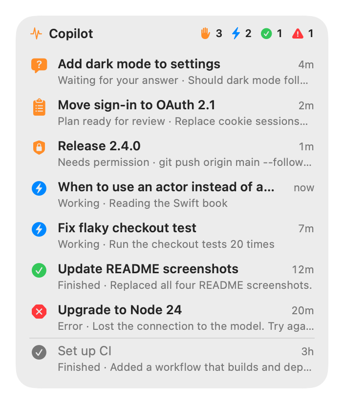

# BriefBar

[](https://github.com/mnsn/briefbar/actions/workflows/ci.yml)
[](LICENSE)

A macOS menu-bar app that shows what needs you, from the apps you choose:

- your unread **Microsoft Teams** chats,
- your **Azure DevOps** pull requests,
- what your **GitHub Copilot** app sessions are doing.

Every source is off until you turn it on, and each one first says what it reads.

BriefBar brings Teams Pulse, ADO Pulse and Copilot Pulse together in one app: one install, one login
item, and permissions that macOS grants once. Full Disk Access for Teams and notifications for Azure
DevOps cover later sources too, but only the ones you turn on. Several sources can also share a single
menu-bar item.

<p align="center">
  <picture>
    <source media="(prefers-color-scheme: dark)" srcset="docs/images/menubar-teams.chats-dark.png">
    
  </picture>
</p>

> [!NOTE]
> BriefBar is an independent project. It isn't affiliated with or endorsed by Microsoft or GitHub.

## Sources

| Source | Shows | Reads | Needs | Network |
|---|---|---|---|---|
| **Microsoft Teams** | Unread 1:1 chats, and group and meeting chats, in two items | The notifications Teams sends to Notification Center, from its database on your Mac | Full Disk Access | None |
| **Azure DevOps** | Pull requests that need you, are failing, are ready to complete, or wait on someone else | Azure DevOps, with the Azure CLI's sign-in | The Azure CLI, signed in; notifications | `dev.azure.com` and `app.vssps.visualstudio.com`, GET requests only |
| **GitHub Copilot** | Which Copilot app sessions are running, need you, or have finished or stopped | The Copilot app's own files under `~/.copilot` | Nothing | None |

BriefBar itself makes no network requests: no telemetry, and no update checks for now. Only the Azure
DevOps source talks to the network, and only to Azure DevOps.

## Turning a source on

Open **Settings** from BriefBar's icon in the menu bar (it opens by itself the first time), and choose a
source. Its page says what it reads, where it connects and what it needs, and **Turn On** is your
consent.

- **Teams** needs Full Disk Access to read Notification Center's database. macOS has no prompt for
  it, so a window walks you through System Settings:
  1. Click **Open Privacy Settings**.
  2. Turn on BriefBar. If it isn't in the list, click **+** and choose it, or drag it there.
  3. Choose **Quit & Reopen** if macOS offers it.

  macOS gives the access to all of BriefBar, once. A later source that reads Notification Center
  (Outlook, say) would use it too, but only if you turn that source on.
- **Azure DevOps** signs in with the Azure CLI: `brew install azure-cli`, then `az login`, or click
  **Sign In…**, which opens Terminal to run it. macOS asks whether BriefBar may post notifications.
- **Copilot** needs nothing.

Because macOS asks only once, BriefBar never turns a source on by itself. A source that an update adds
starts off. If an update makes a source read more than what you agreed to, it pauses until you've
looked at what it reads now.

Turning a source off stops it and deletes what it saved, such as Teams' unread chats; its settings
stay. When no source that needs Full Disk Access is on anymore, BriefBar offers to open the list so you
can remove it.

## The menu bar

Each section has a menu-bar item of its own: **Chats** and **Group Chats** for Teams, then Azure
DevOps and Copilot. Click one for its list.

In **Settings › Menu Bar** you can put sections together, such as Azure DevOps with Copilot. Their
counts then sit side by side in one item, and its list has a tab for each, opening at the one that needs
you. To move items, hold ⌘ and drag them.

<p align="center">
  <picture>
    <source media="(prefers-color-scheme: dark)" srcset="docs/images/menubar-combined-dark.png">
    
  </picture>
</p>

Azure DevOps and Copilot also offer a desktop widget, in three sizes, behind your windows or floating
above them. Drag it by its header, and right-click it for settings.

<p align="center">
  <picture>
    <source media="(prefers-color-scheme: dark)" srcset="docs/images/copilot-widget-large-dark.png">
    
  </picture>
</p>

## What each source shows

### Microsoft Teams

Each chat shows its newest unread message (with the sender in group chats), how long ago it arrived
and how many are unread; hover for the last few. Click a chat to open it in Teams at its oldest unread
message. Click ✨ for a one-sentence summary from Apple's on-device model (macOS 26 or later).

Notification Center doesn't record what you've read, so BriefBar decides:

| A chat becomes | When |
|---|---|
| **Unread** | Teams posts a notification for a new message, while BriefBar runs or while it doesn't |
| **Read** | You open it from BriefBar, or choose **Mark as Read** or **Mark All Read** |
| | You click or clear its notification in Notification Center |
| | Teams' dock badge clears, as it does once you've read everything in Teams (you can turn this off) |
| | Its newest unread message is older than **Keep Unread For** (1 day by default) |

Reactions and channel posts aren't unread chats, so they aren't counted. Read chats stay under
**Recent** for a day.

Teams must post notifications for BriefBar to see them. Check that **System Settings › Notifications ›
Microsoft Teams** allows them, with **Show in Notification Center** on. Muted chats, and messages that
arrive while Teams' status is **Do not disturb**, don't produce notifications. A macOS Focus is fine.

### Azure DevOps

The item shows a symbol and count for each group you can act on: orange ✋ needs you, red ✕ failing,
green ✓ ready to complete, and, if you turn it on, teal 👁 to review. At the top of the list, a brief by
Apple Intelligence sums up the newest of each.

| Group | When |
|---|---|
| **Needs You** | Something new you haven't seen: a reply to your comment, a mention, a comment on your pull request, a review request, new commits since your vote, or a reviewer who's waiting for you or rejected it |
| **Failing** | Your pull request has a failed build or status check, merge conflicts, or a build that expired |
| **Ready to Complete** | Your pull request is approved and every required policy passes (or it completes automatically) |
| **To Review** | Review requests you've seen but haven't voted on |
| **Waiting** | Your pull requests waiting for reviewers, a build or a requirement, and reviews you're waiting on the author for |
| **Done** | Completed or abandoned in the last day |
| **Idle** | Drafts, pull requests without activity for two weeks, and reviews you've approved or declined |

**Needs You** works like an inbox: opening a pull request from BriefBar, or **Mark as Seen**, moves it
on until something new happens. The first time, only the last three days count as new. Notifications
announce new replies, mentions, comments, review requests, votes, new commits, failed builds, and pull
requests that become ready or complete. Clicking one opens the comment it's about. The first time,
BriefBar finds the organizations where you have pull requests; **Organizations** in its settings
changes them.

### GitHub Copilot

| Group | Status | When |
|---|---|---|
| **Needs you** | Waiting for your answer, Plan ready for review, Needs permission | The agent asked a question, finished a plan, or waits for a tool call's permission |
| **Running** | Working, Starting… | A turn is in progress (the current step is shown) |
| **Done** | Finished | The turn ended normally; shows the agent's summary if there is one |
| **Stopped** | Interrupted, Error, Stopped responding | You cancelled the turn, it failed, or it went silent mid-turn for 90 s |
| **Idle** | Idle | Everything else |

**Done** and **Stopped** sessions stay highlighted until you've seen them: you open the session, click
**Clear** on its group, or **Keep Finished Sessions For** passes. Click a session to open it in the
Copilot app.

## Install

BriefBar needs macOS 15 or later, on Apple silicon or Intel. While the repository is private, the way
to install it is to build it from source, with Swift 6 from Xcode or the Command Line Tools
(`xcode-select --install`):

```sh
git clone https://github.com/mnsn/briefbar.git
cd briefbar
make signing-identity   # once per Mac: the certificate every build is signed with
make install            # builds BriefBar.app, copies it to ~/Applications and opens it
```

Each build asks for your login password so that `codesign` can sign it with that certificate: click
**Allow**, never **Always Allow** ([why](#why-the-signing-certificate)). Then turn on the sources you
want, and **Launch BriefBar at Login** in Settings. To update, pull and run `make install` again. To
remove BriefBar, run `make uninstall` and remove it from the Full Disk Access list.

### Moving from the Pulse apps

BriefBar doesn't read the Pulse apps' settings: each source starts fresh. Quit Teams Pulse, ADO Pulse
and Copilot Pulse before you turn on the same source in BriefBar (two copies of Azure DevOps would
notify you twice), turn off their Launch at Login, and remove Teams Pulse from the Full Disk Access
list.

### Why the signing certificate?

macOS ties Full Disk Access, and the keychain item that protects Teams' saved chats, to the app's code
signature. An ad-hoc signature, the usual one for a local build, identifies the app by the hashes of
its code, so every rebuild looks like a new app and loses both. `make signing-identity` creates a
self-signed certificate, **BriefBar Signing**, in your login keychain, and every build is signed with
it, so each build keeps the access you granted once. BriefBar never signs ad hoc.

That makes the certificate's key as powerful as the access: any program that could sign with it could
sign itself as BriefBar and get the Full Disk Access you gave BriefBar. So no app may use the key
without asking, not even `codesign`, and each build asks for your password. **Always Allow** would let
any program running as you use it silently, so `make app` refuses to sign with a key that some app may
use without asking. If it says so, replace the certificate with
`scripts/make-signing-identity.sh --replace`, and give the next build Full Disk Access once more.
[How it works](docs/how-it-works.md#signing) has the details.

### For organizations: no Full Disk Access step

On Macs your organization manages, IT can grant BriefBar Full Disk Access ahead of time, with a
configuration profile deployed through your MDM: `make pppc-profile` writes one for the certificate of
the copy built here. macOS ignores such a profile installed by hand. The access is the app's, but
BriefBar reads nothing with it until someone turns on a source that needs it.

## Settings

Each source has its settings on its page in **Settings**, and in the gear menu of its list (or the
right-click menu of its widget), next to **Launch BriefBar at Login**, **BriefBar Settings…** and
**Quit BriefBar**.

| Source | Setting | Options |
|---|---|---|
| Teams | Keep Unread For | 4 hours, 1 day (default), 3 days, until I read it |
| | Show Message Previews | on/off: off shows only how many messages are new, for screen sharing |
| | Summarize with Apple Intelligence | on/off: the ✨ button on each chat, while previews are shown |
| | Mark All Read When Teams' Badge Clears | on by default |
| Azure DevOps | Notifications, Summaries by Apple Intelligence, Show To Review in the Menu Bar | on/off |
| | Refresh | every 1, 2 or 5 minutes |
| | Keep Done For | 4 hours, 1 day, 3 days |
| | Idle After No Activity For | 1 week, 2 weeks, 1 month, never |
| | Organizations | which to watch; **Add Organization…** takes a name or any link from it |
| Copilot | Keep Finished Sessions For | 15 minutes, 1 hour, 4 hours, 1 day |
| | Show Context Usage | off by default: how full each session's context window is |
| Azure DevOps, Copilot | Show Desktop Widget, Widget Position, Widget Size | on/off; on the desktop or floating; compact, medium or large |

## Privacy

- **Teams and Copilot never use the network**, and BriefBar itself doesn't either: no sign-in, no
  telemetry, no update checks. Only the Azure DevOps source connects, to Azure DevOps, with your Azure
  CLI sign-in, and every request it makes is a GET. `scripts/check-boundaries.sh` checks that no other
  part of the app uses networking APIs.
- **It only reads**: Notification Center's database through a read-only connection, the Copilot app's
  files, and Azure DevOps through GET requests. It never changes any of them.
- **Summaries are made on your Mac**, by Apple's on-device model, never Private Cloud Compute or any
  other model, and are kept in memory only.
- **On disk**, it keeps Teams' unread chats (each chat's name, and its unread messages' sender and
  text), encrypted with a key in your login keychain, in a file only you can read, until they're
  read; which Azure DevOps pull requests you've seen and your organizations; which Copilot sessions
  you've cleared; and its settings. Turning a source off deletes what it saved.
- **Programs it runs**, such as the Azure CLI, never get its permissions: macOS would otherwise let
  them use BriefBar's Full Disk Access.
- Its log never contains names, messages, titles or IDs.

## FAQ

### Why does Teams need Full Disk Access?

Notification Center keeps notifications in a database under
`~/Library/Group Containers/group.com.apple.usernoted`, which macOS protects. Full Disk Access is the
only permission that lets an app read it. Teams reads nothing else there but Teams' notifications.

### Will a Teams, Copilot or macOS update break it?

It could: Notification Center's database, Teams' notifications and the Copilot app's files aren't
documented. BriefBar checks them every time it reads them, and says what changed instead of guessing.
For Teams, **Copy Diagnostics** describes the database's structure, without your data.

### Why does Azure DevOps poll instead of getting pushed updates?

Azure DevOps can only push changes through service hooks, which need a project administrator and a
server on the internet. So BriefBar asks every minute: about 10 to 25 small requests a minute, and
right away when you open the list, when your Mac wakes, and when it's back online.

### Why isn't it notarized, and where are the releases?

Notarization needs a paid Apple Developer Program membership, which this free project doesn't have.
And while the repository is private, its releases and update feed can't be downloaded, so for now you
build BriefBar yourself, which also skips Gatekeeper's question. Releases signed by the project's own
certificate, with in-app updates, come once the repository is public.

### How do I troubleshoot it?

The app binary has command-line modes, and logs to the system log:

```sh
APP="$HOME/Applications/BriefBar.app/Contents/MacOS/BriefBar"
"$APP" --help
"$APP" --dump                     # what each source that's on shows
"$APP" --watch --source copilot   # one source's changes as they happen
"$APP" --diagnose                 # Teams: the database's structure only, safe to share
"$APP" --orgs                     # Azure DevOps: your organizations
log show --last 10m --info --predicate 'subsystem == "com.asaf.BriefBar"' --style compact
```

Run from Terminal, Teams' modes use Terminal's Full Disk Access. `--dump`, `--watch` and `--json`
print your chats, titles and sessions, so keep their output to yourself; `--diagnose` is safe to share.

## Contributing

[CONTRIBUTING.md](CONTRIBUTING.md) explains how to build, test, and try the app with made-up data for
every source. Please report security issues privately, as [SECURITY.md](SECURITY.md) describes.

## License

Copyright © 2026 Asaf Manassen. BriefBar is free software, licensed under the
[GNU General Public License v3.0 or later](LICENSE).

Microsoft, Microsoft Teams, Azure and Azure DevOps are trademarks of the Microsoft group of companies.
GitHub and GitHub Copilot are trademarks of GitHub, Inc. Apple Intelligence is a trademark of Apple Inc.
