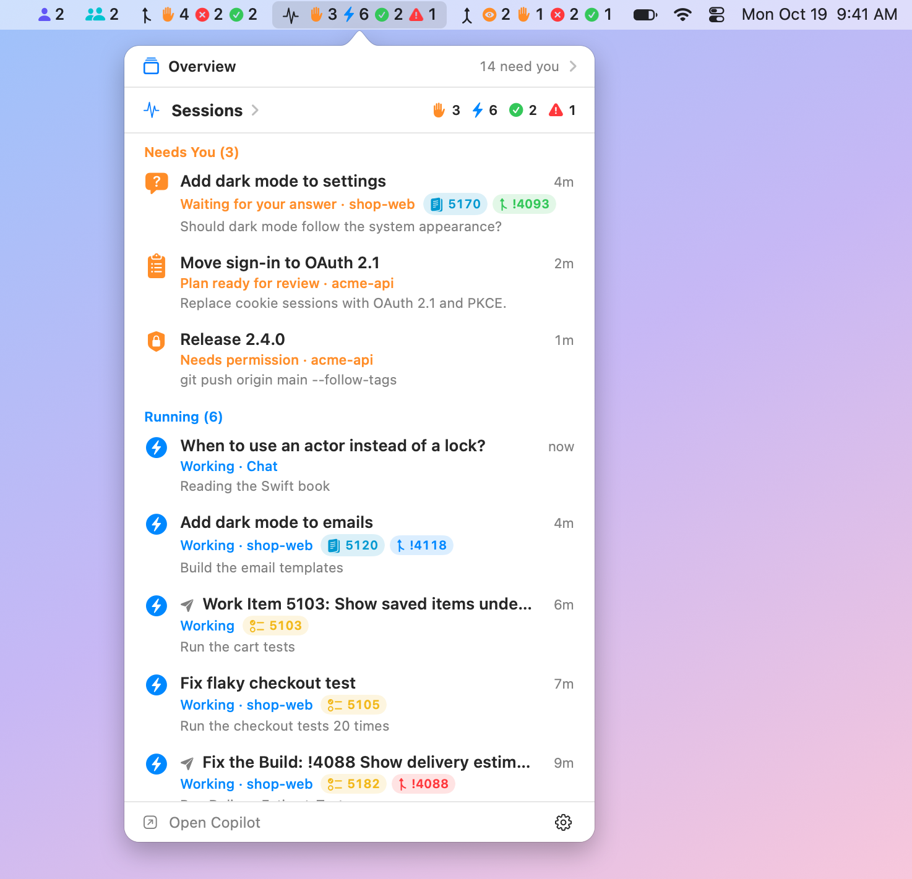
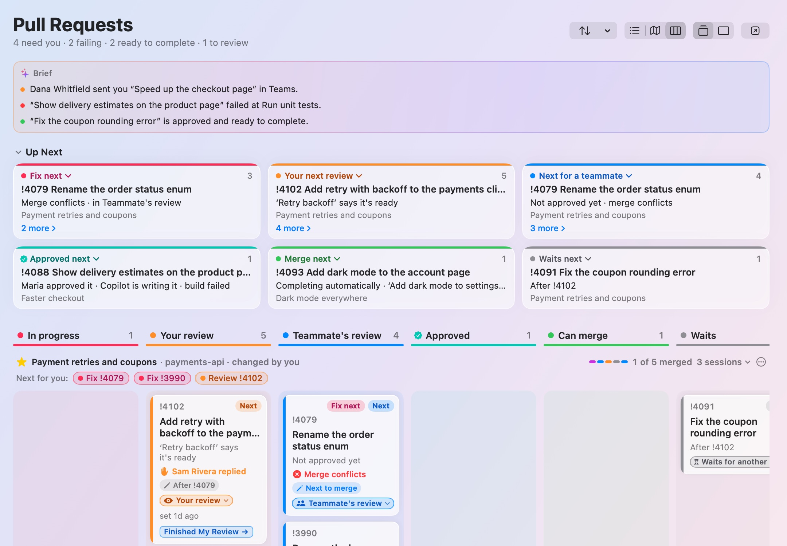

<p align="center">
  
</p>

<h1 align="center">BriefBar</h1>

<p align="center">
  <strong>Everything that needs you, in your Mac's menu bar.</strong><br>
  Pull requests, GitHub Copilot sessions, your Azure DevOps sprint and Microsoft Teams chats, in one place.<br>
  See what's next, get the short version from AI, and hand the next step to Copilot.
</p>

<p align="center">
  <a href="https://github.com/mnsn/brief-bar/releases/latest/download/BriefBar.zip"></a>
</p>

<p align="center">
  or <code>brew install --cask mnsn/tap/briefbar</code><br>
  <sub>Free and open source · macOS 26 or later · Apple silicon</sub>
</p>

<p align="center">
  <a href="https://github.com/mnsn/brief-bar/releases/latest"></a>
  <a href="https://github.com/mnsn/brief-bar/actions/workflows/ci.yml"></a>
  <a href="LICENSE"></a>
</p>

<p align="center">
  <picture>
    <source media="(prefers-color-scheme: dark)" srcset="docs/images/readme-tour-dark.gif">
    
  </picture>
</p>

- **See what needs you at a glance.** Live counts for your pull requests and Copilot sessions in the menu bar; one
  click for a brief and a single list across Azure DevOps, GitHub, Copilot and Teams. Or a widget on your desktop, or
  the full window.
- **Know what's next.** Every pull request's stage, Up Next's pick of what to fix, review and merge next, and a Board
  to move them along.
- **Follow the work, not the notifications.** Open a story to see its tasks, pull requests, builds and the Copilot
  sessions working on them, and who it's waiting on.
- **Get the short version.** AI summaries of a work item, pull request or session: where it stands, what's left and
  the next step.
- **Hand the next step to Copilot.** Send a task, review comments, a failing build or merge conflicts to Copilot, with
  the context filled in; ask a session where it stands; push and reply once it's fixed.
- **Private by default.** No account and no telemetry. Every source starts off, and says what it reads before you turn
  it on.

<p align="center">
  <a href="https://github.com/mnsn/brief-bar/releases/latest/download/BriefBar.zip"><strong>Download BriefBar</strong></a> ·
  <a href="#get-started">Get started</a> · <a href="docs/user-guide.md">User guide</a> · <a href="CHANGELOG.md">What's new</a>
</p>

## See what needs you at a glance

Each source gets its own item in the menu bar, with its counts: pull requests that need you, failed or are ready to
complete, and Copilot sessions waiting for you, running, done or stopped. Click an item for its list, add them all up in
one item, put a widget on your desktop, or open the window for everything, with a page for each source.

<p align="center">
  <picture>
    <source media="(prefers-color-scheme: dark)" srcset="docs/images/menubar-copilot.sessions-dark.png">
    
  </picture>
</p>

| Source | What you can follow |
|---|---|
| **Azure DevOps** | Pull requests needing your reply or review, failures and ready-to-complete work, with what's left before each of yours can complete and, with Pull Request Order, its stage; your team's sprint and work-item details; pinned pipelines and pipelines after your merges. |
| **GitHub Copilot** | Sessions running, waiting for your answer, ready for plan review, finished or stopped, with the work items and pull requests they're on. Works with the Copilot app, or with local CLI sessions when the app isn't installed. |
| **GitHub** | Reviews requested from you by name, and your pull requests with changes requested, failing checks, conflicts or approvals, for every account the GitHub CLI is signed in to, such as your work account and your own. |
| **Microsoft Teams** | Unread one-to-one, group and meeting chats from notifications on your Mac, with optional message previews and on-device summaries. |

Hide what you don't need. To read long descriptions and comments, hold **⌘** and scroll in a window to
make its text bigger.
[Layouts and appearance options →](docs/user-guide.md#menu-bar-widgets-and-windows)

## Know what's next

Turn on **Pull Request Order** in **Settings › Pull Requests**, and each Azure DevOps pull request shows its stage, in
color: **In progress**, **Your review**, **Teammate's review**, **Can merge**, **Waits for another PR** or **Merged**.
BriefBar works it out from Azure DevOps and your Copilot sessions, and with agents on, the sessions working on your
pull requests update it as they go. Click a stage to change it, or **Finished My Review** to pass a pull request on to
your teammates.

<p align="center">
  <picture>
    <source media="(prefers-color-scheme: dark)" srcset="docs/images/azureDevOps-pull-requests-board-window-dark.jpg">
    
  </picture>
</p>

- **Up Next**, at the top of the Pull Requests page, picks what's next for you: the pull request to fix next, your
  next review, the next one for a teammate, the next to merge and the next that waits. Choose another yourself, and
  BriefBar keeps it until that pull request moves on.
- **The Board** has a column for each stage and a lane for each mission. Drag a card to another column, or press
  **⌘→** or **⌘←**, to change its stage. Click a column's title to fold it to a strip; in a narrow window, BriefBar
  folds the columns you need least, so those where it's your move stay in sight.
- **By Mission** puts together the pull requests that go together, such as a stack's or a story's, in the order they
  merge where BriefBar can tell: from stacked branches, and what Copilot sessions tell it. **Map** draws each mission in
  merge waves. Apple Intelligence names each mission on your Mac, and suggests a split when one has become two pieces
  of work.

Stages, missions and what you choose are BriefBar's own: nothing changes in Azure DevOps.
[Pull Request Order, Up Next and the Board →](docs/user-guide.md#azure-devops)

## Follow the work, not the notifications

<p align="center">
  <picture>
    <source media="(prefers-color-scheme: dark)" srcset="docs/images/readme-trail-dark.gif">
    
  </picture>
</p>

Turn on **Show Links** in **Settings › General** to connect work items, pull requests and sessions.
BriefBar picks up Azure DevOps' work-item links, the pull requests Copilot records with its sessions,
and sessions on a pull request's branch. You can also link things yourself from a row's right-click
menu or by pasting a link.

Open a story, bug or task on the **Sprint** page. **Where It Stands** brings together its linked pull
requests, their builds and Copilot sessions, with what needs you first, and **Waiting on** names who
acts next: you, a reviewer or Copilot. Click through without leaving BriefBar:

- **Work item:** description, acceptance criteria, tasks, attachments and discussion.
- **Pull request:** reviewers and votes, comments waiting on you, conflicts, builds and failure details, and one
  click to its Copilot session or to the worktree it works in, in your editor, a terminal or the Finder.
- **Session:** its question or plan, progress notes, what's been done, what's next and its last response.

Links you add stay in BriefBar; they don't change Azure DevOps, GitHub or Copilot.
[How linking works →](docs/user-guide.md#links)

## Get the short version with AI

**“Where does this stand, what's next, and who is it waiting on?”** Turn on **Summaries** in
**Settings › General**, with Show Links on. A work item's summary reads it and its linked work, down
to pull requests' comment threads and what each Copilot session was asked and answered, and gives a
headline, the next step and whose it is, and a few points on what's done, left or blocking. Pull
requests and sessions get one too: on their page, or under their row from **✨**.

<p align="center">
  <picture>
    <source media="(prefers-color-scheme: dark)" srcset="docs/images/rows-summary-pull-requests-dark.jpg">
    
  </picture>
</p>

<details>
<summary><strong>Which model writes them, and what it sees</strong></summary>

| | What you get | Where it runs |
|---|---|---|
| **Summaries** | Summaries of work items, pull requests and sessions as you open them, or only when you ask, using what BriefBar knows about them and their links | Claude Haiku 5.5 by default when the Copilot CLI is installed: the details go through your signed-in Copilot CLI to GitHub Copilot, one request on your Copilot plan each, and you can choose any model from Haiku, the cheapest, to Claude Opus 5.5, the most capable. Or Apple Intelligence on your Mac, the default without the CLI: free, with Apple Intelligence available and enabled, and no Copilot requests, but a small model that often gets details wrong. Either way, nothing from Teams is included and no tools are allowed: summarizing cannot change files or take actions. |
| **Chat summaries and the brief** | Summaries of unread Teams chats and more concise briefs about what needs you | Apple's on-device model, on your Mac. Requires Apple Intelligence, available and enabled. |
| **Missions' names and splits** | With Pull Request Order on, a short name for each mission By Mission shows, and a suggested split when its pull requests look like different pieces of work, from the titles of its Azure DevOps pull requests, their work items and stories, and the Copilot sessions on them | Apple's on-device model, on your Mac, never a Copilot model. Requires Apple Intelligence, available and enabled. |

Summaries of your work are written **as you open** a work item's details or a page, never in the
background, and the card says what it's about to do first, with **Not Now**; or, if you choose, **only
when you ask**. One that's still current shows again as it was; BriefBar marks a summary **Out of
date** when its inputs change, and writes a new one when you ask, or as you open it once it's ten
minutes old. BriefBar keeps summaries in memory; with a Copilot model, the Copilot CLI also keeps its
summary sessions locally. When Apple Intelligence can't write one, BriefBar says why and never tries
Copilot instead. The app and its plain-language brief work without either AI feature.

</details>

## Hand the next step to Copilot

Turn on **Send Work to Copilot** in Azure DevOps' settings, and the next step is a click away, with its context already
in the prompt. Review, edit or copy the prompt, then choose where it goes, such as the session that's already on the
work or a new one, and the model.

<p align="center">
  <picture>
    <source media="(prefers-color-scheme: dark)" srcset="docs/images/azureDevOps-copilot-composer-dark.jpg">
    
  </picture>
</p>

- **Send a task** from the Sprint page. Copilot works on its own in a new worktree, then pushes a branch and opens a
  pull request as you, and you follow the task until it does.
- **Fix a pull request** with **Fix Comments**, **Fix the Build**, **Resolve Conflicts** or **Pre-review**, or a single
  comment's **Fix**. A failed build has **✨ Explain the Failure**, and merge conflicts list the files that conflict.
  **Fix with Copilot…** is on notifications too, when your build fails, someone comments or your pull request conflicts.
- **Ask a session** where it stands, or why it changed something, with **Ask…**. It answers aside, in a copy of the
  session, so nothing in it changes.
- **Ship the fix** with **Push & Reply**, which commits and pushes all a session changed and replies on the threads it
  fixed, as you. Or check **Push and reply once it's fixed** in a comment's **Fix** or **Fix All**, for Copilot to do
  the same once it's fixed: the composer names any other fixes in the session that would go too, and a thread it
  changed nothing for gets a reply saying why.
- **Or do it yourself.** With **Make Changes in Azure DevOps** on, reply to comments, resolve threads, edit or delete
  your own comments and change tags, as you, without opening Azure DevOps.

Fixes don't push unless you ask, and Pre-review changes and posts nothing. Turn on **Send Prompts to Copilot
Sessions** in **Settings › Agents**, and BriefBar sends a prompt to one of the Copilot app's sessions itself, or to a
fork of it, rather than copy it for you to paste; it's off by default, since it adds a small extension to each of the
app's sessions.
[Copilot actions and their limits →](docs/user-guide.md#sending-to-a-session-thats-already-there)

## Works with your agents

Turn on agents in **Settings › Agents**, then install the **Copilot plugin** there to use **/briefbar** in the GitHub
Copilot app or CLI:

| Ask | Get |
|---|---|
| `/briefbar` | What needs you across Azure DevOps and Copilot; in the Copilot app, an inbox you can search, sort and group. |
| `/briefbar 5101` | Where the work item stands, what's done, what's left and who it waits on. |
| “Fix the comments on !4102” | In the Copilot app, the pull request's own session, a fork of it or a new one, which you can follow and steer. |

- **Sessions keep BriefBar current.** With **Updates from Copilot Sessions** on, sessions tell BriefBar the work items
  and pull requests they're working on, and the pull requests they open. With **Pull Request Order** on, they also set
  their pull requests' stages as they go, such as Your review once they've pushed their work.
- **Sessions don't sit waiting on pipelines.** Once one pushes, it ends its turn, and if the build fails, BriefBar's
  notification offers **Fix with Copilot…**. For a short build its next step needs, a session can wait with
  `BriefBar --wait`, for up to two hours, and carry on with what it prints.
- **Any MCP agent.** BriefBar is also an opt-in **MCP server**, with install actions for VS Code and Cursor. Agent tools
  expose Azure DevOps and Copilot data, not Teams or GitHub.

[Agent setup and available tools →](docs/user-guide.md#agents)

## Get started

1. Install with [Homebrew](https://brew.sh):

   ```sh
   brew install --cask mnsn/tap/briefbar
   ```

   Or download [**BriefBar.zip**](https://github.com/mnsn/brief-bar/releases/latest/download/BriefBar.zip)
   from the [latest release](https://github.com/mnsn/brief-bar/releases/latest), unzip it and move
   **BriefBar** to **Applications** before opening it.
2. The app isn't notarized by Apple, so either way macOS blocks the first launch: click **Done**, then
   go to **System Settings › Privacy & Security › Open Anyway** and confirm. On a managed Mac, check
   your organization's policy first.
3. In BriefBar's Settings, turn on only the sources you want. Each explains what it reads before
   you consent.

| To use | Set up |
|---|---|
| **Azure DevOps** | Install the Azure CLI (`brew install azure-cli`) and run `az login`, or use **Sign In…** in Settings. No personal access token. |
| **GitHub** | Install the GitHub CLI (`brew install gh`) and run `gh auth login`, or use **Sign In…** in Settings; **Add Account…** there signs in to another of your accounts. Authorize the CLI for your organization's SSO if needed. |
| **Copilot sessions** | Your local Copilot app or CLI session files. No extra sign-in for BriefBar to show them. |
| **Teams** | Grant BriefBar **Full Disk Access** using its setup guide. It reads Teams notifications and local read markers, not your complete chat history. |
| **Connected work and summaries** | Turn on **Show Links**, then optionally **Summaries**, in **Settings › General**. Summaries use Claude Haiku 5.5 through the [Copilot CLI](https://docs.github.com/copilot/how-tos/copilot-cli) when it's installed and signed in, or another model you choose there; without it, Apple Intelligence. |

You can enable **Launch BriefBar at Login** and allow automatic update checks. Later releases install
through the built-in updater, even if you installed with Homebrew (`brew upgrade` skips BriefBar
unless you add `--greedy`), and keep Full Disk Access.
[Full installation guide, managed Macs and building from source →](docs/user-guide.md#install)

## Your data and your choices

**No BriefBar account. No telemetry. Nothing starts acting on your work unless you ask.**

Sources are read-only, but for one opt-in: with **Make Changes in Azure DevOps**, off by default,
BriefBar posts your replies in pull requests' threads, sets threads' statuses, edits and deletes your own
comments, and adds and removes pull requests' tags, as you, only when you click. Azure DevOps and GitHub use
your existing CLI sign-ins, and Teams and Copilot tracking reads files on your Mac. Full Disk Access is needed for
Teams and the optional **Pull Requests Sent in Chats**, not for ordinary pull-request or session tracking.

Links, summaries, Pull Request Order, Send Work to Copilot, Make Changes in Azure DevOps and agent access each start
off. Once you turn summaries on, they send the details of the work you open to GitHub Copilot when the Copilot CLI is
installed, to be written by Claude Haiku 5.5; choose Apple Intelligence in their setting to keep them on your Mac, as
they are when the CLI isn't installed. Sending work gives an agent permission to act within that action's limits.
Teams content never goes to Copilot summaries or BriefBar's agent tools.

[Full privacy details](docs/user-guide.md#privacy) · [Security and download verification](SECURITY.md)

## Learn more and contribute

[User guide and FAQ](docs/user-guide.md) · [How it works](docs/how-it-works.md) ·
[Contributing and demo mode](CONTRIBUTING.md) · [Changelog](CHANGELOG.md) ·
[Report a bug or suggest a feature](https://github.com/mnsn/brief-bar/issues)

On Windows? [BriefBar for Windows](windows/README.md) is in development, with the same four sources in a bar docked to
the top of each display.

BriefBar is an independent project, not affiliated with or endorsed by Microsoft or GitHub.
Copyright © 2026 Asaf Manassen. Licensed under [GPL v3.0 or later](LICENSE).
