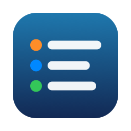
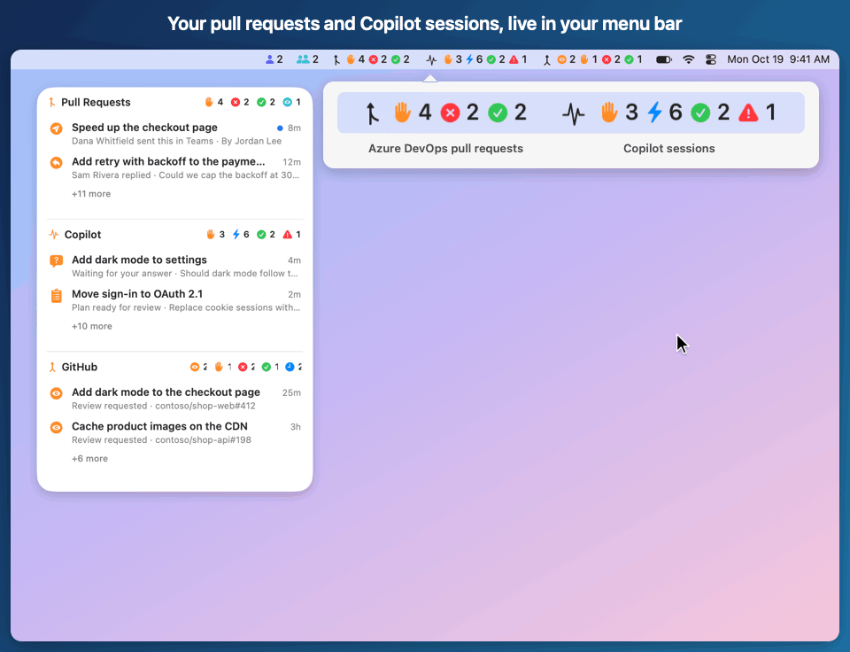
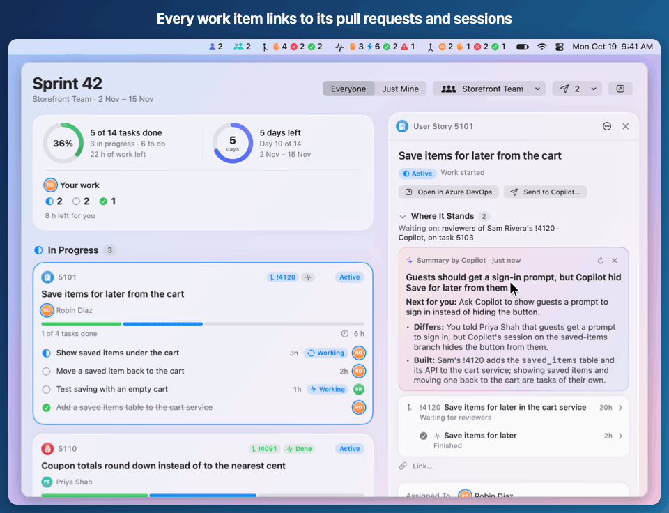
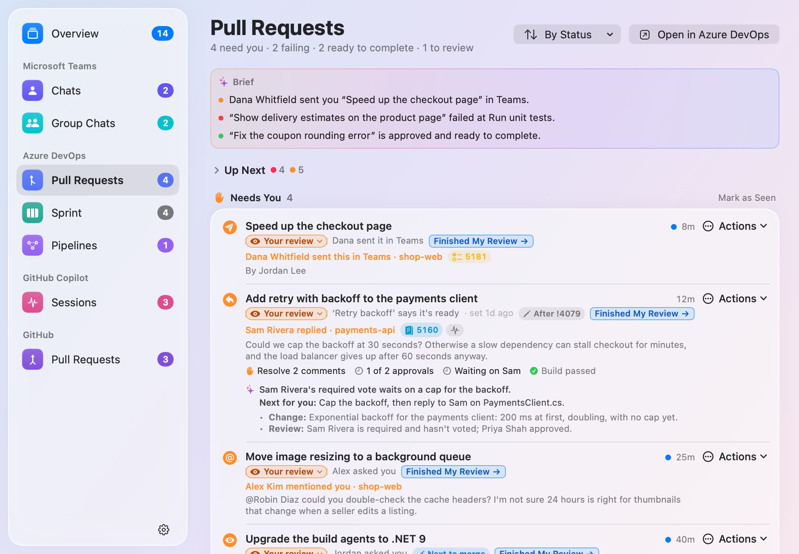
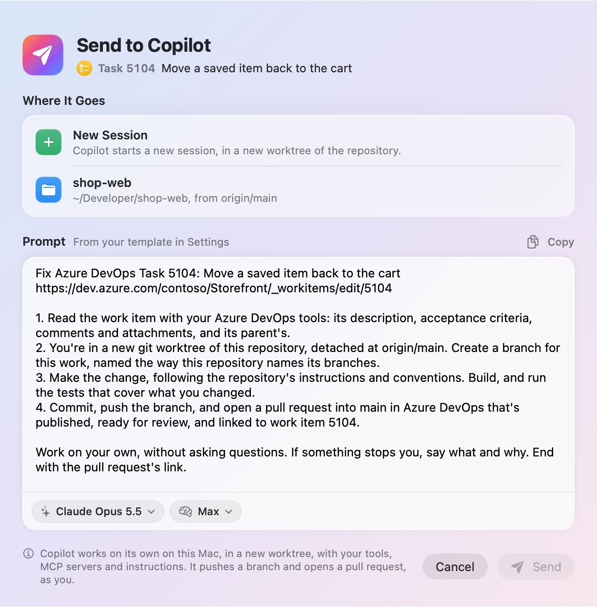

<p align="center">
  
</p>

<h1 align="center">BriefBar</h1>

<p align="center">
  <strong>Everything that needs you, in your Mac's menu bar.</strong><br>
  Pull requests, GitHub Copilot sessions, your Azure DevOps sprint and Microsoft Teams chats, in one place.<br>
  Summarized by AI, and one click from handing the next step to Copilot.
</p>

<p align="center">
  <a href="https://github.com/mnsn/brief-bar/releases/latest/download/BriefBar.zip"></a>
</p>

<p align="center">
  or <code>brew install --cask mnsn/tap/briefbar</code><br>
  <sub>Free and open source · macOS 26 or later · Apple silicon</sub>
</p>

<p align="center">
  <picture>
    <source media="(prefers-color-scheme: dark)" srcset="docs/images/readme-tour-dark.gif">
    
  </picture>
</p>

- **See what needs you at a glance.** Counts in the menu bar; one click for a brief and a single list
  across Azure DevOps, GitHub, Copilot and Teams. Or a widget on your desktop, or the full window.
- **Follow the work, not the notifications.** Open a story to see its tasks, pull requests, builds and
  the Copilot sessions working on them, and who it's waiting on.
- **Get the short version.** AI summaries of a work item, pull request or session: where it stands,
  what's left and the next step.
- **Hand the next step to Copilot.** Send a task, review comments, a failing build or merge conflicts
  to Copilot, with the context filled in.
- **Private by default.** No account and no telemetry. Every source starts off, and says what it reads
  before you turn it on.

<p align="center">
  <a href="https://github.com/mnsn/brief-bar/releases/latest/download/BriefBar.zip"><strong>Download BriefBar</strong></a> ·
  <a href="#get-started">Get started</a> · <a href="docs/user-guide.md">User guide</a> · <a href="CHANGELOG.md">What's new</a>
</p>

## See what needs you at a glance

Give each source its own item in the menu bar, with its counts, or add them all up in one. Click an
item for its list, put a widget on your desktop, or open the window for everything, with a page for
each source.

<p align="center">
  <picture>
    <source media="(prefers-color-scheme: dark)" srcset="docs/images/menubar-teams.chats-dark.png">
    
  </picture>
</p>

| Source | What you can follow |
|---|---|
| **Azure DevOps** | Pull requests needing your reply or review, failures and ready-to-complete work, with what's left before each of yours can complete, sorted by status or by date; your team's sprint and work-item details; pinned pipelines and pipelines after your merges. |
| **GitHub Copilot** | Sessions running, waiting for your answer, ready for plan review, finished or stopped. Works with the Copilot app, or with local CLI sessions when the app isn't installed. |
| **GitHub** | Reviews requested from you by name, and your pull requests with changes requested, failing checks, conflicts or approvals, for every account the GitHub CLI is signed in to, such as your work account and your own. |
| **Microsoft Teams** | Unread one-to-one, group and meeting chats from notifications on your Mac, with optional message previews and on-device summaries. |

Hide what you don't need. To read long descriptions and comments, hold **⌘** and scroll in a window to
make its text bigger.
[Layouts and appearance options →](docs/user-guide.md#menu-bar-widgets-and-windows)

## Follow the work, not the notifications

<p align="center">
  <picture>
    <source media="(prefers-color-scheme: dark)" srcset="docs/images/readme-trail-dark.gif">
    
  </picture>
</p>

Turn on **Show Links** in **Settings › General** to connect work items, pull requests and sessions.
BriefBar picks up Azure DevOps' work-item links, the pull requests Copilot records with its sessions,
and sessions on a pull request's branch. You can also link things yourself from a row's right-click
menu or by pasting a link.

Open a story, bug or task on the **Sprint** page. **Where It Stands** brings together its linked pull
requests, their builds and Copilot sessions, with what needs you first, and **Waiting on** names who
acts next: you, a reviewer or Copilot. Click through without leaving BriefBar:

- **Work item:** description, acceptance criteria, tasks, attachments and discussion.
- **Pull request:** reviewers and votes, comments waiting on you, conflicts, builds and failure details.
- **Session:** its question or plan, progress notes, what's been done, what's next and its last response.

Links you add stay in BriefBar; they don't change Azure DevOps, GitHub or Copilot.
[How linking works →](docs/user-guide.md#links)

## Get the short version with AI

**“Where does this stand, what's next, and who is it waiting on?”** Turn on **Summaries** in
**Settings › General**, with Show Links on. A work item's summary reads it and its linked work, down
to pull requests' comment threads and what each Copilot session was asked and answered, and gives a
headline, the next step and whose it is, and a few points on what's done, left or blocking. Pull
requests and sessions get one too: on their page, or under their row from **✨**.

<p align="center">
  <picture>
    <source media="(prefers-color-scheme: dark)" srcset="docs/images/rows-summary-pull-requests-dark.jpg">
    
  </picture>
</p>

<details>
<summary><strong>Which model writes them, and what it sees</strong></summary>

| | What you get | Where it runs |
|---|---|---|
| **Summaries** | Summaries of work items, pull requests and sessions as you open them, or only when you ask, using what BriefBar knows about them and their links | Claude Haiku 5.5 by default when the Copilot CLI is installed: the details go through your signed-in Copilot CLI to GitHub Copilot, one request on your Copilot plan each, and you can choose any model from Haiku, the cheapest, to Claude Opus 5.5, the most capable. Or Apple Intelligence on your Mac, the default without the CLI: free, with Apple Intelligence available and enabled, and no Copilot requests, but a small model that often gets details wrong. Either way, nothing from Teams is included and no tools are allowed: summarizing cannot change files or take actions. |
| **Chat summaries and the brief** | Summaries of unread Teams chats and more concise briefs about what needs you | Apple's on-device model, on your Mac. Requires Apple Intelligence, available and enabled. |

Summaries of your work are written **as you open** a work item's details or a page, never in the
background, and the card says what it's about to do first, with **Not Now**; or, if you choose, **only
when you ask**. One that's still current shows again as it was; BriefBar marks a summary **Out of
date** when its inputs change, and writes a new one when you ask, or as you open it once it's ten
minutes old. BriefBar keeps summaries in memory; with a Copilot model, the Copilot CLI also keeps its
summary sessions locally. When Apple Intelligence can't write one, BriefBar says why and never tries
Copilot instead. The app and its plain-language brief work without either AI feature.

</details>

## Hand the next step to Copilot

With **Send Work to Copilot** on in Azure DevOps' settings, send a sprint task to Copilot with its
context already filled in. Review, edit or copy the prompt, choose a repository and model, and follow the
task from running to its linked pull request. For pull requests, choose **Fix Comments**, **Fix the
Build**, **Resolve Conflicts** or **Pre-review**, and send follow-up work to the session that opened
the pull request instead of starting from scratch. When a notification says your pull request's build
failed, someone commented or it has merge conflicts, **Fix with Copilot…** on it opens the same window
with the fix's prompt.

<p align="center">
  <picture>
    <source media="(prefers-color-scheme: dark)" srcset="docs/images/azureDevOps-copilot-composer-dark.jpg">
    
  </picture>
</p>

**Send to Session** sends the prompt straight to the selected session in the Copilot app, and **Send to a
Fork** to a fork of it, with its history, in a worktree of its own, once you turn on **Send Prompts to
Copilot Sessions** in **Settings › Agents**; until then, BriefBar copies the prompt and opens the session
for you to paste. **Run with the CLI** runs it directly on your Mac, when the session is safe to use.
A new work-item task runs autonomously in its own worktree and can change code, run commands, push
and open a pull request as you. Pull-request fixes don't push; **Push & Reply** is a separate action.
Pre-review changes and posts nothing.
[Copilot actions and their limits →](docs/user-guide.md#sending-to-a-session-thats-already-there)

## Ask from the Copilot app, too

Enable agent access in **Settings › Agents**, then install the **Copilot plugin** there to use
**/briefbar** in the GitHub Copilot app or CLI:

| Ask | Get |
|---|---|
| `/briefbar` | What needs you across Azure DevOps and Copilot; in the Copilot app, an inbox you can search, sort and group. |
| `/briefbar 5101` | Where the work item stands, what's done, what's left and who it waits on. |
| “Fix the comments on !4102” | In the Copilot app, the pull request's own session, a fork of it or a new one, which you can follow and steer. |

Sessions don't sit waiting on your pipelines. Once one pushes, it ends its turn, and if the build fails,
BriefBar's notification offers **Fix with Copilot…**. For a short build its next step needs, a session
can wait with `BriefBar --wait`, for up to two hours, and carry on with what it prints: the build's
result, new comments or conflicts, with the prompt to fix them.

Turn on **Send Prompts to Copilot Sessions** there too, and BriefBar's Send to Copilot window sends its
prompt to one of the app's sessions itself, with **Send to Session**, or to a fork of it, with **Send to a
Fork**, rather than copy it for you to paste. It's off by default, since it adds a small extension to
each session the app has open, of about 46 MB.

BriefBar also provides an opt-in **MCP server** for compatible agents, with install actions for
VS Code and Cursor. Agent tools expose Azure DevOps and Copilot data, not Teams or GitHub.
[Agent setup and available tools →](docs/user-guide.md#agents)

## Get started

1. Install with [Homebrew](https://brew.sh):

   ```sh
   brew install --cask mnsn/tap/briefbar
   ```

   Or download [**BriefBar.zip**](https://github.com/mnsn/brief-bar/releases/latest/download/BriefBar.zip)
   from the [latest release](https://github.com/mnsn/brief-bar/releases/latest), unzip it and move
   **BriefBar** to **Applications** before opening it.
2. The app isn't notarized by Apple, so either way macOS blocks the first launch: click **Done**, then
   go to **System Settings › Privacy & Security › Open Anyway** and confirm. On a managed Mac, check
   your organization's policy first.
3. In BriefBar's Settings, turn on only the sources you want. Each explains what it reads before
   you consent.

| To use | Set up |
|---|---|
| **Azure DevOps** | Install the Azure CLI (`brew install azure-cli`) and run `az login`, or use **Sign In…** in Settings. No personal access token. |
| **GitHub** | Install the GitHub CLI (`brew install gh`) and run `gh auth login`, or use **Sign In…** in Settings; **Add Account…** there signs in to another of your accounts. Authorize the CLI for your organization's SSO if needed. |
| **Copilot sessions** | Your local Copilot app or CLI session files. No extra sign-in for BriefBar to show them. |
| **Teams** | Grant BriefBar **Full Disk Access** using its setup guide. It reads Teams notifications and local read markers, not your complete chat history. |
| **Connected work and summaries** | Turn on **Show Links**, then optionally **Summaries**, in **Settings › General**. Summaries use Claude Haiku 5.5 through the [Copilot CLI](https://docs.github.com/copilot/how-tos/copilot-cli) when it's installed and signed in, or another model you choose there; without it, Apple Intelligence. |

You can enable **Launch BriefBar at Login** and allow automatic update checks. Later releases install
through the built-in updater, even if you installed with Homebrew (`brew upgrade` skips BriefBar
unless you add `--greedy`), and keep Full Disk Access.
[Full installation guide, managed Macs and building from source →](docs/user-guide.md#install)

## Your data and your choices

**No BriefBar account. No telemetry. Nothing starts acting on your work unless you ask.**

Sources are read-only, but for one opt-in: with **Make Changes in Azure DevOps**, off by default,
BriefBar posts your replies in pull requests' threads, sets threads' statuses, edits and deletes your own
comments, and adds and removes pull requests' tags, as you, only when you click. Azure DevOps and GitHub use
your existing CLI sign-ins, and Teams and Copilot tracking reads files on your Mac. Full Disk Access is needed for
Teams and the optional **Pull Requests Sent in Chats**, not for ordinary pull-request or session tracking.

Links, summaries, Send Work to Copilot, Make Changes in Azure DevOps and agent access each start off. Once you turn summaries on,
they send the details of the work you open to GitHub Copilot when the Copilot CLI is installed, to be
written by Claude Haiku 5.5; choose Apple Intelligence in their setting to keep them on your Mac, as
they are when the CLI isn't installed. Sending work gives an agent permission to act within that
action's limits. Teams content never goes to Copilot summaries or BriefBar's agent tools.

[Full privacy details](docs/user-guide.md#privacy) · [Security and download verification](SECURITY.md)

## Learn more and contribute

[User guide and FAQ](docs/user-guide.md) · [How it works](docs/how-it-works.md) ·
[Contributing and demo mode](CONTRIBUTING.md) · [Changelog](CHANGELOG.md) ·
[Report a bug or suggest a feature](https://github.com/mnsn/brief-bar/issues)

[](https://github.com/mnsn/brief-bar/actions/workflows/ci.yml)
[](LICENSE)

BriefBar is an independent project, not affiliated with or endorsed by Microsoft or GitHub.
Copyright © 2026 Asaf Manassen. Licensed under [GPL v3.0 or later](LICENSE).
