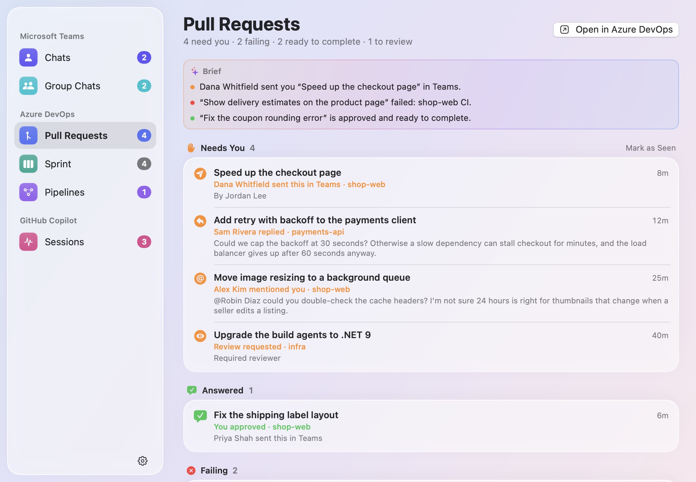

# BriefBar

[](https://github.com/mnsn/brief-bar/actions/workflows/ci.yml)
[](LICENSE)

A macOS menu-bar app that shows what needs you, from the apps you choose:

- your unread **Microsoft Teams** chats,
- your **Azure DevOps** pull requests, your team's sprint and the pipelines you follow,
- what your **GitHub Copilot** app sessions are doing.

Every source is off until you turn it on, and each one first says what it reads.

BriefBar brings Teams Pulse, ADO Pulse and Copilot Pulse together in one app: one install, one login
item, and permissions that macOS grants once. Full Disk Access for Teams and notifications for Azure
DevOps cover later sources too, but only the ones you turn on. Several sources can share a menu-bar
item, a desktop widget or a window, and you can hide what you don't need.

<p align="center">
  <picture>
    <source media="(prefers-color-scheme: dark)" srcset="docs/images/menubar-teams.chats-dark.png">
    
  </picture>
</p>

> [!NOTE]
> BriefBar is an independent project. It isn't affiliated with or endorsed by Microsoft or GitHub.

## Sources

| Source | Shows | Reads | Needs | Network |
|---|---|---|---|---|
| **Microsoft Teams** | Unread 1:1 chats, and group and meeting chats, in two items | The notifications Teams sends to Notification Center, from its database on your Mac | Full Disk Access | None |
| **Azure DevOps** | Pull requests that need you, are failing, are ready to complete, or wait on someone else; your team's sprint, and the pipelines you pin | Azure DevOps, with the Azure CLI's sign-in; and, only if you turn on **Pull Requests Sent in Chats**, every app's notifications in Notification Center, for links to pull requests | The Azure CLI, signed in; notifications; Full Disk Access for pull requests sent in chats | `dev.azure.com` and `app.vssps.visualstudio.com`, GET requests only |
| **GitHub Copilot** | Which Copilot app sessions are running, need you, or have finished or stopped | The Copilot app's own files under `~/.copilot` | Nothing | None |

Only the Azure DevOps source talks to the network for what you see, and only to Azure DevOps. BriefBar's
own requests are for its updates, from this project's GitHub releases, and only if you allow them. No
telemetry.

## Turning a source on

Open **Settings** from BriefBar's icon in the menu bar (it opens by itself the first time), and choose a
source. Its page says what it reads, where it connects and what it needs, and **Turn On** is your
consent.

- **Teams** needs Full Disk Access to read Notification Center's database. macOS has no prompt for
  it, so a window walks you through System Settings:
  1. Click **Open Privacy Settings**.
  2. Turn on BriefBar. If it isn't in the list, click **+** and choose it, or drag it there. If it's on
     already, remove it with **−** and add it again.
  3. Choose **Quit & Reopen** if macOS offers it.

  macOS gives the access to all of BriefBar, once. A later source that reads Notification Center
  (Outlook, say) would use it too, but only if you turn that source on.
- **Azure DevOps** signs in with the Azure CLI: `brew install azure-cli`, then `az login`, or click
  **Sign In…**, which opens Terminal to run it. macOS asks whether BriefBar may post notifications.
  **Pull Requests Sent in Chats**, off until you turn it on in its settings, also needs Full Disk
  Access, the same window as Teams'.
- **Copilot** needs nothing.

Because macOS asks only once, BriefBar never turns a source on by itself. A source that an update adds
starts off. If an update makes a source read more than what you agreed to, it pauses until you've
looked at what it reads now.

Turning a source off stops it and deletes what it saved, such as Teams' unread chats; its settings
stay. When no source that needs Full Disk Access is on anymore, BriefBar offers to open the list so you
can remove it.

## Menu bar, widgets and windows

Each source has sections: **Chats** and **Group Chats** for Teams, **Pull Requests**, **Sprint** and
**Pipelines** for Azure DevOps, and **Sessions** for Copilot. BriefBar shows them in three places, each
arranged in Settings:

- **The menu bar** (Settings › Menu Bar): each section starts with an item of its own, but Sprint and
  Pipelines start hidden there. Click one for its list.
- **Desktop widgets** (Settings › Widgets): Azure DevOps' pull requests and Copilot each start with a
  widget, behind your windows or floating above them, in three sizes. Teams' widgets, Sprint and
  Pipelines start hidden. Drag a widget by its header, and right-click it for its settings.
- **Windows** (Settings › Windows): one BriefBar window with a page for every section, and a sidebar
  with their counts. Open it with **Open in Window** from a list's gear menu or a widget's menu.
  BriefBar shows a Dock icon while a window is open.

Everywhere, you can put sections together, such as Azure DevOps with Copilot, or all of them in one
item, widget or window, then give each its own again. Items that share sections show their counts side
by side, with a tab for each in the list, opening at the one that needs you. You can also hide a
section you don't need, such as Group Chats, from any of them: its source stays on, and shows wherever
you didn't hide it. To move menu-bar items, hold ⌘ and drag them.

<p align="center">
  <picture>
    <source media="(prefers-color-scheme: dark)" srcset="docs/images/menubar-combined-dark.png">
    
  </picture>
</p>

<p align="center">
  <picture>
    <source media="(prefers-color-scheme: dark)" srcset="docs/images/window-azureDevOps.pullRequests-dark.jpg">
    
  </picture>
  &nbsp;
  <picture>
    <source media="(prefers-color-scheme: dark)" srcset="docs/images/widget-all-medium-dark.png">
    
  </picture>
</p>

## What each source shows

### Microsoft Teams

Each chat shows its newest unread message (with the sender in group chats), how long ago it arrived
and how many are unread; hover for the last few. Click a chat to open it in Teams at its oldest unread
message. Click ✨ for a one-sentence summary from Apple's on-device model (macOS 26 or later).

Notification Center doesn't record what you've read, so BriefBar decides:

| A chat becomes | When |
|---|---|
| **Unread** | Teams posts a notification for a new message, while BriefBar runs or while it doesn't |
| **Read** | You open it from BriefBar, or choose **Mark as Read** or **Mark All Read** |
| | You click or clear its notification in Notification Center |
| | Teams' dock badge clears, as it does once you've read everything in Teams (you can turn this off) |
| | Its newest unread message is older than **Keep Unread For** (1 day by default) |

Reactions and channel posts aren't unread chats, so they aren't counted. Read chats stay under
**Recent** for a day.

Teams must post notifications for BriefBar to see them. Check that **System Settings › Notifications ›
Microsoft Teams** allows them, with **Show in Notification Center** on, and keep **Badge application
icon** on too: BriefBar watches Teams' dock badge to tell when you've read everything in Teams. In
Teams' own settings, under **Notifications and activity**, chat notifications must be on. Muted chats,
and messages that arrive while Teams' status is **Do not disturb** or while you're looking at the
chat, don't produce notifications. A macOS Focus is fine: notifications are still stored.

### Azure DevOps

The item shows a symbol and count for each group you can act on: orange ✋ needs you, red ✕ failing,
green ✓ ready to complete, and, if you turn it on, teal 👁 to review. At the top of the list, a brief by
Apple Intelligence sums up the newest of each.

| Group | When |
|---|---|
| **Needs You** | Something new you haven't seen: a reply to your comment, a mention, a comment on your pull request, a review request, new commits since your vote, a reviewer who's waiting for you or rejected it, or a link to it someone sent you (if you turned that on) |
| **Answered** | Something that needed you that you've since taken care of in Azure DevOps, such as "You approved · Dana sent this in Teams", until you've seen it in the list |
| **Failing** | Your pull request has a failed build or status check, merge conflicts, or a build that expired |
| **Ready to Complete** | Your pull request is approved and every required policy passes (or it completes automatically) |
| **To Review** | Review requests you've seen but haven't voted on |
| **Waiting** | Your pull requests waiting for reviewers, a build or a requirement, and reviews you're waiting on the author for |
| **Done** | Completed or abandoned in the last day |
| **Idle** | Drafts, pull requests without activity for two weeks, and reviews you've approved or declined |

**Needs You** works like an inbox: opening a pull request from BriefBar, or **Mark as Seen**, moves it
on until something new happens. The first time, only the last three days count as new, and each
account you sign in to the Azure CLI with has its own. Notifications announce new replies, mentions,
comments, review requests, votes, new commits, failed builds, and pull requests that become ready or
complete. Clicking one opens the comment it's about. The first time, BriefBar finds the
organizations where you have pull requests; **Organizations** in its settings changes them.

**Pull Requests Sent in Chats**, off by default, lists a pull request as needing you when someone
sends you a link to it, in Teams, Slack, an email or any other app, as "Dana sent this in Teams",
even if you're not on it. In Teams, only chat messages count, not channel posts or reactions, and
emails from Azure DevOps itself don't count. It reads the notifications that every app posts to
Notification Center, keeps only the links, with who sent them, in which app and when, never the
messages, and needs Full Disk Access, like Teams. Right-click the pull request to open the message. A
link needs you until you open the pull request from BriefBar, vote or comment on it, it closes, or a
week goes by.

**Sprint** shows your team's current sprint at a glance: how much is done, how many days are left and
where your own work stands, then each story and bug with its tasks, in **In Progress** (when they, or
any of their tasks, have started), **Not Started** and **Done**. Tasks without a story in the sprint
are in a card of their own, and your avatar has a blue ring. **Just Mine** shows only yours, and the
team menu shows another team's sprint. Its widget and menu-bar item list your own work.

**Pipelines** shows the pipelines you pin, from any of your projects: how each one's latest run is
going stage by stage, where it failed, and how its recent runs went. **Add Pipeline** searches a
project's pipelines by name, and a pinned pipeline's menu shows only one branch's runs, moves it, or
unpins it.

Both start in BriefBar's window only, and read Azure DevOps only while something shows them on screen:
the window's page while it isn't minimized or hidden behind other windows, a widget that isn't
covered, a menu-bar item or its list. Click anything to open it in Azure DevOps.

<p align="center">
  <picture>
    <source media="(prefers-color-scheme: dark)" srcset="docs/images/window-azureDevOps.sprint-dark.jpg">
    
  </picture>
</p>

### GitHub Copilot

| Group | Status | When |
|---|---|---|
| **Needs you** | Waiting for your answer, Plan ready for review, Needs permission | The agent asked a question, finished a plan, or waits for a tool call's permission |
| **Running** | Working, Starting… | A turn is in progress (the current step is shown) |
| **Done** | Finished | The turn ended normally; shows the agent's summary if there is one |
| **Stopped** | Interrupted, Error, Stopped responding | You cancelled the turn, it failed, or it went silent mid-turn for 90 s |
| **Idle** | Idle | Everything else |

**Done** and **Stopped** sessions stay highlighted until you've seen them: you open the session, click
**Clear** on its group, or **Keep Finished Sessions For** passes. Click a session to open it in the
Copilot app.

## Install

BriefBar needs macOS 15 or later, on Apple silicon or Intel.

1. Download [**BriefBar.zip**](https://github.com/mnsn/brief-bar/releases/latest/download/BriefBar.zip)
   from the [latest release](https://github.com/mnsn/brief-bar/releases/latest) and unzip it.
2. Drag **BriefBar** to your Applications folder before you open it. Opened from Downloads, macOS runs
   it from a temporary location, and Full Disk Access, Launch at Login and updates may not work.
3. Open it. The app isn't notarized by Apple, so the first time, macOS won't open it because it can't
   verify it. Click **Done**, then go to **System Settings › Privacy & Security**, scroll down to the
   message that BriefBar was blocked, click **Open Anyway** and confirm.
4. Settings opens: turn on the sources you want, as [above](#turning-a-source-on). Changing the Full
   Disk Access list asks for your password or Touch ID, and an administrator's on a standard account.
5. Turn on **Launch BriefBar at Login** in Settings. If macOS asks you to allow it, use
   **Allow in Login Items Settings…**.

The second time you open it, BriefBar asks whether to check for updates automatically. If you allow
it, it checks once a day and offers each new version, which it installs and reopens without the
Gatekeeper step. Updates keep its Full Disk Access. **Check for Updates…**, in Settings and in each
list's gear menu, checks right away. To remove BriefBar, quit it, move it to the Trash and remove it
from the Full Disk Access list.

On a Mac that your organization manages, **Open Anyway** may be missing, or a profile may keep you
from granting Full Disk Access, and security software may flag an app that reads Notification
Center's database, so check your organization's policy first. Your IT department can grant the access
for you, as described below.

### Moving from the Pulse apps

BriefBar doesn't read the Pulse apps' settings: each source starts fresh. Quit Teams Pulse, ADO Pulse
and Copilot Pulse before you turn on the same source in BriefBar (two copies of Azure DevOps would
notify you twice), turn off their Launch at Login, and remove them from the Full Disk Access list.

### For organizations: no Full Disk Access step

On Macs your organization manages, IT can grant BriefBar Full Disk Access ahead of time, so its users
never see that step. With this repository cloned, `scripts/make-pppc-profile.sh /Applications/BriefBar.app`
writes a configuration profile for a release, to deploy with your MDM (for example, in Intune, as a
custom macOS configuration profile). macOS ignores it if it's installed by hand. The profile names the
app's signing certificate, which every release shares, so it covers later versions too. For copies
you build yourself with a certificate of your own ([below](#keeping-full-disk-access-across-rebuilds)),
`make pppc-profile` writes one for it instead. The access is the app's, but BriefBar reads nothing
with it until someone turns on a source that needs it.

### Build from source

You need Swift 6, from Xcode or the Command Line Tools (`xcode-select --install`). An app you build
yourself opens without the Gatekeeper step.

```sh
git clone https://github.com/mnsn/brief-bar.git
cd brief-bar
make install     # builds BriefBar.app, copies it to ~/Applications and opens it
```

Then turn on the sources you want, as above: BriefBar is in `~/Applications` (press ⌘⇧G in the file
dialog to type the folder). To remove it, run `make uninstall` and remove it from the Full Disk
Access list.

It's signed ad hoc, so macOS ties Full Disk Access to that exact build, and you allow each rebuild
again. Turning BriefBar off and on in the list keeps the old build's signature, so first run
`tccutil reset SystemPolicyAllFiles com.asaf.BriefBar`, which resets only BriefBar's entry (or remove
it with −), then add it again with +, and choose **Quit & Reopen**. If you have unread Teams chats
saved, macOS may also ask whether the new build may use BriefBar's keychain item: **Always Allow** is
fine there, since it covers only that build.

A copy you build updates itself too, to the release builds, unless you turn off
**Check for Updates Automatically** in Settings and build each new version yourself. Releases are
signed with the project's certificate, so after that first update, allow Full Disk Access once more
the same way, and later updates keep it.

### Keeping Full Disk Access across rebuilds

macOS ties Full Disk Access to the app's code signature. An ad-hoc signature is identified by the
hashes of the app's code, so every rebuild looks like a new app. If you rebuild often,
`make signing-identity` creates a self-signed certificate, **BriefBar Signing**, in your login
keychain. Every build is then signed with it, and keeps the access you granted.

That makes the certificate's key as powerful as the access: any program that can sign with it can sign
itself as BriefBar, and get the Full Disk Access you gave BriefBar. So no app may use the key without
asking, not even `codesign`, and it can't be exported: each build asks for your login password. Click
**Allow** only while a build of yours is signing, since any program can make `codesign` ask, and never
**Always Allow**, which would let any program running as you use the key silently. `make app` refuses
to sign with a key that some app may use without asking, and checks again after signing.
`scripts/make-signing-identity.sh --replace` swaps such a certificate for a new one, and `--delete`
deletes it, so that builds are signed ad hoc again. Either way, allow the next build again as above.

Releases are signed the same way, with a certificate of the project's own that only GitHub's release
workflow can use, which is why updates keep the access. [How it works](docs/how-it-works.md#signing)
has the details.

## Settings

Each source has its settings on its page in **Settings**, and in the gear menu of its list (or the
right-click menu of its widget), next to **Launch BriefBar at Login**, **Check for Updates…**,
**BriefBar Settings…** and **Quit BriefBar**. **Settings › General** also has
**Check for Updates Automatically**.

| Source | Setting | Options |
|---|---|---|
| Teams | Keep Unread For | 4 hours, 1 day (default), 3 days, until I read it |
| | Show Message Previews | on/off: off shows only how many messages are new, for screen sharing |
| | Summarize with Apple Intelligence | on/off: the ✨ button on each chat, while previews are shown |
| | Mark All Read When Teams' Badge Clears | on by default |
| Azure DevOps | Notifications, Summaries by Apple Intelligence, Show To Review in the Menu Bar | on/off |
| | Pull Requests Sent in Chats | off by default: reads every app's notifications for links to pull requests, and keeps only the links. Needs Full Disk Access |
| | Refresh | every 1, 2 or 5 minutes |
| | Keep Done For | 4 hours, 1 day, 3 days |
| | Idle After No Activity For | 1 week, 2 weeks, 1 month, never |
| | Organizations | which to watch; **Add Organization…** takes a name or any link from it |
| | Sprint | on its page: **Everyone** or **Just Mine**, and which team's sprint |
| | Pipelines | on its page: the pipelines you pin, in your order, each with all its branches' runs or one branch's |
| Copilot | Keep Finished Sessions For | 15 minutes, 1 hour, 4 hours, 1 day |
| | Show Context Usage | off by default: how full each session's context window is |

In **Settings › Menu Bar**, **Widgets** and **Windows**, each section shows on its own, with others or
not at all, and **Put All in One** and **Give Each Its Own** change them all at once. Each widget has
its own **Position** (on the desktop or floating above windows) and **Size** (compact, medium or large),
there and in its right-click menu.

## Privacy

- **Teams and Copilot never use the network.** Only the Azure DevOps source connects, to Azure DevOps,
  with your Azure CLI sign-in, and every request it makes is a GET. No sign-in of BriefBar's own, and
  no telemetry. `scripts/check-boundaries.sh` checks that no other part of BriefBar's code uses
  networking APIs.
- **Updates, only if you allow them.** BriefBar's own requests are for its updates, from this
  project's releases on GitHub: a small file that describes the latest release, once a day, and the
  new version when you install it. GitHub sees your IP address and the versions of BriefBar and of
  [Sparkle](https://sparkle-project.org), the updater it uses. They carry nothing about your chats,
  pull requests or sessions.
- **It only reads**: Notification Center's database through a read-only connection, the Copilot app's
  files, and Azure DevOps through GET requests. It never changes any of them.
- **Your sprint and pipelines** are read only while something shows them on screen, with the same
  sign-in and GET requests as your pull requests.
- **Pull Requests Sent in Chats** reads the notifications that every app posts, not only Teams', and
  only if you turn it on. It keeps only the links to pull requests, with who sent them, in which app
  and when, never the messages, and forgets them when you turn it off.
- **Summaries are made on your Mac**, by Apple's on-device model, never Private Cloud Compute or any
  other model, and are kept in memory only.
- **On disk**, it keeps Teams' unread chats (each chat's name, and its unread messages' sender and
  text), encrypted with a key in your login keychain, in a file only you can read, until they're
  read; which Azure DevOps pull requests you've seen, with each account, your organizations and the
  links people sent you; which Copilot sessions you've cleared; and its settings. Turning a source
  off deletes what it saved.
- **Programs it runs**, such as the Azure CLI, never get its permissions: macOS would otherwise let
  them use BriefBar's Full Disk Access.
- **Teams' widgets start hidden**: a widget puts your chats on the desktop, where anyone who sees your
  screen, or your screen share, can read them. With **Show Message Previews** off, the widgets and
  lists show only how many messages are new.
- Its log never contains names, messages, titles or IDs.

## FAQ

### Why do Teams and pull requests sent in chats need Full Disk Access?

Notification Center keeps notifications in a database under
`~/Library/Group Containers/group.com.apple.usernoted`, which macOS protects. Full Disk Access is the
only permission that lets an app read it. Teams reads nothing else there but Teams' notifications.
Azure DevOps' **Pull Requests Sent in Chats**, if you turn it on, reads every app's, and keeps only
the links to pull requests.

### Will a Teams, Copilot or macOS update break it?

It could: Notification Center's database, Teams' notifications and the Copilot app's files aren't
documented. BriefBar checks them every time it reads them, and says what changed instead of guessing.
For Teams, **Copy Diagnostics** describes the database's structure, without your data.

### How do Teams and Copilot update without polling?

Notification Center and the Copilot app keep what BriefBar shows in SQLite databases, and each of the
Copilot app's agents writes a log file. They write every change to disk as it happens, so BriefBar
watches those files with kqueue and FSEvents, and reads them again only when they change.
[How it works](docs/how-it-works.md) has the details.

### Why does Azure DevOps poll instead of getting pushed updates?

Azure DevOps can only push changes through service hooks, which need a project administrator and a
server on the internet. So BriefBar asks every minute: about 10 to 25 small requests a minute, and
right away when you open the list, when your Mac wakes, and when it's back online. Your sprint and
pipelines add a few requests a minute, and only while something shows them.

### Why isn't a pull request assigned to my team shown?

Azure DevOps' search for "pull requests I review" only matches you, not the groups you're in. Pull
requests where you were added yourself, including by a policy, are shown.

### Why does a failed build show no error details?

Azure DevOps doesn't include a build's errors with a pull request's policies, so the list shows which
build failed. Click the pull request to see it.

### How does it pick my team's sprint?

The first time, it looks through your teams for one with a sprint going on today. When several have
one, it picks the team with the most work assigned to you, and keeps it. Choose another team from the
Sprint page's team menu. Azure DevOps keeps calling a team's last sprint "current" after it's over,
when the team stops planning sprints: BriefBar shows no sprint then.

### Why do some Copilot sessions show less detail?

Questions, plans, permission prompts and the current step come from the agent's log on this Mac. A
session without a local log only shows Running, Interrupted or Idle, based on the Copilot app's own
flags.

### Which languages can it summarize?

Those Apple's on-device model supports, which depend on your macOS version. For others it may still
manage; if not, Teams says it can't summarize that language yet, and Azure DevOps shows no brief.
Summaries and the brief need macOS 26 or later, and Apple Intelligence turned on in System Settings.

### Why isn't it notarized?

Notarization needs a paid Apple Developer Program membership, which this free project doesn't have.
So macOS asks you to allow the app the first time you open it, as described in [Install](#install).
Each release is built from its tagged source by [GitHub Actions](.github/workflows/release.yml), with
an attestation you can [verify](SECURITY.md#verifying-a-download). You can also build it yourself.

### How do I know an update is genuine?

Each update, and the file that announces it, is signed with the project's private key. BriefBar
installs an update only if both signatures match the public key built into the app. Only the
maintainer holds the private key, and so does the release workflow, which can use it only after the
maintainer approves the release. Every release is also signed with the same certificate, which is
what keeps Full Disk Access. [SECURITY.md](SECURITY.md#how-updates-are-verified) has the details.

### Why did clicking BriefBar switch my other display's Space?

That's macOS, and a click on any app's menu-bar item does it. With **Displays have separate Spaces**
on, each display has a menu bar of its own, and it can still belong to an app you've moved away from:
switching another display to a different Space doesn't change it. A click anywhere in that menu bar
first makes that app active. If its windows are in a Space you switched away from, macOS switches back
to that Space, as it does when you switch to the app with ⌘-Tab. An item that does nothing when clicked
causes it too, so BriefBar can't prevent it. Its list does stay on the display you clicked.

### How do I troubleshoot it?

The app binary has command-line modes, and logs to the system log:

```sh
APP="/Applications/BriefBar.app/Contents/MacOS/BriefBar"   # ~/Applications after make install
"$APP" --help
"$APP" --dump                     # what each source that's on shows
"$APP" --json                     # the same, as JSON, with each source's counts
"$APP" --watch --source copilot   # one source's changes as they happen
"$APP" --render ~/Desktop/render  # the menu bar, its lists, widgets, window and Settings, as PNGs
"$APP" --diagnose                 # Teams: the database's structure only, safe to share
"$APP" --orgs                     # Azure DevOps: your organizations
"$APP" --chats                    # Azure DevOps: the pull request links in every app's notifications
"$APP" --teams                    # Azure DevOps: your teams, and which have a sprint going on today
"$APP" --sprint                   # Azure DevOps: your team's current sprint
"$APP" --pipelines                # Azure DevOps: the pipelines you pinned, with their latest runs
log show --last 10m --info --predicate 'subsystem == "com.asaf.BriefBar"' --style compact
log show --last 1d --predicate 'subsystem == "org.sparkle-project.Sparkle"' --style compact   # updates
```

Run from Terminal, Teams' modes, `--chats` and `--render` use Terminal's Full Disk Access. They run
only from a shell like that: started as an app, with `open` say, BriefBar has its own Full Disk
Access, and whoever started it could read its output, so it refuses every mode but `--help`. Teams'
modes and `--render` never read the unread chats that BriefBar saved: any program can run the app's
binary, so only the app itself reads them. They show what Notification Center has now, and count as
unread only what arrived since BriefBar last read it (while BriefBar runs, the last minute or so). So
they usually show fewer unread chats than BriefBar, and never one that Notification Center has
already dropped. Except for `--diagnose`, which is safe to share, their output shows your own chats,
names, titles and sessions, so keep it to yourself. `--demo --render` draws made-up data instead.

## Contributing

[CONTRIBUTING.md](CONTRIBUTING.md) explains how to build, test, and try the app with made-up data for
every source. Please report security issues privately, as [SECURITY.md](SECURITY.md) describes.

## License

Copyright © 2026 Asaf Manassen. BriefBar is free software, licensed under the
[GNU General Public License v3.0 or later](LICENSE).

Microsoft, Microsoft Teams, Azure and Azure DevOps are trademarks of the Microsoft group of companies.
GitHub and GitHub Copilot are trademarks of GitHub, Inc. Apple Intelligence is a trademark of Apple Inc.
