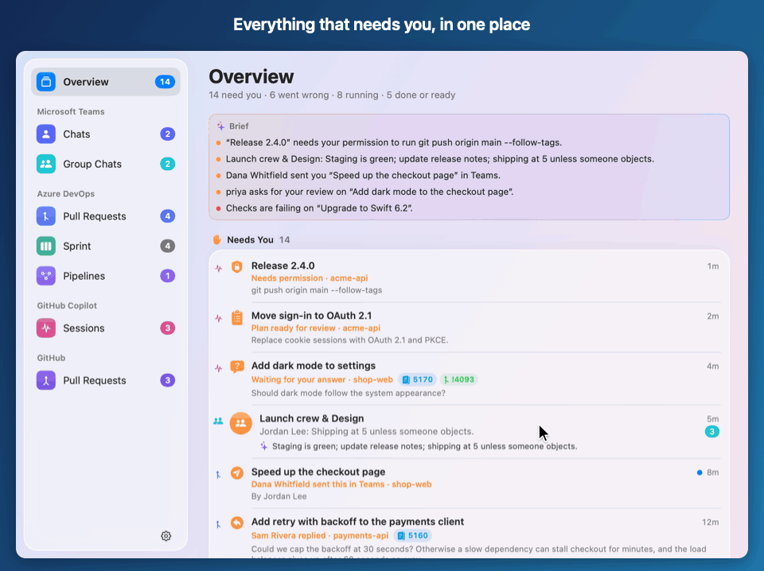
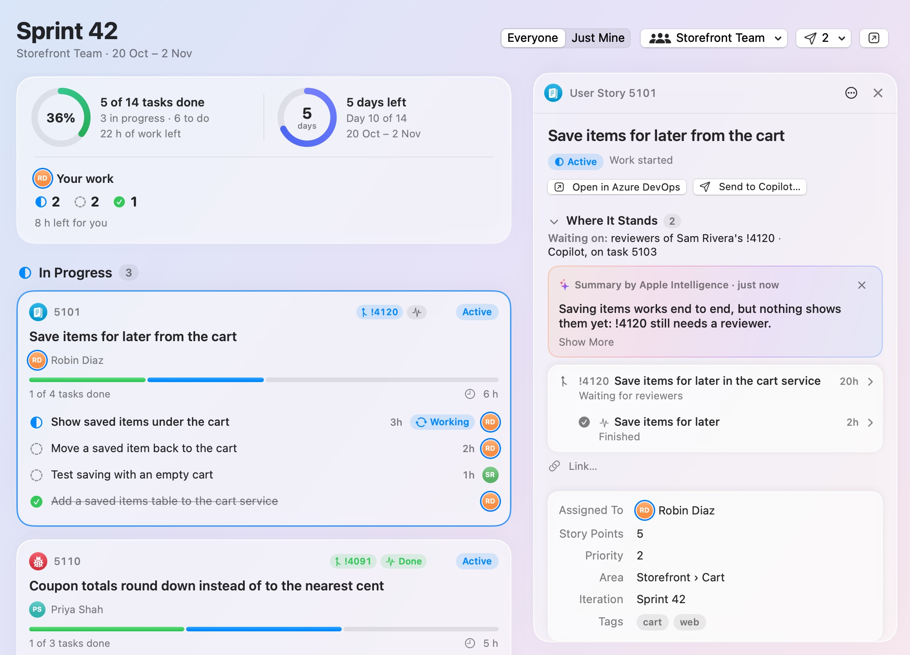
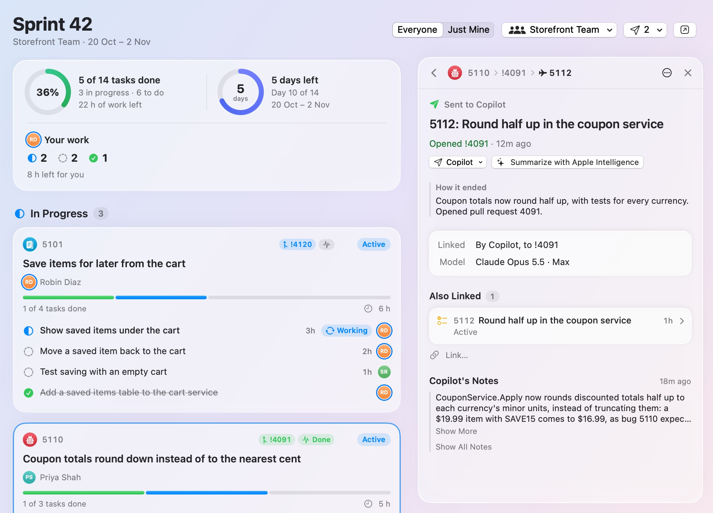
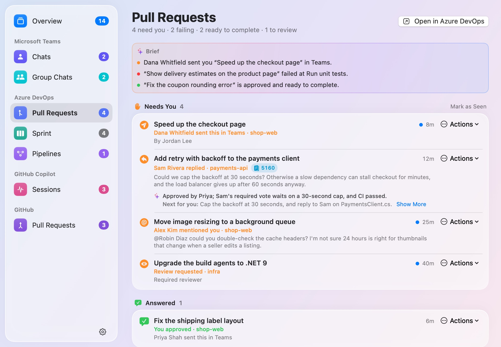
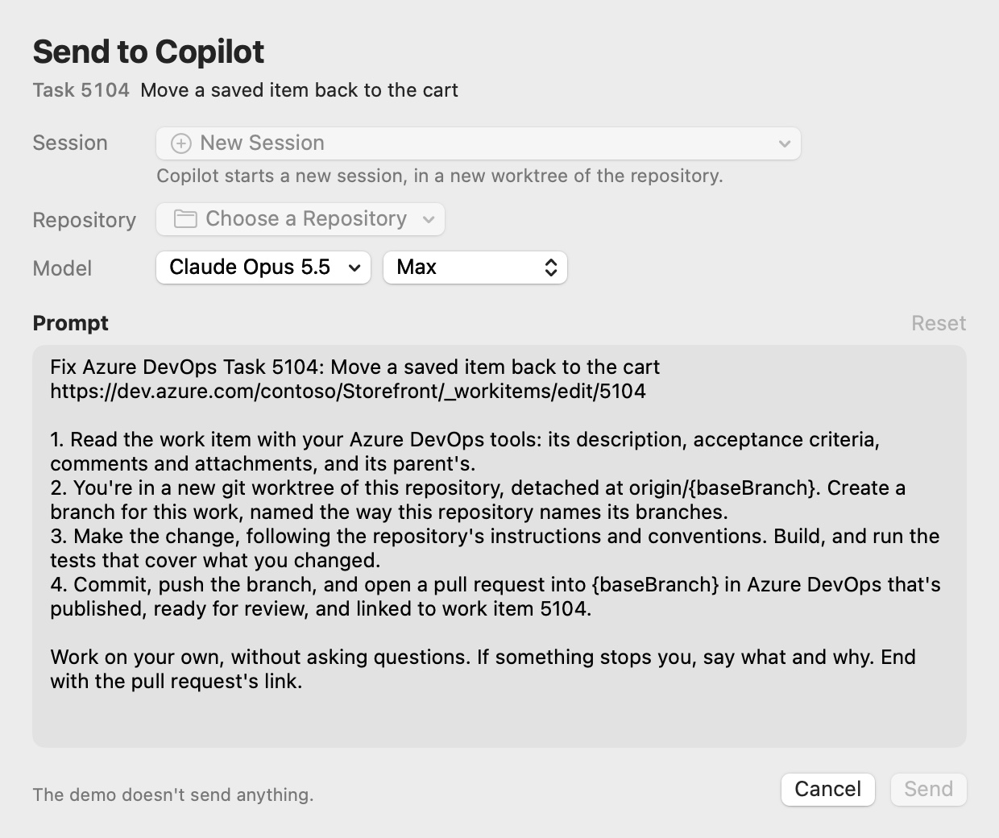

# BriefBar

**Your tasks, Copilot sessions and pull requests, connected. See what needs you and what happens next.**

BriefBar is a macOS menu-bar app that brings **Azure DevOps**, **GitHub**, **GitHub Copilot** and
**Microsoft Teams** into one view. Follow a work item through its tasks, the sessions working on it
and the pull requests they produce. See who it's waiting on, ask AI for the short version, and send
the next step to Copilot without piecing the story together across tabs.

[**Download BriefBar**](https://github.com/mnsn/brief-bar/releases/latest/download/BriefBar.zip) ·
[Get started](#get-started) · [User guide](docs/user-guide.md) · [What's new](CHANGELOG.md)

**macOS 15+ · Apple silicon (M1 or later) · Free and open source**

  <picture>
    <source media="(prefers-color-scheme: dark)" srcset="docs/images/readme-tour-dark.gif">
    
  </picture>

<em>From your sprint to a story, its pull request and the Copilot session behind it, summarized by AI, then the next task handed to Copilot.</em>

Screenshots use made-up demo data, including example summaries, in light and dark mode.
They show optional features enabled. **Every source starts off**, and links, summaries,
delegating work and agent access are separate opt-ins.

## Follow the work, not just the notifications

Turn on **Show Links** in **Settings › General** to connect work items, pull requests and sessions.
BriefBar picks up Azure DevOps' work-item links, the pull requests Copilot records with its sessions,
and sessions on a pull request's branch. You can also link things yourself from a row's right-click
menu or by pasting a link.

Open a story, bug or task on the **Sprint** page. **Where It Stands** brings together its linked pull
requests, their builds and Copilot sessions, with what needs you first. **Waiting on** names the next
person to act: you, a reviewer or Copilot.

  <picture>
    <source media="(prefers-color-scheme: dark)" srcset="docs/images/azureDevOps-sprint-details-dark.jpg">
    
  </picture>

Click through without leaving BriefBar:

- **Work item:** description, acceptance criteria, tasks, attachments and discussion.
- **Pull request:** reviewers and votes, comments waiting on you, conflicts, builds and failure details.
- **Session:** its question or plan, progress notes, what's been done, what's next and its last response.

  <picture>
    <source media="(prefers-color-scheme: dark)" srcset="docs/images/azureDevOps-sprint-deep-page-dark.jpg">
    
  </picture>

Links you add stay in BriefBar; they don't change Azure DevOps, GitHub or Copilot.
[How linking works →](docs/user-guide.md#links)

## Get the short version with AI

**“Where does this stand, what's next, and who is it waiting on?”**

Enable **Summaries** under **Settings › General**, with Show Links on, then click **✨ Summarize**
in a work item's details. It combines the work item and its linked work into a short
status and a next step, with more detail behind **Show More**. Pull requests and sessions have the
same action: hover over a row for **✨**, or use its right-click menu.

  <picture>
    <source media="(prefers-color-scheme: dark)" srcset="docs/images/rows-summary-pull-requests-dark.jpg">
    
  </picture>

There are two different kinds of AI help:

| | What you get | Where it runs |
|---|---|---|
| **Summaries** | On-demand summaries of work items, pull requests and sessions, using what BriefBar knows about them and their links | Apple Intelligence on your Mac by default: macOS 26+, with Apple Intelligence available and enabled, and no Copilot requests. Or choose a Copilot model, and the details go through your signed-in Copilot CLI to GitHub Copilot, on your Copilot plan. Either way, nothing from Teams is included and no tools are allowed: summarizing cannot change files or take actions. |
| **Chat summaries and the brief** | Summaries of unread Teams chats and more concise briefs about what needs you | Apple's on-device model, on your Mac. Requires macOS 26+ with Apple Intelligence available and enabled. |

Summaries of your work run **only when you ask**, not in the background. BriefBar marks a summary
**Out of date** when its inputs change, so you know when to ask again. BriefBar keeps summaries in
memory; with a Copilot model, the Copilot CLI also keeps its summary sessions locally. BriefBar never
switches from Apple Intelligence to Copilot on its own. The app and its plain-language brief work
without either AI feature.

## Send the next step to Copilot

With **Send Work to Copilot** enabled in Azure DevOps' settings, send a sprint task to Copilot with
its context already filled in. Review or edit the prompt, choose a repository and model, and follow
the task from running to its linked pull request.

For pull requests, choose **Fix Comments**, **Fix the Build**, **Resolve Conflicts** or **Pre-review**.
You can send follow-up work to the session that opened the pull request instead of starting from
scratch. The **Session** menu includes related sessions and lets you choose another or start a new one.

  <picture>
    <source media="(prefers-color-scheme: dark)" srcset="docs/images/azureDevOps-copilot-composer-dark.jpg">
    
  </picture>

**Open in Copilot** copies the prompt and opens the selected session in the Copilot app for you to
paste and send. **Run with the CLI** runs it directly on your Mac, when the session is safe to use.
A new work-item task runs autonomously in its own worktree and can change code, run commands, push
and open a pull request as you. Pull-request fixes don't push; **Push & Reply** is a separate action.
Pre-review changes and posts nothing.

[Copilot actions and their limits →](docs/user-guide.md#sending-to-a-session-thats-already-there)

## Know what needs you, wherever you're working

Keep a small menu-bar view, put a widget on your desktop, or open the full window. Group sources
together or keep them separate. The **Overview** brings them together by state: what needs you,
what's failing, what's running and what's ready.

  <picture>
    <source media="(prefers-color-scheme: dark)" srcset="docs/images/window-overview-dark.jpg">
    
  </picture>

| Source | What you can follow |
|---|---|
| **Azure DevOps** | Pull requests needing your reply or review, failures and ready-to-complete work; your team's sprint and work-item details; pinned pipelines and pipelines after your merges. |
| **GitHub Copilot** | Sessions running, waiting for your answer, ready for plan review, finished or stopped. Works with the Copilot app, or with local CLI sessions when the app isn't installed. |
| **GitHub** | Reviews requested from you by name, and your pull requests with changes requested, failing checks, conflicts or approvals. |
| **Microsoft Teams** | Unread one-to-one, group and meeting chats from notifications on your Mac, with optional message previews and on-device summaries. |

The task board and **Send Work to Copilot** actions are Azure DevOps features. GitHub provides
pull-request tracking, links and on-demand summaries, not a GitHub Issues board.

<strong>See the menu bar and desktop widget</strong>

  <picture>
    <source media="(prefers-color-scheme: dark)" srcset="docs/images/menubar-by-state-dark.png">
    
  </picture>
  &nbsp;
  <picture>
    <source media="(prefers-color-scheme: dark)" srcset="docs/images/widget-all-medium-dark.png">
    
  </picture>

[Layouts and appearance options →](docs/user-guide.md#menu-bar-widgets-and-windows)

## Ask from the Copilot app, too

Enable agent access in **Settings › Agents**, then install the **Copilot plugin** there to use
**/briefbar** in the GitHub Copilot app or CLI:

| Ask | Get |
|---|---|
| `/briefbar` | What needs you across Azure DevOps and Copilot; in the Copilot app, an inbox you can search, sort and group. |
| `/briefbar 5101` | Where the work item stands, what's done, what's left and who it waits on. |
| “Fix the comments on !4102” | In the Copilot app, a session of its own for the work, which you can follow and steer. |

BriefBar also provides an opt-in **MCP server** for compatible agents, with install actions for
VS Code and Cursor. Agent tools expose Azure DevOps and Copilot data, not Teams or GitHub.
[Agent setup and available tools →](docs/user-guide.md#agents)

## Get started

1. Download [**BriefBar.zip**](https://github.com/mnsn/brief-bar/releases/latest/download/BriefBar.zip)
   from the [latest release](https://github.com/mnsn/brief-bar/releases/latest), unzip it and move
   **BriefBar** to **Applications** before opening it.
2. The app isn't notarized by Apple. If macOS blocks the first launch, click **Done**, then go to
   **System Settings › Privacy & Security › Open Anyway** and confirm. On a managed Mac, check your
   organization's policy first.
3. In BriefBar's Settings, turn on only the sources you want. Each explains what it reads before
   you consent.

| To use | Set up |
|---|---|
| **Azure DevOps** | Install the Azure CLI (`brew install azure-cli`) and run `az login`, or use **Sign In…** in Settings. No personal access token. |
| **GitHub** | Install the GitHub CLI (`brew install gh`) and run `gh auth login`, or use **Sign In…** in Settings. Authorize the CLI for your organization's SSO if needed. |
| **Copilot sessions** | Your local Copilot app or CLI session files. No extra sign-in for BriefBar to show them. |
| **Teams** | Grant BriefBar **Full Disk Access** using its setup guide. It reads Teams notifications and local read markers, not your complete chat history. |
| **Connected work and summaries** | Turn on **Show Links**, then optionally **Summaries**, in **Settings › General**. Summaries use Apple Intelligence (macOS 26+) unless you choose a Copilot model, which requires the [Copilot CLI](https://docs.github.com/copilot/how-tos/copilot-cli), signed in with access to that model. |

You can enable **Launch BriefBar at Login** and allow automatic update checks. Later releases install
through the built-in updater and keep Full Disk Access.
[Full installation guide, managed Macs and building from source →](docs/user-guide.md#install)

## Your data and your choices

**No BriefBar account. No telemetry. Nothing starts acting on your work unless you ask.**

Sources are read-only: Azure DevOps and GitHub use your existing CLI sign-ins, and Teams and Copilot
tracking reads files on your Mac. Full Disk Access is needed for Teams and the optional
**Pull Requests Sent in Chats**, not for ordinary pull-request or session tracking.

Links, summaries, Send Work to Copilot and agent access each start off. Summaries stay on your Mac
with Apple Intelligence; only if you choose a Copilot model do they send the selected work's details
to GitHub Copilot. Sending work gives an agent permission to act within that action's limits. Teams
content never goes to Copilot summaries or BriefBar's agent tools.

[Full privacy details](docs/user-guide.md#privacy) · [Security and download verification](SECURITY.md)

## Learn more and contribute

[User guide and FAQ](docs/user-guide.md) · [How it works](docs/how-it-works.md) ·
[Contributing and demo mode](CONTRIBUTING.md) · [Changelog](CHANGELOG.md) ·
[Report a bug or suggest a feature](https://github.com/mnsn/brief-bar/issues)

BriefBar is an independent project, not affiliated with or endorsed by Microsoft or GitHub.
Copyright © 2026 Asaf Manassen. Licensed under [GPL v3.0 or later](LICENSE).
