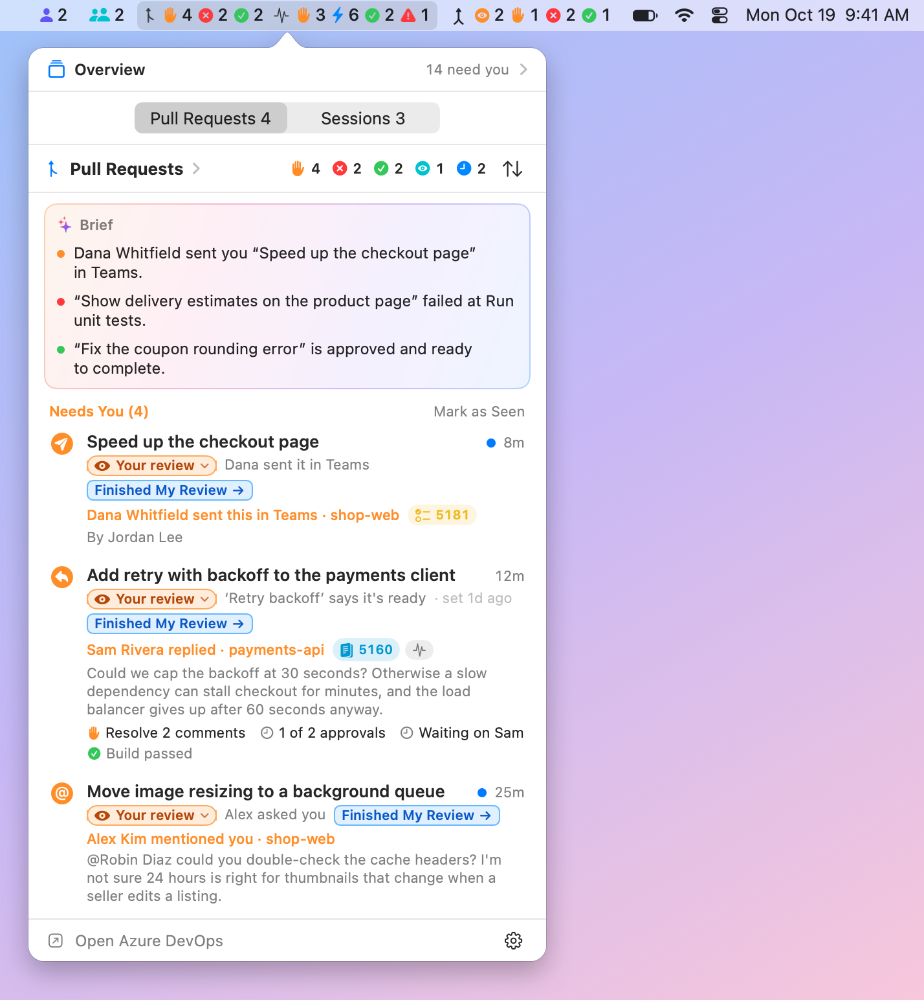
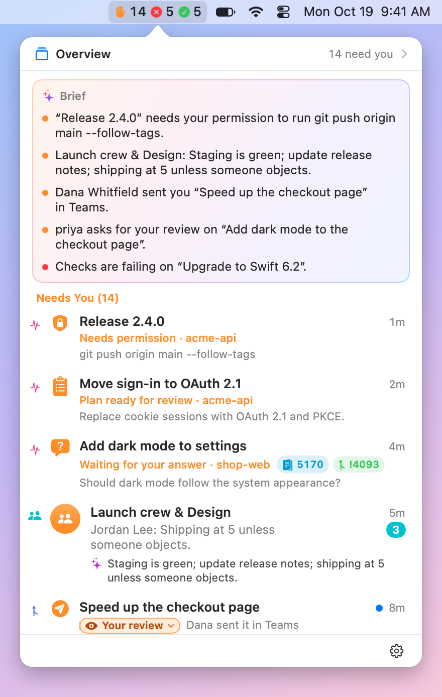
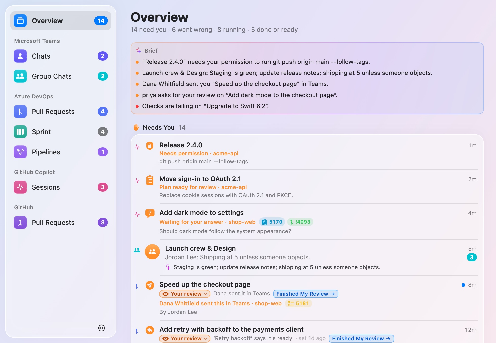
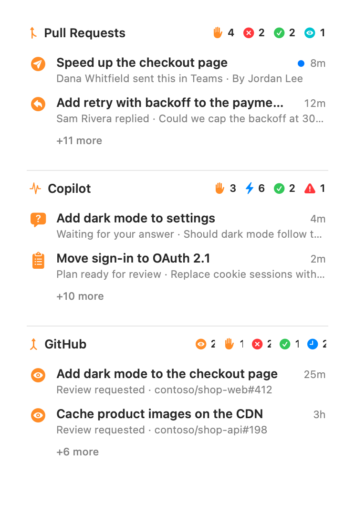
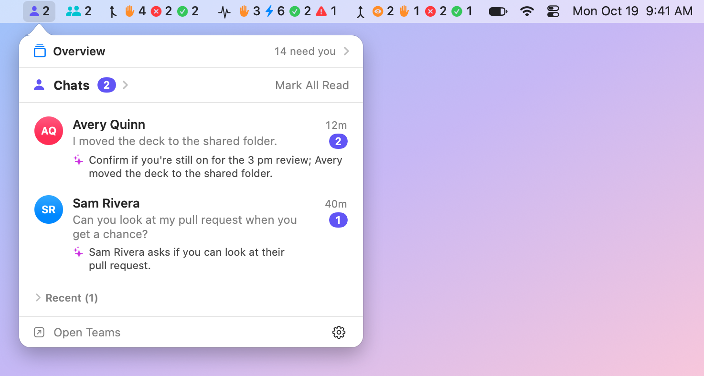
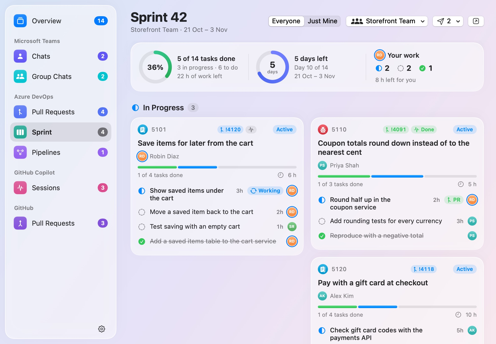

# BriefBar user guide

[Back to BriefBar](../README.md)

The full reference for sources, linked work, summaries, Copilot actions, settings and permissions.
For a quick tour and download, see the [README](../README.md).

[Sources](#sources) · [Setup](#turning-a-source-on) · [Links](#links) ·
[Copilot actions](#azure-devops) · [Agents](#agents) · [Install](#install) ·
[Settings](#settings) · [Privacy](#privacy) · [FAQ](#faq)

## Sources

| Source | Shows | Reads | Needs | Network |
|---|---|---|---|---|
| **Microsoft Teams** | Unread 1:1 chats, and group and meeting chats, in two items | The notifications Teams sends to Notification Center, from its database on your Mac; and how far you've read each chat, from Teams' own data on your Mac | Full Disk Access | None |
| **Azure DevOps** | Pull requests that need you, are failing, are ready to complete, or wait on someone else; your team's sprint, with each work item's details, and the pipelines you pin | Azure DevOps, with the Azure CLI's sign-in; and, only if you turn on **Pull Requests Sent in Chats**, every app's notifications in Notification Center, for links to pull requests; and, only if you turn on **Send Work to Copilot** and send a work item or a pull request, the repository you choose, Copilot's log of that session, and the Copilot app's sessions it could go to instead; and, only if you turn on **Show Links**, the work items and pull requests linked to yours and to the sprint's | The Azure CLI, signed in; notifications; Full Disk Access for pull requests sent in chats; the Copilot CLI to send work to Copilot | `dev.azure.com` and `app.vssps.visualstudio.com`, GET requests only, but, only if you turn on **Make Changes in Azure DevOps**, your replies in pull requests' threads, their statuses, your own comments, edited or deleted, and pull requests' tags, each when you click it; and, only if you turn on **Summaries** and choose a Copilot model, as you open a work item's details or a page, or ask, a work item's, pull request's or session's details and what's linked to it go to GitHub Copilot, through the Copilot CLI; and, when you ask a Copilot session about a comment, its conversation, the comment and its code go there too, and, when you ask one with **Ask…**, its conversation and your question; and, when you choose a Copilot model for **Fix Grammar** and use it, the reply or comment you're writing |
| **GitHub Copilot** | Which Copilot sessions are running, need you, or have finished or stopped; local CLI sessions when the app isn't installed; and, with Show Links, what Copilot recorded of a linked session's work, in a work item's details | The Copilot app's and CLI's own files under `~/.copilot` | Local Copilot session files | None for tracking; optional Copilot summaries send the selected work's details through the CLI, and **Ask…**, with Send Work to Copilot on, a session's conversation and your question, as described in [Privacy](#privacy) |
| **GitHub** | Pull requests that ask for your review by name, and yours that need changes, are failing, are approved or wait on someone else | github.com, with the GitHub CLI's sign-in, as each account it's signed in to: those open pull requests, with their checks, reviews, branches and whether they can merge | The GitHub CLI, signed in; no personal access token | `api.github.com`, one read-only GraphQL query for each account each refresh |

Only the Azure DevOps and GitHub sources talk to the network for what you see, each only to its own
service. BriefBar's
own requests are for its updates, from this project's GitHub releases, and only if you allow them. No
telemetry.

## Turning a source on

Open **Settings** from BriefBar's icon in the menu bar (it opens by itself the first time), and choose a
source. Its page says what it reads, where it connects and what it needs, and **Turn On** is your
consent.

- **Teams** needs Full Disk Access to read Notification Center's database. macOS has no prompt for
  it, so a window walks you through System Settings:
  1. Click **Open Privacy Settings**.
  2. Turn on BriefBar. If it isn't in the list, click **+** and choose it, or drag it there. If it's on
     already, remove it with **−** and add it again.
  3. Choose **Quit & Reopen** if macOS offers it.

  macOS gives the access to all of BriefBar, once. A later source that reads Notification Center
  (Outlook, say) would use it too, but only if you turn that source on.
- **Azure DevOps** signs in with the Azure CLI: `brew install azure-cli`, then `az login`, or click
  **Sign In…**, which opens Terminal to run it. An organization in another directory (tenant) than your
  sign-in's says so, and its **Sign In…** runs `az login --tenant` for that directory; your other
  organizations stay listed meanwhile. macOS asks whether BriefBar may post notifications.
  **Pull Requests Sent in Chats**, off until you turn it on in **Settings › Pull Requests**, also needs
  Full Disk Access, the same window as Teams'.
- **Copilot** needs nothing.
- **GitHub** signs in with the GitHub CLI: `brew install gh`, then `gh auth login`, or click
  **Sign In…**, which opens Terminal to run it. BriefBar asks `gh` for its token and keeps it in memory
  only; it never asks for a personal access token. It reads every account the GitHub CLI is signed in
  to on github.com, such as your work account and your own: to add one, run `gh auth login` again, or
  click **Add Account…** on GitHub's page in Settings, which keeps the account `gh` uses in Terminal
  as it was. That takes GitHub CLI 2.81 or later; with an older one, BriefBar reads the account it
  uses. It lists only pull requests that ask for your review by name, not those asked of a team
  you're in. If your organization uses SAML single sign-on, authorize the GitHub CLI for it, and the
  list says so when it can't see an organization's pull requests.

Because macOS asks only once, BriefBar never turns a source on by itself. A source that an update adds
starts off. If an update makes a source read more than what you agreed to, it pauses until you've
looked at what it reads now.

Turning a source off stops it and deletes what it saved, such as Teams' unread chats; its settings
stay. When no source that needs Full Disk Access is on anymore, BriefBar offers to open the list so you
can remove it.

## Menu bar, widgets and windows

Each source has sections: **Chats** and **Group Chats** for Teams, **Pull Requests**, **Sprint** and
**Pipelines** for Azure DevOps, **Sessions** for Copilot, and **Pull Requests** for GitHub. BriefBar
shows them in three places, each arranged in Settings:

- **The menu bar** (Settings › Menu Bar): each section starts with an item of its own, but Sprint and
  Pipelines start hidden there. Click one for its list.
- **Desktop widgets** (Settings › Widgets): Azure DevOps' pull requests, Copilot and GitHub each start
  with a widget, behind your windows or floating above them, in three sizes. Teams' widgets, Sprint and
  Pipelines start hidden, and so does the **Overview** widget: every source's counts, the brief's
  first line and what needs you. Drag a widget by its header, and right-click it for its settings.
- **Windows** (Settings › Windows): one BriefBar window, which opens on an **Overview** of everything
  by state, with the brief, then has a page for every section, and a sidebar with their counts. Open
  it from the top of any list: **Overview** opens it on the Overview, with how many things need you
  there, and the list's title, such as **Pull Requests ›**, at the list's page. A widget's menu has
  **Open in Window** too. BriefBar shows a Dock icon while a window or Settings is open. With
  **Notifications Page** on, it also lists what BriefBar notified you of, after the Overview (see
  [Notifications](#notifications)).

Everywhere, you can put sections together, such as Azure DevOps with Copilot, or all of them in one
item, widget or window, then give each its own again: in Settings, each item is a card with a chip for
each of its sections, and you drag a chip onto another card. Items that share sections show their
counts side by side, with a tab for each in the list. The list opens at the tab you looked at last,
even after BriefBar restarts, and the first time at the one that needs you. You can also hide a section
you don't need, such as Group Chats, from any of them: its source stays on, and shows wherever you
didn't hide it. To move menu-bar items, hold ⌘ and drag them.

A menu-bar item that shows several sections can instead add its counts up by state, the same for
every source: set its **Counts** to **Added Up** in Settings › Menu Bar. With everything in one
item, that's one ✋, one ✕ and one ✓ rather than nine symbols.

| | Teams | Azure DevOps | Copilot | GitHub |
|---|---|---|---|---|
| ✋ Needs you | Unread chats, 1:1 and group | Needs You, and To Review while it shows in the menu bar | Questions, plans and permission prompts | To Review, and Changes Requested |
| ✕ Something's wrong | | Failing pull requests, failed pipelines | Sessions that stopped | Failing checks or merge conflicts |
| ✓ Done or ready | | Ready to complete | Finished sessions | Approved, ready to merge |
| ⚡ Running | | Running pipelines | Running sessions | |

⚡ is off until you turn it on there. A source that can't show what it should, such as Teams without
Full Disk Access or Azure DevOps without a sign-in, adds a small ⚠, and the item's tooltip says
what's in each count. Its **List** can also show **Everything by State**: under a brief, what needs
you, what's wrong, what's running, then what's done or ready, from every section, the newest first,
each with the actions its own list has. Each item keeps its counts and its list as they were until you
switch them.

<p align="center">
  <picture>
    <source media="(prefers-color-scheme: dark)" srcset="images/menubar-combined-dark.png">
    
  </picture>
</p>

<p align="center">
  <picture>
    <source media="(prefers-color-scheme: dark)" srcset="images/menubar-by-state-dark.png">
    
  </picture>
</p>

<p align="center">
  <picture>
    <source media="(prefers-color-scheme: dark)" srcset="images/window-overview-dark.jpg">
    
  </picture>
  &nbsp;
  <picture>
    <source media="(prefers-color-scheme: dark)" srcset="images/widget-all-medium-dark.png">
    
  </picture>
</p>

## Optional appearance improvements

**Settings › Appearance** has seven independent options. **All start off**, including after an
update. Turn on only the changes you want; none enables a source, grants permissions or starts an agent.

**Text Size in Windows**, at the top of the page, makes the text on the pages of BriefBar's windows
bigger, from its usual size up to 150%, for reading long descriptions and comments. In a window, hold
**⌘** and scroll up to make it bigger, or down to make it smaller. The menu bar's lists, the widgets
and Settings keep their size.

| Option | When you turn it on |
|---|---|
| **Compact Briefs** | Moves the brief below the first group and shows two highlights, with **Show All** for the rest. A completed chat summary replaces the duplicate message preview, without hiding unread counts or changing preview permissions. |
| **Quieter Colors and Surfaces** | Uses neutral navigation, avatars and backgrounds, with less decorative color. Status symbols keep their meaning. |
| **Aligned, Easier-to-Read Rows** | Aligns titles across sources and makes reasons and previews larger. Widgets grow slightly to fit complete rows. |
| **Compact Menu Bar** | Temporarily combines the sections already visible in the menu bar into one BriefBar icon. Its count adds **Needs You** and failures; a warning also flags failures or missing access. Choose **All Activity** or a source from its list. |
| **Clearer States and Counts** | Separates **Ready to Merge** from **Finished** in the overview. Sidebar badges and list headers count items needing you or failing, while remaining sprint work is labeled **left**. |
| **Visible Row and Widget Actions** | Adds a row's **…** menu with explicitly named destinations and its existing actions. Widgets offer **View All**; if a section is hidden from windows, **Show in a Window…** opens layout settings instead. |
| **Simple Layout Choices** | Starts Menu Bar, Widgets and Windows settings with **Together**, **Separate** and **Custom**. Custom keeps the full arrangement editor. |

Turning an appearance option off restores its usual presentation. Compact Menu Bar never rewrites
your saved grouping or unhides sections: turning it off restores your saved arrangement. Choosing a
layout in **Simple Layout Choices** is an explicit layout change, just like using the existing editor.
Opening an item retains its source's existing read/seen behavior; these options never approve or
complete work for you.

## The brief

A list by state and the window's Overview start with a brief, and the Overview widget with its first
line: a few lines about what needs you, what's wrong and what's done or ready, from every source
that has something to say, each opening its thing. BriefBar picks the lines, and says each in its
own words. With Apple Intelligence, Apple's on-device model rewords those with something to
condense, such as a chat or a review comment (✨), on your Mac, as it does for Azure DevOps' brief
and Teams' summaries:

- Teams' lines say who wrote and how many messages. What a message says shows only while **Show
  Message Previews** is on, and the model reads a chat only while **Summarize with Apple
  Intelligence** is on too.
- Azure DevOps' lines condense a comment only while its **Summaries** setting is on.
- Copilot's lines stay in BriefBar's own words.

The model only words the lines BriefBar picked, and only while a list or the window shows them, never
for the widget. Without Apple Intelligence (on a Mac that can't run it, or with it turned off or
still getting ready), the brief stays in BriefBar's own words, without ✨, and Settings › Menu Bar says
why.

## Links

**Show Links**, in **Settings › General**, shows which work items, pull requests and Copilot sessions
go together, on their own rows: small capsules next to what's going on, for a pull request's work items
and the sessions working on it, a work item's pull requests and their sessions, and a session's pull
request and work item. A capsule shows a number, or how many, and the sessions' capsule says how the
one that needs you most stands, in its color, so you see when the session on a pull request is waiting
for your answer. It's off until you turn it on. Widgets' rows stay as they are.

Links come from where they already are:

| Link | From |
|---|---|
| A pull request and its work items | Azure DevOps: the work items linked to each of your pull requests, and the pull requests linked to the sprint's work items, a teammate's too |
| A session and the work item or pull request it started from, and the pull request it opened | The tasks you send to Copilot, and what the Copilot app records of its own sessions |
| A session and a pull request on its branch | The session's branch in the Copilot app, in the pull request's repository, unless everybody works on it, as on `main` |
| Anything else | You: right-click a row, then **Link Work Items or Sessions…**, **Link Pull Requests or Sessions…** or **Link Work Items or Pull Requests…** |

A work item's sessions include its pull requests' sessions, and a session's work items its pull
request's. Right-click a row, or click a capsule on a sprint card, to open what it's linked to, link
more, or unlink: one of your pull requests there has **Show in BriefBar**, for its details on the
window's Pull Requests page, and **Open in Azure DevOps**, and so does its own row under **Where It
Stands** or **Also Linked**, when you right-click it. The window that links things suggests what's on the same branch, names the same
number or shares words with the title, and takes a pasted link to a pull request, a work item or a
session.

A work item's details on the Sprint page list what's linked to it, with what's known of each, under
**Where It Stands** ([Azure DevOps](#azure-devops)).

What you link or unlink stays in BriefBar: Azure DevOps, GitHub and Copilot never see it, so a policy
that requires linked work items still sees only Azure DevOps' own. Unlinking what Azure DevOps or
Copilot links hides it in BriefBar, until you choose **Show Hidden Links**. While it's on, Azure DevOps
reads the links of your pull requests and, while the sprint is on screen, of its work items, and the
Copilot source reads which pull request each session started from or opened, and, when a work item's
details show a session, the checkpoints and last words Copilot keeps in that session's folder, in
memory only. Only as a summary is written, or, for one ten minutes old or more, as you open it again, to
tell whether it's still current, Azure DevOps also reads each pull request's description and comment
threads, and each work item's details unless they're on screen, up to two or three GET requests for each,
and Copilot reads what was asked in each session and what it answered, from the session's log; they go to
the model that writes a summary with the rest, and BriefBar keeps none of it.

## Notifications

Azure DevOps posts notifications for what's new on your pull requests, and for the work you send to
Copilot, as it starts and when it ends ([below](#azure-devops)). Clicking one opens what it's about,
such as the comment or the run, in front of BriefBar: in Azure DevOps, or, for a pull request, in its
details in BriefBar's window, with **Open Pull Requests in BriefBar** on. With **Send Work to Copilot**
on, one about your pull request whose build failed, that has merge conflicts, or where someone
commented, replied, mentioned you or wants changes has **Fix with Copilot…** too, which opens the
Send to Copilot window with the fix's prompt ([below](#azure-devops)).

**Notifications Page**, in **Settings › General**, lists what BriefBar notified you of on a page of
its own in BriefBar's window, right after the Overview, so you can see what you missed: a banner that
went away, a notification macOS didn't show, during a Focus or with notifications off for BriefBar,
and each update of a refresh that had more than its notifications show ("3 more pull request
updates", which opens the page). It's off until you turn it on. Each entry says what it means for
you, ✋, ✕ or ✓, when it came, and with a dot, that you haven't seen it yet. Click one to open what
it's about, as its notification would, but a pull request's right there in the window, in its details,
or right-click it for **Fix with Copilot…**, when its notification had it, or to remove it; **Clear All** empties the
page. The page shows only while it lists something. BriefBar keeps the entries for a day, or for 4
hours or 3 days (**Keep Notifications For**), in memory only: the page starts empty when BriefBar
restarts or updates.

## What each source shows

### Microsoft Teams

Each chat shows its newest unread message (with the sender in group chats), how long ago it arrived
and how many are unread; hover for the last few. Click a chat to open it in Teams at its oldest unread
message. Click ✨ for a one-sentence summary from Apple's on-device model.

Notification Center doesn't record what you've read, so BriefBar decides:

| A chat becomes | When |
|---|---|
| **Unread** | Teams posts a notification for a new message, while BriefBar runs or while it doesn't |
| **Read** | You open it from BriefBar, or choose **Mark as Read** or **Mark All Read** |
| | You read it in Teams: BriefBar reads how far you've read each chat from Teams' own data on your Mac (you can turn this off) |
| | You click or clear its notification in Notification Center |
| | Teams' dock badge clears, as it does once you've read everything in Teams (you can turn this off) |
| | Its newest unread message is older than **Keep Unread For** (1 day by default) |

Reading a chat in Teams reads it in BriefBar too, within a second or so, up to the newest message you
saw there; a message that arrives later is unread again. **Mark as Unread** in Teams doesn't make it
unread in BriefBar.

Reactions and channel posts aren't unread chats, so they aren't counted. Read chats stay under
**Recent** for a day.

Teams must post notifications for BriefBar to see them. Check that **System Settings › Notifications ›
Microsoft Teams** allows them, with **Show in Notification Center** on, and keep **Badge application
icon** on too: BriefBar watches Teams' dock badge to tell when you've read everything in Teams. In
Teams' own settings, under **Notifications and activity**, chat notifications must be on. Muted chats,
and messages that arrive while Teams' status is **Do not disturb** or while you're looking at the
chat, don't produce notifications. A macOS Focus is fine: notifications are still stored.

<p align="center">
  <picture>
    <source media="(prefers-color-scheme: dark)" srcset="images/menubar-teams.chats-dark.png">
    
  </picture>
</p>

### Azure DevOps

The item shows a symbol and count for each group you can act on: orange ✋ needs you, red ✕ failing,
green ✓ ready to complete, and, if you turn it on, teal 👁 to review. At the top of the list, a brief by
Apple Intelligence sums up the newest of each.

| Group | When |
|---|---|
| **Needs You** | Something new you haven't seen: a reply to your comment, a mention, a comment on your pull request, a review request, new commits since your vote, a reviewer who's waiting for you or rejected it, or a link to it someone sent you (if you turned that on). And comments you've seen that still wait on you |
| **Answered** | Something that needed you that you've since taken care of in Azure DevOps, such as "You approved · Dana sent this in Teams", until you've seen it in the list |
| **Failing** | Your pull request has a failed build or status check, merge conflicts, a merge Azure DevOps couldn't make otherwise (it failed, or a policy rejected it), or a build that expired. A failed build says where it failed, and its first error. And your merged pull request, when a pipeline that ran after it merged failed |
| **Ready to Complete** | Your pull request is approved, every person it requires as a reviewer approved, and every required policy passes (or it completes automatically) |
| **To Review** | Review requests you've seen but haven't voted on |
| **Waiting** | Your pull requests waiting for reviewers, a build or a requirement, and reviews you're waiting on the author for |
| **Done** | Completed or abandoned in the last day, and while the pipelines that run after it merged are still going or wait for an approval |
| **Idle** | Drafts, pull requests without activity for two weeks, and reviews you've approved or declined |

**What's left.** Under each of your open pull requests, Idle's too, a line says what Azure DevOps still
requires before you can complete it, from its blocking policies, its reviewers' votes and its merge, the
most pressing first: ✋ what you have to do, such as **Resolve 2 comments**, **Link a work item**,
**Publish the draft** or **Sam wants changes**; ✕ what failed, such as **Build failed** or **Merge
conflicts**; ↻ builds and checks still running; a clock for what waits on others, such as **1 of 2
approvals** or **Waiting on Sam**, a reviewer it requires; then ✓ what's done, such as **Build passed**
or **Approved**. Open comments that no policy requires resolving are said too, without holding it up.
Point at the row for who approved, which builds ran and where one failed. A person it requires as a
reviewer, whether a policy or someone added them, holds it up until they approve, as Azure DevOps does:
until then, it waits for reviewers. A team it requires counts as its policy says.

**Sort** the list with ↑↓ at its top, or the menu beside **Open in Azure DevOps** on the window's page:
**By Status**, in the groups above, or by when each was created, **Newest First** or **Oldest First**,
to follow many at once. By date, every open pull request is in one list, each still with its symbol,
what it waits for and what's left, and its time says how long ago it was created; Idle's, folded below
it, are in the same order, and Done's stay apart, the latest first. BriefBar keeps your choice.

**Each pull request's stage**, with **Pull Request Order** on in Settings › Pull Requests: a colored label opens each
row's second line, in the window, the menu bar's list and the Overview, and says where it is in its flow. **In
progress** while a Copilot session works on yours, its build fails, it has conflicts, it's a draft, or someone wants
changes; **Your review** once a session that wrote it finished, or when someone asks you or sends it to you, or new
commits come after your vote, also while Copilot's pre-review of it runs; **Teammate's review** while it waits for
others, or **Find a reviewer** when nobody else is asked; **Can merge** once Azure DevOps says it's ready to complete
and BriefBar saw what its order puts before it merge; **Waits for another PR** while its order puts it after one that
hasn't merged, or until you retarget one still targeting the branch of one that merged; and **Merged**. BriefBar works
it out from Azure DevOps and your Copilot sessions. Where a session or a stage you set decides it while your build
failed, it says that too: **‘Cart’ asks you · build failed**. Click the label to pick another, or the one it's in to
keep it there until you change it, or **Finished My Review** beside it to send it to your teammates; **Stage** in a
row's Actions and right-click menus, and VoiceOver's actions, do the same. What you set holds until the pull request
moves on: new commits, or a session that finishes writing it, end In progress; a vote ends Teammate's review, someone
else's on yours, and yours on someone else's; merging or closing it ends any. **Let BriefBar Decide** forgets it, and
**Undo** puts back your last change. Can merge and Waits come only from what Azure DevOps and its order show: nobody
can set them. Its details show the whole track under its heading, with its next step, such as **Finished My Review**
or **Add Reviewers in Azure DevOps**. Stages only label rows: groups, Needs You, counts, notifications and the brief
stay as they were. On someone else's pull request, Finished My Review takes it off your board until you vote in Azure
DevOps, which is still yours to do, or something new needs you there.

**Up Next**, at the top of the window's page while [Pull Request Order](#settings) is on, says what's next for you,
whichever way you sort: a slot for each kind of next, in its stage's color, each with its first pull request and
how many it has. **Fix next** is what needs you to fix or answer: a session that asks you, then a build that
failed, then changes someone wants. **Your next review** is the one that has waited longest, one that others
build on counting as long as they've waited, as they can't merge before it; **Next for a teammate**, one of yours
that needs a reviewer first; **Merge next**, what can merge next; **Waits next**, the one closest to merging. The
mission you focus on comes first in each. Click one for its details; **2 more ›** shows the rest on the Board.
Click **Up Next** to fold it, and BriefBar remembers. It changes no group or count.

By Mission, **List | Map | Board** offers the **Board**: a column for each stage, **In progress**, **Your
review**, **Teammate's review**, **Can merge**, **Waits** and **Merged**, which shows only its count until you
click it; and a lane for each mission, its header naming your next steps in it, such as **Review !4093** or
**Find a reviewer: !4079**, then a lane for the pull requests in no mission. **Lanes: None** puts every card in
one. Up Next's pull request wears **Next** in its column. Each column puts the mission you focus on first, but In
progress puts what needs you before it, so that Fix next's is its first card. Click a card, or press **Return** or
**Space** on it, for its details, or right-click it for its menu; drag it to another column of its lane, or click it, or
Tab to it, and press **⌘→** or **⌘←**, to change its stage, which says so with **Undo** at the top of its lane, even
once the card leaves the board. Drag one from **Waits** onto **Can merge**, or press **⌘←** on it there, to set it as
next to merge in its lane's mission, where it waits; in another mission's lane, it says where it waits. Where another
mission's order holds it too, it still waits, and its lane says what for, and where: the **Merge After** of its
**Mission** menu in that mission's lane, or of its card's with **Lanes: None**, takes that away; the Board doesn't set it
as next there too, which would only have it wait in the first again. Where its details cover the Board, in a narrow window or with
bigger text, ⌘→ and ⌘← move the pull request they show, or say under its stage why it can't move, but not from a page
over the details or a file's page; the card has the keyboard again once they close. While you drag, the columns that
take it light up, and those that don't say why: only Azure DevOps decides that a pull request can merge or merged, its
order what it waits for, and someone else's pull request asks its own reviewers, so **Finished My Review** takes it off
your board instead, there and in its menus. A row's order capsule, such as **Next to merge**, clicked in another sort
shows its mission's lane, and a lane for each mission again if they were None. Narrow, or with bigger text, the Board
scrolls sideways; a line under it counts the pull requests in your lists that aren't on it, such as others' you
approved, and **Show By Status** lists them. GitHub's page, whose pull requests have no stages, offers List and Map, and
shows List where you chose the Board.

**Click a pull request on the window's page** to see its details beside the list, without leaving
BriefBar, or over it when the window is narrow: where it stands and since when, its branch and who wrote
it, and **✨ Summarize**; **What's Left**, as its row's line says it, each item saying when it's **Your
turn**, and taking you to its merge conflicts, comments, builds or reviewers; the files that conflict with
its target branch, while it has conflicts (below); its comment threads, by file, in the order
its change lists them, those on the pull request itself first, and in each file the ones that wait on you
first, the resolved ones behind **Show Resolved**; the files its change touched (below); its builds and
checks, what failed first, with where a build failed and its first error; who reviews it, which reviewers
it requires and how each voted; and, with [Show Links](#links) on, the work items, Copilot sessions and
pull requests linked to it, which open in the details too, one of your pull requests with the same details
as its own, **‹**, **⌘[** or **Esc** going back. **↗** opens the pull request in Azure DevOps, at the
comment that needs you, as **Open in Azure DevOps** in its menu does, and ↗ on a thread or a build opens
that one; **⋯** has the row's menu, with Copilot's actions while Send Work to Copilot is on. The details
show what BriefBar already read, and read nothing more but the code that comments are on, its files and
which files conflict (below), and showing them sees the pull request, as opening it does: while they show it, what was new in
its threads stays new, and where it was, rather than folding away as you read it, until you remove it from
Needs You. Drag their left edge to make them wider
or narrower: BriefBar keeps the width, separately from the Sprint page's details, and double-clicking the
edge brings back the usual one. **✕** or **Esc** closes them.

**Open a pull request from anywhere else** and its details show here too, at the comment or the run it's
about, or, for a review you're asked for or one that waits on its author for the changes you asked for, at
its **Reviewers**, where your vote is: from the window's **Overview** and its brief, the **Notifications** page, and the **Pipelines**
page, whose **Your Pull Requests** cards show the run you click, or the first that failed, and **After
Your Merges** the run that failed or waits; from a link to it, or a task you sent to Copilot about it; and, as pages over a work item's details on the Sprint page,
the same details for each of your pull requests, the way there in their header, such as **Bug 5110 ›
!4091**. Opening it in BriefBar sees it, as opening it in Azure DevOps does. In the menu bar's list, widgets
and notifications, a click opens a pull request in Azure DevOps, unless you turn on **Open Pull Requests in
BriefBar** in **Settings › Pull Requests**: then those show its details in BriefBar's window too, at what it's
about, while a window shows the Pull Requests page. Either way, its menu has both: **Show in BriefBar**, or
**Show Details** in the window, and **Open in Azure DevOps**, which opens it where its row does, at the comment
that needs you or the run after its merge, from the Pipelines page's cards too. With VoiceOver, the details
take you there too, every time: to the thread, the build or check they point out, or the heading of the part they go
to, such as **Comments** from What's Left, rather than their title.

**Its Copilot session.** With Send Work to Copilot on, a line under the heading, in its details and on its
page over a work item's, names the Copilot session the pull request's work goes to, why it's its, and how it
stands, in its state's color, such as **Copilot · ‘Retry backoff’ · on its branch · Finished 1d ago**: the
session you chose for it; else its last task's; else the session of the work item's task that opened it;
else the Copilot app's session that Copilot recorded with it, that told BriefBar it's working on it or opened
it, that you linked to it with Show Links, or
that's on its branch. When two of those go with it as well as each other, the line asks **Which session is
this pull request's?** instead of guessing, and its work goes to the one you choose. One whose log only has
a link to it may have opened it, but that's a guess, so it's offered in the line's menu, never chosen for
you. Click the line to see the session's page in the details, with Show Links on, or else to open one of the
app's sessions in Copilot; while it waits for your answer, the line is orange, and a click opens it in the
Copilot app, where you answer it. While Copilot works in it, or in its checkout, for a task BriefBar sent,
nothing more goes there until that's done. **⌄** says first how work would get there, as the Send to Copilot
window would send it: with the Copilot CLI, for a task BriefBar runs; or in the Copilot app, where BriefBar
sends the prompt itself with [Send Prompts to Copilot Sessions](#agents) on, or copies it for you to paste.
It opens the session in Copilot, or **Continue in Terminal** for a task BriefBar runs with the Copilot CLI;
with Show Links on, **Show Details** shows its page, and **Ask…** opens it with a field to ask the session where it
stands, or anything else, aside ([Asking a session where it stands](#asking-a-session-where-it-stands)); and, under **Use for This Pull Request**, lists the sessions that go with it, each with why and how it
stands, the app's other sessions, and **New Session**: the one you check is where the pull request's work
goes from then on, in the Send to Copilot window too, until a task starts on it in another session, or, with
Updates from Copilot Sessions and Show Links on, another session starts telling BriefBar it's working on it. **Let
BriefBar Choose** goes back to BriefBar's choice. BriefBar reads the Copilot app's sessions for the line only
while the details show in a window you can see: as they come on screen, then every ten seconds. Without Send
Work to Copilot, the line shows only the sessions Show Links links to it, to look at.

**Each comment thread shows as its reviewer saw it in Azure DevOps.** A thread on code shows the lines it's
on, with a few around them, as they were in the update it was made on: their numbers, before and after the
change when lines were removed, what was added in green and removed in red, and the lines it's about marked in
your accent color. Select the code to copy it, without the numbers. A long line scrolls sideways rather than
wrapping, and while the details are beside the list, **⟷** makes them wide enough for it. When the file
changed after the comment, the thread says **The code changed since this comment**, or that it may have when
BriefBar can't tell, with **↗** to see what changed in Azure DevOps. Each comment shows in full, formatted as
it was written, with who wrote it and when; in a thread of more than three, the first and the latest show, and
**Show 2 more comments** shows the rest. Each thread says how it stands, **Active**, **Resolved**, **Won't
fix** and so on, and who it waits on: **Waits on you**, or someone else, such as **Waiting on Sam**, for
whoever the latest comment mentions, or else whoever has to answer; when the latest comment mentions you, it's
your turn. BriefBar reads a thread's code only as it comes on screen, in a window you can see, and stops if
you scroll past it first or minimize, hide or cover the window; it keeps it in memory only, while the details
show that pull request. VoiceOver reads the code a line at a time, with each line's number, whether it was
added or removed, and whether the comment is on it. When it can't show a thread's code, such as a file that
isn't text, it says why in a few words, with **↗** to see it in Azure DevOps, and, when reading it again may
help, as when you were offline, **↻** to try again.

**Mark a thread as read, and show only the active ones.** A thread that waits on you has **✓** beside its **Waits on
you**: **Mark as Read**, which its right-click menu and VoiceOver's actions have too. It doesn't wait on you anymore, up
to its latest comment, so its pull request leaves Needs You once nothing else there does, and a newer comment in it waits
on you again. It's BriefBar's own, like what you've seen: nothing goes to Azure DevOps, and it works without Make Changes
in Azure DevOps, on your pull requests, the ones you review and the ones sent to you. Its chip and dot go at once, and the
thread stays where it is while the details show its pull request; **Mark as Unread**, in its right-click menu, puts it
back until they show another. A new comment in a resolved thread, such as a bot's note that it updated the description,
waits on you only until you've seen it (**New since you last looked**, its chip's tooltip says), and since the details
keep it as it was while you read, Mark as Read is how to end that before you close them. **Active | All**, beside
**Comments**, chooses which threads show, in every pull request's details and on their files' pages, and BriefBar
remembers it: **All** shows every thread, the resolved ones folded, and **Active** only those whose status is active or
pending, as What's Left counts them, without the closed, fixed, won't fix and by design ones, even one that waits on you,
or those without a status, saying how many it leaves out, such as **4 closed or resolved comments hidden**, with **Show
All**. A thread you're taken to, as from a
notification, shows either way. What's Left, Needs You and the lists count every thread all the same.

**Ask Copilot about a comment.** With Send Work to Copilot on, each open thread ends with
**✨ Explain** and **Fix**, side by side, in the comments and on its file's page. Each opens a small composer under the comment, rather than a window: a field for
what you want in your own words, where it goes, and its button, which Return presses, so a plain explanation or fix takes
two clicks. One composer is open at a time, and each keeps what you wrote until you send it, while BriefBar runs, in memory
only, as a reply does: as you open another, go to a page over the details or a file's page and back, where the same
thread's composer has it too, or look at another pull request; a file's page closes the one that was open, so **‹**
comes back to where you were rather than to it. The same composer open in two windows shows what you write in either.
Turning Send Work to Copilot off, or someone else signing in to the Azure CLI, forgets it. **Explain** asks the session
that worked on the thread, or else the pull request's own (its Copilot session, above), what you want to know, or else
why you got the comment: why the reviewer wrote it, what they want, how the code relates, and a few ways to address it,
with what each would change. The answer shows under the comment, a long one's first dozen or so lines until **Show More**,
with **↗** to the session. It's asked aside, in a copy
of the session's conversation that the Copilot CLI makes with no tools and deletes after, so it changes no file and the
session's history stays as it was; it sends the conversation, with the comment and its code, to GitHub Copilot, as one
premium request, and needs the Copilot CLI 1.0.95 or later. Once it answered, **Ask More** follows up on what it said,
and **Fix** takes the answer along (**Include the answer above**), so you can say which way, such as "the second way,
with 45 seconds". Without a session that goes with the pull request, Explain has nobody to ask, and says so. When the CLI
can't ask aside, or doesn't have the session, the thread says why, and **Ask in the Session** sends the question to the
session as a prompt instead, the way Fix sends its own, where it stays in the session's history. **Fix**, on your own
pull request, has Copilot address that thread alone, as you say in **Tell Copilot how (optional)**, which it quotes as
yours, then build and test; it doesn't commit, push or reply, and the thread leaves Needs You as with Fix Comments,
below. A comment can suggest a change, which shows as **Suggested change**: **Apply ‹name›'s suggestion as written** has
Copilot make it as it's written, and is checked when the suggestion is the thread's last word. Where it goes is one
**▾** away: the session that worked on the thread, if one did, else the pull request's, first and chosen; for a fix, a
fork of it, with its history, in a worktree of its own, while it stays as it is, which goes first while one of
BriefBar's tasks is busy, and a new session; then the other sessions that go with the pull request, and the rest of the
Copilot app's. Each says how a prompt would get there, with the CLI or in Copilot, to paste when BriefBar can't send it
itself, or that it's busy, and the composer says what happens once you send it, as the Send to Copilot window would send
it ([below](#sending-to-a-session-thats-already-there)). **Edit the Whole Prompt…**, last in **▾**, opens that window
with it, for the whole prompt, the model and more. **Fix All**, at the top of the comments, is Fix Comments, through the
same composer; it says **Fix 1 Comment** when others wait on someone else, which it leaves. Once Copilot works on a
thread, a line above its buttons says so, in its state's color, with since when and the step it's at: **Copilot is
explaining this in ‘Retry backoff’ · 1m**, **Fixing this in a fork of ‘Retry backoff’ · 2m**, **Fixed in ‘Retry
backoff’, not pushed** or **Couldn't fix it in ‘Retry backoff’**, with what Copilot said under it, such as why it
couldn't; click it to see the session. One of BriefBar's own tasks, named for what it does, is called a task there,
**Fixed in the ‘Fix Comments’ task, not pushed**. When you send a session something else
before it's done with what you sent it, BriefBar can't tell from the session which of them ended how, so the earlier
thread says **Sent to ‘Retry backoff’ · see the session** instead, as it does once a session hasn't finished in twelve
hours, such as one that waited overnight for your answer. A line's **⋯**, or its right-click menu, has what it allows:
**Stop**, while Copilot is at it, which stops one of BriefBar's tasks, or the session's turn in the Copilot app, or shows
the session to stop it there when BriefBar's extension in it can't; **Try Again**, for a fix that failed or stopped,
which sends it again with the same words, to where it went, or, when it can't go just as it did, opens it there for you to check and send, saying why; and **Clear**, which
lets the line go. **Fix** waits while Copilot fixes the
thread. Once fixes are done, of comments or of a build
(below), a bar at the foot of the details, or of a pull request's
page over a work item's or another pull request's, says what's ready, by what it fixed, **2 fixes ready in ‘Retry
backoff’** or **1 fix and the conflicts' resolution ready in ‘Retry backoff’**, which takes you to what they fixed,
with **Push & Reply…**, which opens the Send to Copilot window to commit them, push, and reply on the threads they
fixed, from that session, or **Push…** when they fixed no comment; they stay in the bar when Push & Reply fails or is
stopped, to try again. Push & Reply commits all that session changed, so a comment it fixed before that Push & Reply
doesn't list says **Pushed from ‘Retry backoff’, without a reply**, and stays so after a later push fails. What's Left says
**Copilot's on it** while Copilot fixes, or pushes, its comments, a build or its conflicts, whether with one of
BriefBar's tasks or a prompt to one of the Copilot app's sessions, and **Copilot asks you** while that session waits for
your answer in the app. **Esc** closes a composer, then the details; closing a composer while it sends calls the send
off, unless the session has it already. VoiceOver hears what becomes of each, once, though it shows in two windows, or on
two rows of a build that two policies run.

**Reply and set a thread's status.** With **Make Changes in Azure DevOps** on, in **Settings › Pull Requests** (off by
default), each thread on an open pull request ends with **Reply** and its status, in the row with Explain and Fix, in
the comments and on its file's page. On a pull request that's completed or abandoned, or that left your lists and
BriefBar doesn't read anymore, a lock takes their place: point at it, or ask VoiceOver, to hear why. One sent to you in
a chat leaves your lists once you've seen it, but BriefBar still reads it while it's open, so you can still reply there,
and what you do shows; its heading says so. **Reply** opens a field under the thread, in place, as Explain and Fix do,
one at a time with them: write in Markdown, Return starting a new line, then **Reply**, or ⌘Return, sends it to the
thread in Azure DevOps, as you, and **Reply & Resolve**, or ⇧⌘Return, sends it and resolves the thread; on a resolved
thread, **Reply & Reactivate** reactivates it. ✕ or Esc closes the field, and what you wrote stays, until you send it,
while BriefBar runs, in memory only; the keyboard's focus goes back to **Reply**, as it does once your reply is sent,
unless you've moved on to another composer meanwhile. **Resolve**, beside Reply, resolves the thread, and **Reactivate**
reactivates a resolved one; its **▾** has the statuses Azure DevOps' own menu offers, **Active**, **Pending**,
**Resolved**, **Won't Fix** and **Closed**, and **By Design** for a thread that has it already. A status changes at
once, without asking, since the same menu sets it back; a thread's right-click menu has Reply and its statuses too. The
thread shows what you did as soon as Azure DevOps answers, as it answered, and stays where it is in the details while
they show that pull request, however it stands now, as pages open over them and you come back, and on its file's page;
once they show another, or close, or you go back from its page, it shows where it stands, with the resolved ones once
you resolved it; then BriefBar reads the pull request again, so Needs You, What's Left, the brief and the counts follow:
a thread you replied to, or resolved, doesn't wait on you anymore. When it can't, the thread says why in a sentence,
such as **Azure DevOps says you may not reply here**, **You're offline**, for a pull request that's completed or
abandoned, when the thread was deleted meanwhile, or when someone else signed in to the Azure CLI since, which sends
nothing as them, with what may help, such as **Try Again** or **Sign In…**; a reply that didn't go keeps what you wrote,
in its field, and one that Azure DevOps didn't answer in time is read again before you send it twice. **Fix Grammar**,
in the field, corrects your reply's spelling, grammar and punctuation, and only those, in the language you wrote it in,
keeping your words, your Markdown, and your code, links and @mentions, which the model never sees; when a model does
more, such as translate your reply or answer what it asks, it suggests nothing, and says so. It uses Apple Intelligence,
on this Mac, free, unless you choose a Copilot model in its **▾**, from those summaries offer, which BriefBar remembers:
each fix is then one premium request, and sends your reply's text to GitHub Copilot, through the Copilot CLI. It shows
the correction under the field, what it changes marked, with **Use It**; once you use it, **Undo** puts back what you
wrote. It never changes your reply without you, and never sends it. Where Apple Intelligence is turned off or can't run,
it says so, with **Choose a Model**. The demo changes only its own made-up pull requests, and sends nothing.

**Edit or delete your comments.** With **Make Changes in Azure DevOps** on, a comment you wrote, on an open pull
request, has **⋯** at the end of its line, with **Edit** and **Delete…**, which its right-click menu has too, before its
thread's, and so do VoiceOver's actions on it: not someone else's, nor a comment Azure DevOps added for a code change.
**Edit** opens what it says in place of it, in a field like Reply's, its @mentions as the names they show, which go back
as mentions: **Save**, or ⌘Return, saves it in Azure DevOps, as you, and it shows as soon as Azure DevOps answers, with
**· Edited** after when you wrote it; **Cancel** keeps it as it was, and forgets what you changed. **✕** or Esc closes
the field and keeps what you changed, as for a reply, and so does opening something else: it stays while BriefBar runs,
until you save it or cancel. If the comment changes meanwhile, in Azure DevOps or another window, your edit says so once
BriefBar has read the change, with all of what it says now, and **Save** is dimmed, since it would replace that without
you seeing it: **Start Over** (⌥⌘R) puts what it says now in your edit, in place of what you wrote, and **Save Anyway**
(⌥⌘Return) replaces it with your edit. If you haven't changed anything, your edit just shows what it says now instead.
**Fix Grammar** is there too, as in a reply. **Delete…** asks first, under the
comment, saying that Azure DevOps deletes it, as you, and that it can't be undone: **Delete** deletes it, and
**Cancel**, or Esc, keeps it. Azure DevOps keeps a deleted comment, marked deleted, and doesn't show it, and deletes its
thread once none of its comments is left, so the comment leaves its thread at once, and the thread leaves the details
then. After each, BriefBar reads the pull request again, as after a reply. While a comment is open to edit or delete,
its thread's comments don't fold, and once it closes, the keyboard's focus goes back to its **⋯**, or to **Reply** once
it's deleted. When an edit or a deletion can't go, the thread says why, as for a reply, such as **Azure DevOps says you
may not edit this comment**, **You're offline**, or until when Azure DevOps asked BriefBar to slow down, with **Edit…**,
**Try Again** or **Sign In…**; an edit that didn't go keeps what you wrote, and one that Azure DevOps didn't answer in
time is read again before you save or delete it twice. The demo changes only its own made-up pull requests.

**Spelling.** In your reply, and in a comment you edit, the Mac checks your spelling as you type, in the languages
your Mac uses: it underlines the words it doesn't know, and a right-click on one suggests others. It never corrects
anything by itself, though, nor makes quotes curly or dashes long, nor replaces text, so your code, links and @mentions
stay as you type them, whatever your Mac's settings for them, even as they change; and it leaves grammar to **Fix
Grammar**.

**See and change a pull request's tags.** A pull request's tags show under its heading in its details, after its branch
and who wrote it, as a work item's details show its own, in the order of their names: those of your pull requests and
the ones you review come with the lists BriefBar reads anyway, and those of a pull request sent to you or that you watch
are read on their own, one request, as its details show on screen. With **Make Changes in Azure DevOps** on, while it's
open, **✕** on a tag removes it, and **Add Tag**, after them, opens a field. As you type, it suggests the tags you added
in that project, the latest first, then those on the pull requests BriefBar read there, the most used first, but the
pull request's own: the tag that's what you typed first, then those whose names start with it, then those with a word
that does, such as `eu` in `deploy-eu`, then those that have it anywhere, ignoring letter case. What you typed, when
it's none of them, is a new tag, last; the best match is chosen as you type, and VoiceOver says which as it
changes, not again at each key as a new tag grows; but nothing is
when the pull request has that tag already, which the field says; as its tags change while the field is open, as when
someone else adds one, the same one stays chosen, or nothing, when it's the one they added. **↑** and **↓** choose
another, **Tab** completes the one chosen in the field, without sending anything, and **Return** adds it, or what you
typed, and the field stays open for another; **Esc** or its **✕** closes it, and it's one at a time with Explain, Fix
and Reply. BriefBar remembers the tags you add, up to 20 for each project, in its settings, to suggest them, until you
turn the setting off. It doesn't suggest from Azure DevOps' own list of a project's tags, which it shares with work
items and can hold many thousands, more than one request can read in time. The tags show what Azure DevOps answered, as
it spells the tag in that project, as soon as it answers, and BriefBar reads them again, for anyone else's change
meanwhile. Nothing asks first: after you remove one, **Undo**, under the tags, adds it back, until you change them
again, dismiss it or close the details, or someone else adds it back. When it can't, a sentence under them says why,
such as **Azure DevOps says you may not change this pull request's tags**, **You're offline**, or that the pull request
is completed, abandoned or no longer in your lists, with **Try Again** where trying again may help, or **Sign In…** when
the Azure CLI isn't signed in. Without the setting, or on a pull request that's completed, abandoned or no longer in
your lists, they show without ✕ or Add Tag, and the tag glyph's tooltip says why. The demo has made-up tags, such as
`deploy-eu`, `deploy-us` and `hotfix`, changes only those, and sends nothing.

**See the whole change, file by file.** Under the comments, **Files** lists the files the pull request
changes, folder by folder as Azure DevOps' Files page lists them, a click on a folder folding it: each with
what happened to it, added, edited, renamed or deleted, how many lines it adds and removes, and how many
comment threads are on it, the open ones in your color while one waits on you; a file that changed in more
places than BriefBar lines up exactly, as a lock file of packages can, says about how many, **~+1249 −1249**,
and its page says why. Once you've looked at the
pull request before and it changed since, the menu beside **Files** shows only what changed since you last
looked. Click a file to see its changes in place of the details, as their trail says, **!4102 ›
PaymentsClient.cs**: what changed, with three lines around each change and the rest folded, **⌃ 20**,
**⌄ 20** and **All** unfolding more; its comment threads under the lines they're on, the resolved ones
folded to a line; and, above, those on the whole file, and those on an earlier version that Azure DevOps
didn't follow to this one, with the code they were made on. **‹** and **›**, or **⌥⌘↑** and **⌥⌘↓**, go to
the files before and after it, **4 of 9** lists them all, and **⌃⌘↑** and **⌃⌘↓** go through its open
comments, on to the next file's, from a bar that stays at the top as you scroll. While the details are
beside the list, **⤢** makes them fill the page,
for long lines, until you go back to the details or click **⤡**. A file that isn't text, or is longer than
1 MB, says so, with **↗** to see it in Azure DevOps, as **↗** on each file's page does. A file's comments
open its page too, with **🔍** beside its name in the comments, at the first of them, or **Show in Its
File's Changes** in a thread's menu, at that one, in all of the change, whatever **Files** shows. **‹**, **⌘[** or **Esc** go back to the details, at the
file's row, or at the comment it opened from; a pull request's page over a work item's details shows its
files the same way, **Bug 5110 › !4091 › Rounding.cs**. BriefBar reads which files changed as **Files**
comes on screen, and each file before and after the change, one file at a time, as its row comes on screen,
to count its lines, or as you open it, and keeps them in memory only, while the details show that pull
request.

**Click a build that failed** in a pull request's details, or **Build failed** in What's Left, to find out why
without leaving BriefBar: it opens under its row, as it does when the pull request opens at it from elsewhere, such
as the Pipelines page, and only then does BriefBar read its run. You see its stages,
where it failed, from its stage to its task, and whether it's the change's doing: that it built an older commit
than the pull request's latest, that it passed on the very same commit before, so it may be flaky, that it
passed on this commit before the target branch changed, or that the pipeline's latest run on the target branch
failed too or passed, each opening the run it names. Then its errors, the tests that failed, with what each said,
all of it with **Show More** when it's long, and its stack trace when you ask, and the last lines of the failed
step's log, which you can select and scroll sideways, all of the 200 BriefBar read with **Show All**. **Open Run**,
**Open Log** and **Open Tests** open the rest in Azure DevOps. A build that's still going opens the same way, to show
its stages as they are and what it runs now. **↻**, beside
when it was read, reads it again, as BriefBar does once it finished or runs again, or once someone pushes to the
pull request or retargets it; it keeps what it read in memory, so opening it again soon after reads little. When it
can't read it again, what it read stays, with why, unless the run ran again since, or it's gone or no longer yours
to read.

**Ask Copilot about a failed build, where you read it.** With Send Work to Copilot on, a build that failed has
**✨ Explain the Failure** and **Fix** under where it failed, above **Open Run**, and each opens a small composer in their
place, as a comment's do: your words, where it goes, one **▾** away, and its button,
which Return presses. **Explain the Failure** asks the Copilot session that worked on the build, or else the pull
request's own, what you want to know, or else what failed and why, and whether it's this change, a flaky test, the
target branch or the build's infrastructure, from what BriefBar read of the run: where it failed, its errors, the tests
that failed with what each said, the last 40 lines of the failed step's log, and what tells whether it's this change.
Its answer shows under the run, asked aside as a comment's is, so nothing changes; **Ask More** follows up on it.
**Fix**, on your own pull request, has Copilot reproduce the failure and fix it, as you say in **Tell Copilot how
(optional)**, building on the answer if you like, in the pull request's session by default, a fork of it, a new
session or another; it doesn't commit, push or touch pipelines. The build then says what Copilot does about it, in its
state's color, above its buttons while it's open, under its name while it's closed, such as **Copilot is fixing this
build in ‘Retry backoff’ · 2m** or **Fixed in ‘Retry backoff’, not pushed**, with what Copilot said once it's done; and,
closed, that a session is explaining it, with **Stop**, or answered, with **Show**, which opens it. The fix counts in the
bar at the details' foot, whose **Push…** pushes it, or **Push & Reply…** with comments' fixes; a rerun, or a push, that
passes ends it, and so does a run that fails after its push, for you to fix it again.

**See which files conflict.** When Azure DevOps says a pull request has merge conflicts, its details list them
right under **What's Left**, whose **Merge conflicts** takes you there: each file that conflicts with its target
branch, and what each branch did to it, such as **Changed on both branches**, **Changed on rename-order-status,
deleted on main**, or **Renamed to order-statuses.md on rename-order-status, and to docs/orders/states.md on main**.
One someone resolved in Azure DevOps, which hasn't committed it yet, says so. Click a file to see what the pull
request changed in it, as from **Files**, and **‹** comes back; a folder, or a file in a folder, where the other branch
has a file, opens in Azure DevOps. **↗** opens the pull request in Azure DevOps, to resolve them there. With Send Work to Copilot on, under them, **✨ Explain** asks the session that worked on the pull
request why its files conflict and how it would resolve each, aside, as for a comment, until someone pushes to it or
retargets it, and, on your own pull request,
**Resolve** has Copilot merge the target branch in and resolve them, as you say in **Tell Copilot how (optional)**,
through the same composer in place, where it goes one **▾** away. Its prompt, and that of **Resolve Conflicts with
Copilot…** in the pull request's menu while its details show it, lists the files and how each conflicts. It may commit
the merge, but doesn't push: once it's done, **Push…**, in the bar at the foot of the details, does. A line
under them says what Copilot does about them, such as **Copilot is resolving the conflicts in ‘Rename the order status
enum’ · 2m** or **Resolved in ‘Rename the order status enum’, not pushed**, until they're gone, or the pull request
targets another branch: a resolution of the old ones isn't offered to push, or to resolve them in, once it conflicts
again. BriefBar reads which files conflict with
one request as the details show a pull request with conflicts, in a window you can see, and again once its branch or
its target moves, and keeps them in memory only, while the details show that pull request.

**Needs You** is what waits on you, and a dot marks what's new. Opening a pull request from BriefBar, its
details in the window, or **Mark as Seen**, sees it: what's new moves on until something new happens, but
a comment that waits on you, such as a reply to you, a mention or a comment on your pull request, stays
there and in the menu bar's count, no longer marked new. It leaves once you reply in its thread or the
thread is resolved, once you mark the thread as read in the pull request's details, once you send the comments
to Copilot with **Fix Comments** or **Push & Reply**, or when you choose **Remove from Needs You** in its menu
(right-click it, or **Actions** in the window); anything after that needs you again. A pull request without activity for two weeks goes to Idle, as
before. The first time, only the last three days count as new, and each account you sign in to the Azure
CLI with has its own. Notifications announce new replies, mentions, comments, review requests, votes, new
commits, failed builds, pull requests that become ready or complete, and, after you merge one, a pipeline
that fails or waits for an approval, all of them passing, or one canceled. Clicking one opens the
comment, or the run, it's about: in Azure DevOps, or in the pull request's details in BriefBar's window
with **Open Pull Requests in BriefBar** on. The first time, BriefBar finds the organizations where you have pull
requests; **Organizations** in its settings changes them.

**Watch a Pull Request…**, in **Settings › Pull Requests** and Azure DevOps' gear menu, follows a pull
request you're not on, such as one your team was asked to review, by its link: it's listed as if you
reviewed it, under **To Review** as **Watching**, with replies and mentions needing you there as on any
review, until it closes or you stop watching it (right-click it, or **Watched Pull Requests** in either
place). Once you vote on it, you're its reviewer.

**Pipelines after your merges.** When a pull request of yours completes, BriefBar follows the pipelines
that run on its merge commit, and the ones those start, such as a deployment, for as long as Done keeps
it. Its row says how they're going ("Merged into main · 2 pipelines running"), moves to **Failing** if
one fails, saying where, and to **Waiting for approval** while a stage waits for one; the Pipelines page
lists them under **After Your Merges**. **Follow Pipelines After You Merge**, in **Settings › Pull
Requests**, turns it off.

**Pull Requests Sent in Chats**, off by default, lists a pull request as needing you when someone
sends you a link to it, in Teams, Slack, an email or any other app, as "Dana sent this in Teams",
even if you're not on it. In Teams, only chat messages count, not channel posts or reactions, and
emails from Azure DevOps itself don't count. It reads the notifications that every app posts to
Notification Center, keeps only the links, with who sent them, in which app and when, never the
messages, and needs Full Disk Access, like Teams. Right-click the pull request to open the message. A
link needs you until you open the pull request from BriefBar, vote or comment on it, it closes, or a
week goes by. BriefBar keeps the links in memory only, so after it restarts, it finds only those whose
notifications Notification Center still has (for Teams, about a couple of days' worth), and one you'd
opened but not voted or commented on needs you again.

**Sprint** shows your team's current sprint at a glance: how much is done, how many days are left and
where your own work stands, then each story and bug with its tasks, in **In Progress** (when they, or
any of their tasks, have started), **Not Started** and **Done**. Tasks without a story in the sprint
are in a card of their own, and your avatar has a blue ring. **Just Mine** shows only yours, and the
team menu shows another team's sprint. Its widget and menu-bar item list your own work; in the list,
its title opens this page, and **Open Task Board** the sprint's task board in Azure DevOps.

Click a story, bug or task to see its details beside the board, without leaving BriefBar: its state,
who has it, its description, acceptance criteria or repro steps, its fields, its tasks and related work
items, its attachments and its discussion. Its parent, its tasks and related work items open the same
way, and **‹** goes back.

With [Show Links](#links) on, the details start with **Where It Stands**: the pull requests, their
pipelines and the Copilot sessions that go with the work item, what needs you first, each saying where
it stands in a sentence. Under its title, **Waiting on** says who it all waits on, you first, such as
**you, to complete !4091 · Copilot, on task 5103**; click the title to fold it to just that line. Click
one, and its page shows what's known of it, right in the details: for one of your pull requests, the same
details as on the Pull Requests page, with what's left, its comment threads, builds and checks, and
reviewers, and how it's linked to the work item; for another, its reviewers and their
votes, its open comments and the ones waiting on you, conflicts, and each build or check that ran on it,
with where a failed one failed; a Copilot session's question or plan, and what Copilot recorded of its
work as it went: the story so far, a line for each of its checkpoints, what it did, what's next, and
what it said last, with what else is linked to it, such as a pull request's sessions. The header shows
the way back, such as **Bug 5110 › !4091**, and **‹**, **⌘[** or **Esc** goes back. BriefBar doesn't
write or reword any of it: Copilot's notes show as Copilot wrote them, and nothing more is read from
Azure DevOps for it.

Turn on **Summaries** in **Settings › General**, under Show Links, or with **Turn On…** where Where It
Stands offers them, and, once something's linked to a work item, opening its details writes a few lines on
where it stands at the top of Where It Stands: a headline, the next step and whose it is, and a few
points, a bullet each, on what reviewers asked and whether it's answered, what Copilot did and said is
left or risky, what's blocking, and where what was built differs from what the work item asks, never what
the rows say already. For it, BriefBar reads more of each thing than its row shows: the work item's description and
comments, each Azure DevOps pull request's description and comment threads, and what you asked in each
Copilot session and what Copilot answered, so you needn't open them or ask a session what it did. As the
details open, its card shows at once, "Summarizing in a moment", with **Not Now**; two seconds later it
starts writing. One that's still current shows again as it was; once something it summed up changes, it
says **Out of date**, and what changed, and **↻** or **Summarize Again** writes another, as opening it
does once that summary is ten minutes old, saying so first, with **Not Now**, while the one before stays
on screen until the new one's ready. With **Writes** set to
**Only when you ask**, it waits for **✨** instead; if you turned summaries on before **Writes** came,
that's what you keep until you change it.

Unless you choose a model, Claude Haiku 5.5 writes it through Copilot when the Copilot CLI is installed,
and Apple Intelligence on your Mac when it isn't. In the picker, you can choose any model through Copilot,
from Claude Haiku 5.5, the cheapest, to Claude Opus 5.5, the most capable, which costs the most: it gets
those details through the Copilot CLI, one request on your Copilot plan, at the model's rate, each time
one's written, and the card says so as it opens. Or choose Apple Intelligence, free: it needs Apple
Intelligence on and ready, uses no Copilot requests or subscription, and never Private Cloud Compute,
but it can take less, so it reads a shorter cut of each thing, and, being a small model, it often gets
details wrong, even in short histories. Neither gets tools, so it can only write. The card says
when it was written, and its tooltip by which model and from what. When one can't be written, it says
why and what would help: Apple Intelligence isn't available or the item is too long, the Copilot CLI
isn't signed in, the model isn't on your plan (**Choose Model…**), or your premium requests ran out; one
that couldn't be written again keeps the one before. When Apple Intelligence can't write one, BriefBar says
why and never tries Copilot instead.

The lists have it too, when you ask: point at a pull request or a Copilot session, in Azure DevOps',
GitHub's or Copilot's list, and **✨** takes its time's place, or right-click it for **Summarize** with
the model you chose. Its summary shows under its row, as a chat's does, from what's known of it and
what's linked to it: its headline, what's next, and the first three lines of its points; **Show More**
shows all of them. **✕** hides it, and **Show Summary**, in its menu, shows it again without writing
another. A pull request's or a session's page writes the same summary as it opens, as a work item's
details do. Widgets never show one.

**Open in Azure DevOps** opens the work item there, to change it; right-clicking it on the board does
too. Drag the details' left edge to make them wider, to read a long description or summary, or
narrower again: BriefBar keeps the width, as far as the window has room for it beside the board, and
double-clicking the edge brings back the usual one. In a narrow window the details cover the board,
until **✕** or Esc closes them. Clicking one of your work items in the Sprint list or widget opens its
details here, in BriefBar's window.

**Pipelines** shows the pipelines that ran after your merges, then the pipelines you pin, from any of
your projects: how each one's latest run is going stage by stage, where it failed, and how its recent
runs went. **Add Pipeline** searches a project's pipelines by name or number, or takes a link to a
pipeline or to one of its runs, which pins the pipeline showing that run's branch; a pinned pipeline's
menu shows only one branch's runs, moves it, or unpins it.

Both start in BriefBar's window only, and read Azure DevOps only while something shows them on screen:
the window's page while it isn't minimized or hidden behind other windows, a widget that isn't
covered, a menu-bar item or its list. The pipelines after your merges are the exception: they're read
with your pull requests, so that you hear when one fails. Click a pipeline or a run to open it in Azure
DevOps, a work item to see its details, and a pull request, or one of its runs under **Your Pull
Requests**, to see its details on the Pull Requests page.

<p align="center">
  <picture>
    <source media="(prefers-color-scheme: dark)" srcset="images/window-azureDevOps.sprint-dark.jpg">
    
  </picture>
</p>

**Send Work to Copilot**, off by default, hands a sprint's work item to the
[Copilot CLI](https://docs.github.com/copilot/how-tos/copilot-cli) on your Mac, the way you'd ask
Copilot yourself, with your sign-in, tools, MCP servers and instructions. Point at a task and click ✈︎ to
see the prompt, which you can change, and choose the model, how hard it thinks and the repository the
change goes in, then **Send**. Or right-click a task to send it right away, with your model or with the
one for easy work. BriefBar fetches the repository, makes a new worktree of it at the latest base
branch, in `copilot-worktrees` next to it, and starts Copilot there, on its own: in autopilot, with
every tool allowed and no questions. Nothing opens, so a notification says Copilot is on it as you send
it. The task shows Copilot working, then **PR** once it has opened a pull request, published and linked
to the work item, which you'll find under Pull Requests as your own; a notification says when it's
done, or why it stopped. While **GitHub Copilot** is on, each task you sent is listed with your Copilot
sessions too, marked ✈︎ ([below](#github-copilot)). The badge's menu, and the task's there, show the pull
request in BriefBar's window with **Show Pull Request in BriefBar**, or open it with **Open Pull Request in
Azure DevOps**, or **on GitHub** for one Copilot opened there, go on
with the session in Terminal, show the worktree, stop Copilot or remove the worktree, and the ✈︎
menu at the top of the Sprint page lists every task you sent. Copilot keeps going if BriefBar quits.

The standard prompt asks Copilot to read the work item with your Azure DevOps tools, branch the way the
repository does, build and test what it changed, then push and open the pull request. A work item's
text is written by whoever wrote it, and goes to an agent that may run any command: send only work you'd
hand to Copilot yourself.

With it on, **your pull requests' menus send them to Copilot too** (right-click one):

| Action | On | What Copilot does |
|---|---|---|
| **Fix Comments with Copilot…** | your pull request with unresolved comments | addresses each one that waits on you, quoted word for word, with its file and line, then builds and tests; it doesn't commit, push or reply |
| **Fix the Build with Copilot…** | your pull request whose build failed | reproduces the failure, from where it failed and the run's errors, and, for a build you opened in its details, the tests that failed and the end of its log, and fixes it, or says it's infrastructure or flaky; it doesn't push, or touch pipelines |
| **Resolve Conflicts with Copilot…** | your pull request with merge conflicts | merges the target branch in and resolves the conflicts, with the files that conflict once its details read them; it may commit the merge, but doesn't push |
| **Push & Reply with Copilot…** | your pull request, once one of those is done | goes on in the session the fixes are in, one session at a time: commits, pushes the branch (never with force), replies on the threads they fixed and resolves them; **Push with Copilot…** when they fixed no comment. Nothing goes while the session holds a merge of what the branch the pull request merges into doesn't have, as when it was retargeted after Copilot resolved its conflicts, while Azure DevOps or the list says it merges into another branch than the prompt names, or, for a Copilot app session, while a turn runs in it or in its checkout: BriefBar says why |
| **Pre-review with Copilot…** | a pull request you review | reads the change and drafts your review, with each comment's file, line and how much it matters; it changes and posts nothing |

The Copilot CLI refuses what an action shouldn't do, whatever a comment asks: only Push & Reply may push,
and a review can't change files or commit. Each works in a worktree detached at the pull request's latest
commit (`copilot-worktrees/<repository>/pr-<id>`),
in the clone of its repository you choose the first time, and a later one goes on with the last one's
session, in its worktree, unless you start a new one. As with a work item, a notification says Copilot is
on it, and the task is listed with your Copilot sessions. The pull request's row shows how its task is
going, and its menu has the task's own menu. Once **Fix Comments** or **Push & Reply** starts, or you send
it to a session in Copilot ([below](#sending-to-a-session-thats-already-there)), or paste it there once BriefBar copied
it for you, and BriefBar sees what you pasted, the comments its prompt quotes are off **Needs You**; one that comes while you check the prompt, in a thread you take out of it, or in one
reopened meanwhile, still needs you. Comments are written by whoever wrote them, and go to an agent that
may run any command: send only what you'd hand to Copilot yourself.

**Fix with Copilot…** on a notification does the same from Notification Center: on one that says your
pull request's build failed, it has merge conflicts, or someone commented, replied, mentioned you or wants
changes, it opens this window with **Fix the Build**, **Resolve Conflicts** or **Fix Comments**, going
where that pull request's work goes, as its menu would. It's there only while its menu would offer that
action, so not while Copilot's last task on the pull request is still under way; and if that changed since
the notification came, clicking it opens the notification instead. A click that starts BriefBar opens
the window once BriefBar has read your pull requests. The pull request is seen, as opening it would see it.
Nothing goes to Copilot until you send it from the window.

#### Sending to a session that's already there

A task doesn't have to start a new session. The window's session menu, under **Where It Goes**, lists the ones it can go to
instead: BriefBar's earlier tasks on the work item or pull request, and the task of the work item that
opened the pull request; then your Copilot app's sessions that go with it, such as the one on the pull
request's branch, one the app records with it, one you linked to it with [Show Links](#links), or one
whose log links to it; and, under **Other Copilot Sessions**, the rest, the most recently active first.
A pull request's task goes where its details say its work goes ([above](#azure-devops)): to the session you
chose for it there, unless a task started on it since, or another session started telling BriefBar it's working on it
since; else on with its last task's session, as before; without
one, to the session of the work item's task that opened it, or to the app's session that goes with it best. When
two go with it as well as each other, it starts a new session unless you choose one, as its details ask which; and so
it does while the session they name is busy, rather than go to another.
Choose **New Session** for a new worktree instead.

| Send | What happens |
|---|---|
| **Send to Session** | BriefBar sends the prompt to the session in the Copilot app, as your own message, and opens it there. Copilot works on it in that session, with the session's own model, mode and permissions, where you can follow it; a session that's working takes it once it's done. The default for the app's sessions. |
| **Send to a Fork** | The Copilot app forks the session, with its history and the changes it hasn't committed, into a worktree and branch of its own, and BriefBar sends the fork the prompt. The session itself stays as it is, with a note that it forked. For the app's sessions, but not chats, nor **Push & Reply**, which pushes what its last task changed from that task's own session. |
| **Run with the CLI** | The Copilot CLI goes on with the session now, on its own, in the folder it works in, and BriefBar follows it as it does a new task, with the same limits on what the action may do. The default for BriefBar's own tasks. |
| **Fork with the CLI** | For BriefBar's own tasks: the Copilot CLI forks the session, with its history, into a worktree of its own, at the commit its checkout has, without the changes it hasn't committed, and goes on with the fork on its own, while the session stays as it is. Not for **Push & Reply**. |

To send prompts to the app's sessions itself, BriefBar needs **Send Prompts to Copilot Sessions**, off until
you turn it on in Settings › Agents, which adds BriefBar's extension to the sessions that start afterwards.
Before you send it, the window says what will happen: the prompt goes at once; or the app opens the
session, which loads it with the extension, and the prompt goes then; or, for a session that's been open
since before the option was on, that you need to restart the session. Until then, and whenever BriefBar
can't send it, it copies the prompt and opens the session, for you to paste and send; when the window
knows that beforehand, its button says **Open in Copilot**. For a fork, it copies `/fork` and the prompt,
which the app's own `/fork` takes: paste it in the session and send it, and the app forks the session and
sends the fork the prompt. When a Copilot CLI has the session open in a terminal, BriefBar brings that
terminal up instead, and the window stays open, since it can't pick the session's window or tab there: find
it, and paste the prompt. For a fork, fork the session there with `/fork` first, which takes a name for the
fork rather than a prompt, then paste the prompt in the fork.

**Run with the CLI** is only there while the Copilot app doesn't have the session open: the app keeps an
open session's history in memory and wouldn't see a turn the CLI runs in it, so the session's history
would fork. For the same reason, don't open the session in the app until Copilot is done; and a session
that a task of BriefBar's still works in, or one that shares its checkout, shows as working, and can't be
chosen until it's done. Nor is **Run with the CLI** there while another of the app's sessions runs a turn in
the same checkout, wherever in it each works. The window looks again every few seconds while it's open, and BriefBar
once more as the task starts. For a pull request, the session's folder has to be a clone of its repository. **Send to Session** and
**Send to a Fork** need the Copilot app, and the comments the prompt quotes leave **Needs You** only once
it's sent, or once the session has opened with the prompt copied for you to paste.

The prompt fits where Copilot works. In a session that's already there, which may be on another branch
or hold work of its own, a pull request's prompt asks Copilot to check out the pull request's latest
commit only if that's safe, and to ask you first otherwise; a work item's is BriefBar's own, which checks
the same way before it branches, rather than the one in Settings, which is for a new worktree. Once you
choose a session or change the prompt, BriefBar doesn't change where it goes. A prompt you changed stays
as you wrote it when you choose another session, and **Reset** goes back to the one for that session.
**Copy**, above the prompt, puts it on the clipboard as it stands, with your changes, whatever you chose
under **Where It Goes**, to paste where you like. It sends nothing, so the comments it quotes stay on
**Needs You**.

### GitHub Copilot

| Group | Status | When |
|---|---|---|
| **Needs you** | Waiting for your answer, Plan ready for review, Needs permission | The agent asked a question, finished a plan, or waits for a tool call's permission |
| **Running** | Working, Starting…, Answer in “…”, Waiting for child sessions | A turn is in progress (the current step is shown), or, with **Show Relayed Questions Once**, the session coordinating it asks you its question or plan for it, or, with **Nest Sessions Under Their Parents**, it finished while sessions it started still run |
| **Done** | Finished | The turn ended normally; shows the agent's summary if there is one |
| **Stopped** | Interrupted, Error, Stopped responding | You cancelled the turn, it failed, or it went silent mid-turn for 90 s |
| **Idle** | Idle | Everything else |

**Done** and **Stopped** sessions stay highlighted until you click **Clear** on their group or
**Keep Finished Sessions For** passes. **Move Viewed Sessions to Idle**, off by default, also hides
them after you open or view them in Copilot; turning it off shows recent viewed completions again,
but never ones you explicitly cleared. Click a session to open it in the
Copilot app.

Without the Copilot app, as on a Mac with only the Copilot CLI, the list has the CLI's sessions that
changed in the last day, and there's no app database to miss. Click one to open it in a terminal: one
the CLI still has open brings up the app it runs in, such as Terminal, and any other opens in Terminal
with `copilot --resume`, in the folder it worked in. With the app installed, nothing changes.

When a session that another session started and coordinates has a question or a plan for you, the app
tells the coordinating session, which then asks you too. Answer where it asks: it passes your answer
on, while a plan you approve in the session itself leaves the coordinating session's question waiting,
and its approval then fails. **Show Relayed Questions Once**, off by default, shows such a question
once: as soon as the coordinating session asks, it's in **Needs you** on that session's row only. The
session it's for moves to **Running** as **Answer in “…”**, naming the coordinating session, and
clicking it opens that session; right-click it to open the session itself. Until the coordinating
session asks, the session needs you on its own. Off, both need you once both ask, and a session
passing on a question shows as **Working**.

The Copilot app's sidebar shows the sessions that a session started under it. **Nest Sessions Under
Their Parents**, off by default, does the same within each group: a session in the same group as the
session that started it shows right under it, indented, and the two move together to where the one
waiting longest, or the most recent, would be. A session that finished while sessions it started still
run stays with them, in **Running**, or in **Needs you** when one of them needs you, as **Waiting for
child sessions**, saying how many need you and how many are running. A session whose parent is in another group stays in its
place, with a **↳** tag that names the session that started it; click the tag to open that session.
Counts don't change. **Everything by State** mixes every section's items, so it doesn't nest sessions,
and shows the tag on each one that another session started.

The list has the tasks you sent to Copilot from Azure DevOps too, with ✈︎ before their names, such as
"Fix Comments: !4071 Fix the checkout total": they run in the Copilot CLI, not the Copilot app, so the
app doesn't list them. Each is in **Running** while it gets ready and works, then in **Done** or
**Stopped**, as a session is; one you stopped yourself goes straight to **Idle**. Click one to see its
pull request, as the pull request's own row shows it: its details in BriefBar's window, from the window,
and from the menu bar and widgets with **Open Pull Requests in BriefBar** on; otherwise in Azure DevOps, as
a work item's task opens its work item, or on GitHub, for a pull request Copilot opened there, which the menu
says too. Right-click it for the other way to its pull request, where there's one, **Show Pull Request in BriefBar**
or **Open Pull Request in Azure DevOps**, then the task's own menu. The same **Move Viewed
Sessions to Idle** setting controls whether opening a finished task dismisses it.

#### Asking a session where it stands

With **Send Work to Copilot** on, in [Azure DevOps](#azure-devops)' settings, you can ask any of your
sessions, a task BriefBar sent too, where it stands, or why it changed something, without opening it. Right-click
it, or use its **⋯**, and choose **Ask…**: a field opens under its row. Write your question and click **Ask**, or
press Return; left empty, it asks **Where do you stand?**, which has it say what's done, what's left, and what or whom
it waits on. While it's asked, a line under the row says so, with **Stop**; then its answer shows there, as
Explain's does under a comment, its first few lines until **Show More**, with **Copy**, **↗** to open the session,
and **✕** to dismiss it. **Ask More** follows up on what it said; left empty, it asks where the session stands now.
When it can't answer, the line says why, such as that you're out of premium requests, with **Try Again**. A
session's page, from a work item's or a pull request's details with Show Links on, has **Ask…** in its heading,
and its answer shows under it; and **⌄** on a pull request's Copilot line has **Ask…**, which opens that page
with the field ready. One field is open at a time, and **Esc** or its **✕** closes it.

It's asked aside, as Explain asks about a comment: in a copy of the session's conversation that the Copilot CLI
makes with no tools and deletes after, with the session's own model, so it changes no file and the session's
history stays as it was. It sends the conversation, with your question, to GitHub Copilot, as one premium
request, and needs the Copilot CLI 1.0.95 or later. What you asked and what it answered stay in memory only,
wherever the session shows, until you dismiss them, BriefBar quits, or Send Work to Copilot is turned off. The
widgets show neither, and the demo makes its answers up.

### GitHub

The item shows a symbol and count for each group you can act on: orange 👁 to review, orange ✋ changes
requested, red ✕ failing, and green ✓ ready to merge. It lists open pull requests on github.com that
ask for your review by name, and your own open pull requests, up to 50 of each, the most recently
changed first: those of every account the GitHub CLI is signed in to, whose logins its foot shows.

| Group | When |
|---|---|
| **To Review** | Someone asked you, by name, to review it |
| **Changes Requested** | Yours, and a reviewer asked for changes |
| **Failing** | Yours, and its checks fail or it has merge conflicts |
| **Ready to Merge** | Yours, and approved, with its checks passing or none |
| **Waiting** | Yours, and a draft, waiting for its checks to finish, or waiting for reviews |

A pull request that's both yours and asks for your review shows once, as yours, even when it's one of
your accounts' and asks another of them. Click one to open it on GitHub. If an organization uses SAML
single sign-on and the GitHub CLI isn't authorized for it, the list says to authorize it, and shows the
rest. When one of your accounts can't be read, the list says why and shows the others' pull requests,
with what it last read of that one, unless it takes signing in to that account again. When none can be
read, it shows what it last read of each, on the same terms, unless every one takes signing in again.

To add an account, click **Add Account…** on GitHub's page in Settings, or run `gh auth login` in
Terminal; to stop reading one, sign the GitHub CLI out of it (`gh auth logout --user <login>`). BriefBar
asks the GitHub CLI which accounts it's signed in to every half hour, and as you click **Refresh Now**;
after **Sign In…** or **Add Account…**, every minute, until the account you sign in to shows.

## Agents

Agents can ask BriefBar too, once you let them. `BriefBar --mcp` is a
[Model Context Protocol](https://modelcontextprotocol.io) server, so the Copilot CLI, or any agent that
speaks the protocol, can answer "what needs me?" or fix a pull request's comments with what BriefBar
knows. It's off until you turn it on in **Settings › Agents**, which says what agents get first.
Turning agents on adds BriefBar to the Copilot CLI's MCP servers (`copilot mcp add briefbar`), which
the GitHub Copilot app's sessions use too, and turning them off removes it. **Install**, on the same
page, adds BriefBar to Visual Studio Code or Cursor, whichever are on your Mac, with each app's own
install link: the app shows what it would add and asks you first. Its **GitHub Copilot** adds BriefBar
to the Copilot CLI, as turning agents on does, and is checked once it's there. For any other agent,
**Copy Command** copies the command to add.

| Tool | What the agent gets |
|---|---|
| `needs_me` | What the menu bar counts, in each source: pull requests that need you, fail or are ready to complete, pinned pipelines that failed, Copilot sessions waiting for you |
| `pull_requests` | Your pull requests by group, each with why it's there and its link |
| `pull_request` | One pull request: the branch it merges into, as Azure DevOps says when you ask, votes, checks and where a build failed, conflicts, the pipelines after its merge, what's new, and its unresolved threads word for word; with **Send Work to Copilot** on, its session too: the Copilot session BriefBar sends its work to, as its details show it, and why, or the ones it asks you to choose from |
| `pull_request_prompt` | The prompt of **Fix Comments**, **Fix the Build**, **Resolve Conflicts**, **Pre-review** or **Push & Reply**, for the agent to follow where it works |
| `pipelines` | Your pinned pipelines, and the ones after your merges |
| `sprint` | Your team's sprint, or only your part of it |
| `work_item` | One work item and what goes with it: where it stands and who it waits on, its tasks, each pull request linked to it with its votes, comments and pipelines, the Copilot sessions on those pull requests with what Copilot recorded of their work, the work BriefBar sent to Copilot for it, and its description and latest comments |
| `copilot_tasks` | The work BriefBar sent to the Copilot CLI, and how it's going |
| `copilot_sessions` | Your Copilot app sessions, as BriefBar shows them |
| `watch_pull_request`, `stop_watching_pull_request` | Watches a pull request by its link, or stops |
| `pin_pipeline`, `unpin_pipeline` | Pins a pipeline by its link, or a run's, or unpins one |

It serves only the sources that are on in BriefBar, reads as the app does, with your Azure CLI sign-in
and only GET requests, and changes nothing in Azure DevOps, even with **Make Changes in Azure DevOps** on,
which is only for what you click in BriefBar's window: only BriefBar's own lists of the pull requests you
watch and the pipelines you pin, which a running BriefBar picks up at once. It leaves
Teams and GitHub out. A source's tool asks the others what they know of what it names, and each
answers only while it's on: `work_item` gets the Copilot sessions on a work item's pull requests from
Copilot, on their branches or as the Copilot app records them, or a line saying Copilot is off. What it
answers goes to the agent's model, which may run in the cloud, so let only agents you'd show your pull
requests to use it. Titles, comments and Copilot's notes come word for word from whoever wrote them,
and an agent may act on what they say: keep its permissions to what you'd allow anyway. If an update gives agents more, they wait until you've seen what they get now, as a source
does. `BriefBar --mcp --demo` answers with made-up data, whatever your settings.

**Waiting on a pull request.** For one of your open pull requests, `pull_request` also gives the
command that waits on it, `BriefBar --wait <link> --timeout <minutes>`, for an agent to start in the
background. It reads that pull request every minute, with GET requests as the app does, and ends on
its next build's result, comments that wait on you, merge conflicts or its closing, and prints what
happened, with the prompt to fix it, as `pull_request_prompt` gives it; or at its timeout, 90 minutes
unless it says otherwise and two hours at most. Its exit code says which: 0 the build passed, 1 it
couldn't read it, 2 wrong usage, 3 the timeout, 4 a build failed, 5 comments, 6 conflicts, 7 completed or
abandoned. It works only from a shell, like `--mcp`, and only while agents and Azure DevOps are on in
BriefBar. A session that waits stays busy, and wakes up whatever the result, so BriefBar's skill waits
only on a short build that the next step needs: for a pipeline that runs an hour, the session ends its
turn, and the notification brings you **Fix with Copilot…** if it fails ([above](#azure-devops)).
`BriefBar --demo --wait 4091` waits a second for a made-up comment.

### In the GitHub Copilot app

Once agents are on, **Install** in **Settings › Agents › Copilot plugin** adds BriefBar's plugin to
the Copilot CLI, which the GitHub Copilot app loads too. It's off until you install it, and turning
agents off removes it; if Copilot can't, the page says so, with **Try Again**. Its one skill,
**/briefbar**, works in the app and the CLI:

- **/briefbar** on its own, or "what needs me?", shows what the menu bar counts, in the app as an
  inbox you can search, sort and group, with each pull request's and pipeline's link, and a link to
  each Copilot session that waits for you. A source that's off in BriefBar is listed as off.
- "Fix the comments on !4102", or its build, its conflicts or a review, goes to a session in the app
  that you can follow and steer. With **Send Work to Copilot** on, BriefBar names the pull request's
  session, the one its Send to Copilot window would send the work to, such as the one on its branch or
  that opened it, and you choose: that session, or a new one, in a worktree of your clone of that
  repository. Asked in that very session, it can also fork it, so the work goes another way while the
  session stays as it is; for another session, **Send to a Fork** is in BriefBar's Send to Copilot
  window. It asks unless you've said which, and never does both. The session asks BriefBar for the
  prompt of the same Copilot action, and does what it allows: it changes files there, resolving
  conflicts commits the merge, and only **Push & Reply**, sent to that same session, pushes and replies
  as you. In the Copilot CLI, the work happens where you are.
- Once a session pushes, it ends its turn rather than wait on the pipeline. It waits, with
  `BriefBar --wait` and a timeout, only on a short build that its next step needs, and doesn't start
  waiting again on its own.
- **/briefbar 5101**, or "how's 5101 going?", answers in four short lines, with their links: where the
  work item stands and what you can do now, what's done, by people and by Copilot, what's left and who
  has it, and who it waits on. Then it offers a next step, and starts nothing until you say so.
- It never answers a session's question, plan or permission for you: it offers to open the session.

The plugin comes with BriefBar.app, which the Copilot CLI loads it from, so it updates with BriefBar
and nothing is copied. It gives agents nothing BriefBar didn't already: it uses BriefBar's MCP server,
so add BriefBar to the Copilot CLI too. BriefBar changes only its own plugin marketplace, by the
bundle identifier of the app it's in, and leaves any other named `briefbar`, with its plugins.

**Send Prompts to Copilot Sessions**, on the same page, is off until you turn it on. Then BriefBar
installs its other plugin, an extension that runs in each of the app's sessions, so that BriefBar's Send
to Copilot window can send a prompt to a session itself, with **Send to Session**, or fork the session and
send the prompt to the fork, with **Send to a Fork**, rather than copy it for you to paste. The extension
does nothing else: it acts only on what BriefBar asks of its own session, never logs a prompt, and runs
as a process of about 46 MB in each session the app has open.
Sessions that are already open get it once they start again. Turning it off, or turning agents off,
removes it, and BriefBar stops sending prompts to sessions at once, though the sessions that are open
keep the extension until they start again.

## Install

BriefBar needs macOS 26 or later, on Apple silicon (M1 or later). Intel Macs aren't supported. A Mac
on an older macOS keeps the version of BriefBar it has: the updater doesn't offer it newer ones.

To install it with [Homebrew](https://brew.sh), run:

```sh
brew install --cask mnsn/tap/briefbar
```

Use this full name: Homebrew 6 and later refuse third-party taps you haven't trusted, and installing
by the full name trusts just this cask. It puts BriefBar in Applications, so continue from step 3.
Or download it yourself:

1. Download [**BriefBar.zip**](https://github.com/mnsn/brief-bar/releases/latest/download/BriefBar.zip)
   from the [latest release](https://github.com/mnsn/brief-bar/releases/latest) and unzip it.
2. Drag **BriefBar** to your Applications folder before you open it. Opened from Downloads, macOS runs
   it from a temporary location, and Full Disk Access, Launch at Login and updates may not work.
3. Open it. The app isn't notarized by Apple, so the first time, macOS won't open it because it can't
   verify it, whether you installed it with Homebrew or downloaded it. Click **Done**, then go to
   **System Settings › Privacy & Security**, scroll down to the message that BriefBar was blocked,
   click **Open Anyway** and confirm.
4. Settings opens: turn on the sources you want, as [above](#turning-a-source-on). Changing the Full
   Disk Access list asks for your password or Touch ID, and an administrator's on a standard account.
5. Turn on **Launch BriefBar at Login** in Settings. If macOS asks you to allow it, use
   **Allow in Login Items Settings…**.

The second time you open it, BriefBar asks whether to check for updates automatically. If you allow
it, it checks once a day and offers each new version, which it installs and reopens without the
Gatekeeper step. Updates keep its Full Disk Access. **Check for Updates…**, in Settings and in each
list's gear menu, checks right away. If you installed it with Homebrew, BriefBar still updates itself,
so `brew upgrade` skips it unless you add `--greedy`.

To remove BriefBar, quit it, move it to the Trash and remove it from the Full Disk Access list. If you
installed it with Homebrew, run `brew uninstall --cask briefbar` instead of moving it to the Trash;
`brew uninstall --zap --cask briefbar` also deletes its settings and saved data.

On a Mac that your organization manages, check your organization's policy first: security software
may flag an app that reads Notification Center's database. If **Open Anyway** is missing, [build
BriefBar from source](#build-from-source) instead: an app you build yourself opens without the
Gatekeeper step. If a profile keeps you from granting Full Disk Access, your IT department can grant
it for you, as described below. For a copy you build, that grant applies once it has updated itself
to a release.

### Moving from the Pulse apps

BriefBar doesn't read the Pulse apps' settings: each source starts fresh. Quit Teams Pulse, ADO Pulse
and Copilot Pulse before you turn on the same source in BriefBar (two copies of Azure DevOps would
notify you twice), turn off their Launch at Login, and remove them from the Full Disk Access list.

### For organizations: no Full Disk Access step

On Macs your organization manages, IT can grant BriefBar Full Disk Access ahead of time, so its users
never see that step. With this repository cloned, `scripts/make-pppc-profile.sh /Applications/BriefBar.app`
writes a configuration profile for a release, to deploy with your MDM (for example, in Intune, as a
custom macOS configuration profile). macOS ignores it if it's installed by hand. The profile names the
app's signing certificate, which every release shares, so it covers later versions too. For copies
you build yourself with a certificate of your own ([below](#keeping-full-disk-access-across-rebuilds)),
`make pppc-profile` writes one for it instead. The access is the app's, but BriefBar reads nothing
with it until someone turns on a source that needs it.

### Build from source

You need Swift 6, from Xcode or the Command Line Tools (`xcode-select --install`). An app you build
yourself opens without the Gatekeeper step.

```sh
git clone https://github.com/mnsn/brief-bar.git
cd brief-bar
make install     # builds BriefBar.app, copies it to ~/Applications and opens it
```

Then turn on the sources you want, as above: BriefBar is in `~/Applications` (press ⌘⇧G in the file
dialog to type the folder). To remove it, run `make uninstall` and remove it from the Full Disk
Access list.

It's signed ad hoc, so macOS ties Full Disk Access to that exact build, and you allow each rebuild
again. Turning BriefBar off and on in the list keeps the old build's signature, so first run
`tccutil reset SystemPolicyAllFiles com.asaf.BriefBar`, which resets only BriefBar's entry (or remove
it with −), then add it again with +, and choose **Quit & Reopen**. If you have unread Teams chats
saved, macOS may also ask whether the new build may use BriefBar's keychain item: **Always Allow** is
fine there, since it covers only that build.

A copy you build updates itself too, to the release builds, unless you turn off
**Check for Updates Automatically** in Settings and build each new version yourself. Releases are
signed with the project's certificate, not ad hoc or with a certificate of yours, so after that first
update, allow Full Disk Access once more the same way. Later updates keep it.

### Keeping Full Disk Access across rebuilds

macOS ties Full Disk Access to the app's code signature. An ad-hoc signature is identified by the
hashes of the app's code, so every rebuild looks like a new app. If you rebuild often,
`make signing-identity` creates a self-signed certificate, **BriefBar Signing**, in your login
keychain. Every build is then signed with it, and keeps the access you granted.

That makes the certificate's key as powerful as the access: any program that can sign with it can sign
itself as BriefBar, and get the Full Disk Access you gave BriefBar. So no app may use the key without
asking, not even `codesign`, and it can't be exported: each build asks for your login password. Click
**Allow** only while a build of yours is signing, since any program can make `codesign` ask, and never
**Always Allow**, which would let any program running as you use the key silently. `make app` refuses
to sign with a key that some app may use without asking, and checks again after signing.
`scripts/make-signing-identity.sh --replace` swaps such a certificate for a new one, and `--delete`
deletes it, so that builds are signed ad hoc again. Either way, allow the next build again as above.

Releases are signed the same way, with a certificate of the project's own that only GitHub's release
workflow can use, which is why updates keep the access. [How it works](how-it-works.md#signing)
has the details.

## Settings

Each source has its settings on its page in **Settings**, and in the gear menu of its list (or the
right-click menu of its widget), next to **Launch BriefBar at Login**, **Check for Updates…**,
**BriefBar Settings…** and **Quit BriefBar**. Those about pull requests are on **Settings › Pull
Requests** rather than its page (below). **Settings › General** also has
**Check for Updates Automatically**, **Show Links**, off by default (see [Links](#links)),
**Summaries**, off by default (see [Azure DevOps](#azure-devops)), and
**Notifications Page**, off by default, with how long it keeps what it lists: 4 hours, 1 day (default)
or 3 days (see [Notifications](#notifications)).

| Source | Setting | Options |
|---|---|---|
| Teams | Keep Unread For | 4 hours, 1 day (default), 3 days, until I read it |
| | Show Message Previews | on/off: off shows only how many messages are new, for screen sharing |
| | Summarize with Apple Intelligence | on/off: the ✨ button on each chat, and chats worded in [the brief](#the-brief), while previews are shown |
| | Mark Chats Read When You Read Them in Teams | on by default: reads how far you've read each chat from Teams' own data, read-only, and keeps only that, in memory |
| | Mark All Read When Teams' Badge Clears | on by default |
| Azure DevOps | Notifications, Summaries by Apple Intelligence | on/off |
| | Refresh | every 1, 2 or 5 minutes |
| | Organizations | which to watch; **Add Organization…** takes a name or any link from it, and checks that your sign-in can read it: it says why when it can't, such as an organization in another directory, which **Sign In…** fixes, or a project's name, whose organization is the first part of its link |
| | Sprint | on its page: **Everyone** or **Just Mine**, which team's sprint, and how wide you drag a work item's details |
| | Pipelines | on its page: the pipelines you pin, in your order, each with all its branches' runs or one branch's |
| | Send Work to Copilot | off by default: a button on the sprint's work items that sends one to the Copilot CLI on your Mac, and your pull requests' Copilot actions. Its **Model** (Claude Opus 5.5, Max by default), **Model for Easy Work** (Claude Sonnet 5.5, Medium), **Prompt**, and where **Worktrees** go (in `copilot-worktrees` next to each repository by default) |
| Copilot | Keep Finished Sessions For | 15 minutes, 1 hour, 4 hours, 1 day |
| | Move Viewed Sessions to Idle | off by default: when on, opening or viewing a finished or stopped session moves it to Idle |
| | Show Relayed Questions Once | off by default: a question or plan that a coordinating session asks you for another session shows once, on the coordinating session (see [GitHub Copilot](#github-copilot)) |
| | Nest Sessions Under Their Parents | off by default: a session that another session started shows under it, as in the Copilot app's sidebar, or with a ↳ tag when it's in another group (see [GitHub Copilot](#github-copilot)) |
| | Show Context Usage | off by default: how full each session's context window is |
| GitHub | Refresh Every | 1, 2 (default), 5 or 15 minutes: one request for each account each time |

**Settings › Pull Requests** has the settings about pull requests, each under the sources whose pull
requests it works with: first those that work with Azure DevOps' and GitHub's, then those that work with
Azure DevOps' only. A source's settings work only while it's on: while it's off, or paused until you look
at what it reads now, they show all the same, disabled, saying so, with **Turn On…** or **Review…**. Azure
DevOps' gear menu has its own too: they're the same settings.

| Works with | Setting | Options |
|---|---|---|
| Azure DevOps and GitHub | Pull Request Order | off by default: the window's Pull Requests pages, Azure DevOps' and GitHub's, can list your pull requests **By Mission**, those that go together in the order they merge, from the stacks BriefBar sees and what Copilot sessions tell it, and shows each Azure DevOps pull request's stage, what's next at the top of Azure DevOps' page, and a **Board** beside List and Map. An Azure DevOps pull request's **Mission** menu lets you change its mission yourself: **Set as Next to Merge**, **Merge After**, **Move to Mission**; a session's later change wins only where it goes against yours, and **Put Yours Back** and **Undo** are there. With **Show Links** on too, Azure DevOps' pull requests for one story's tasks go together as that story's mission, in its tasks' backlog order, with no merge order claimed. While Apple Intelligence is on, it names each mission on your Mac from its pull requests', work items' and sessions' titles; **Rename…**, in a mission's **⋯**, gives one your own name, and **Use BriefBar's Name** takes it back. **Forget All Orders…** forgets the orders sessions told it, your changes, and the names you gave missions; **Forget Stages…**, the stages you set |
| Azure DevOps only | Show To Review in the Menu Bar | off by default: the menu bar counts the pull requests you review too |
| | Follow Pipelines After You Merge | on by default: the pipelines that run after your pull requests merge, while Done keeps them |
| | Open Pull Requests in BriefBar | off by default: a pull request clicked in the menu bar's list, a widget or a notification shows its details in BriefBar's window, at the comment or the run it's about, rather than opening in Azure DevOps |
| | Pull Requests Sent in Chats | off by default: reads every app's notifications for links to pull requests, and keeps only the links, in memory. Needs Full Disk Access |
| | Keep Done For | 4 hours, 1 day, 3 days |
| | Idle After No Activity For | 1 week, 2 weeks, 1 month, never |
| | Watch a Pull Request | a pull request you're not on, by its link: listed as if you reviewed it, until it closes or you stop watching it |
| | Make Changes in Azure DevOps | off by default: **Reply** and the status menu on each comment thread in a pull request's details, which write your reply, or the thread's status, to Azure DevOps, as you, when you click them; **Edit** and **Delete…** on your own comments, which save one as you edited it, or delete it; **Add Tag** and **✕** on its tags, which add a tag or remove one; and **Fix Grammar** in a reply or an edit, with Apple Intelligence or the Copilot model you choose in its **▾** (see [Azure DevOps](#azure-devops)). Turning it off forgets the replies and edits you haven't sent and the tags you added, which adding one suggests, and stops a change that hasn't gone yet |

**Settings › Agents** lets agents use BriefBar, off by default, and installs its Copilot plugin, and
its extension for the Copilot app's sessions, only when you ask (see [Agents](#agents)).

In **Settings › Menu Bar**, **Widgets** and **Windows**, each item is a card with a chip for each
section it shows. Drag a chip onto another card to put them together, onto **New Item** (or **New
Widget**, **New Window**) to give it one of its own, or onto **Hidden**; click **New Item** to choose a
section instead, or right-click a chip for the same moves. **Put All in One** and **Give Each Its Own**
change them all at once. Settings › Menu Bar starts with your menu bar as it is now, BriefBar's items
left to right with your counts, and each card shows its item the same way. A menu-bar item that shows
several sections has **Counts**, **Side by Side** or **Added Up** with the states it adds up, and
**List**, **A Tab for Each Section** or **Everything by State**. Each widget has its own **Position**
(on the desktop or floating above windows) and **Size** (compact, medium or large), there and in its
right-click menu, and Settings › Widgets turns on the **Overview** widget.

## Privacy

- **Teams and Copilot never use the network.** Only the Azure DevOps source connects, to Azure DevOps,
  with your Azure CLI sign-in, and every request it makes is a GET, but for what you change there
  yourself, below; and the GitHub source, to
  `api.github.com`, with your GitHub CLI sign-in, sending one fixed, read-only GraphQL query each
  refresh for each account the GitHub CLI is signed in to. Neither follows a redirect, so their
  sign-ins go nowhere else. The GitHub CLI's tokens stay in memory, and BriefBar never asks for a
  personal access token. No sign-in of
  BriefBar's own, and no telemetry. `scripts/check-boundaries.sh` checks that no other part of
  BriefBar's code uses networking APIs.
- **Updates, only if you allow them.** BriefBar's own requests are for its updates, from this
  project's releases on GitHub: a small file that describes the latest release, once a day, and the
  new version when you install it. GitHub sees your IP address and the versions of BriefBar and of
  [Sparkle](https://sparkle-project.org), which BriefBar's updater uses: a helper app inside BriefBar,
  with none of BriefBar's permissions. They carry nothing about your chats, pull requests or sessions.
- **It only reads**: Notification Center's database through a read-only connection, Teams' own data
  in place (never copied, and without taking its lock), the Copilot app's files, Azure DevOps
  through GET requests, and GitHub through a query that only reads. It never changes any of them,
  but for these in Azure DevOps, only if you turn on **Make Changes in Azure DevOps**, and only when
  you click them in a pull request's details: your reply in a comment thread, a thread's status, your
  own comment, edited or deleted, and a tag you add to the pull request or remove. They go as you, with
  your Azure CLI sign-in, and nothing else does, never by itself, and not from agents or the command
  line. What you write in a reply, or in place of your comment, stays in memory only, until you send or
  save it. The tags you add are kept in its settings, up to 20 for each project, by the project's ID, to
  suggest them, until you turn the setting off.
  **Fix Grammar** corrects what you write with Apple Intelligence, on your Mac, unless you choose a
  Copilot model for it: then each fix sends its text to GitHub Copilot, through the Copilot CLI, as one
  premium request, in a session of its own, "BriefBar grammar fix", which the CLI keeps.
- **Of Teams' own data**, it keeps only how far you've read each chat (Teams' ID of the newest message
  you've seen in it), in memory, while **Mark Chats Read When You Read Them in Teams** is on. That data
  holds your chats' messages too: BriefBar reads only the part about your conversations, and keeps
  nothing else of it.
- **Send Work to Copilot** starts the Copilot CLI only if you turn it on, and only when you send a work
  item, or a pull request's comments, build, conflicts or review, or ask a session something, with Explain or
  **Ask…**. Copilot then works as you: it changes code in a new worktree, runs commands, uses your MCP
  servers, pushes a branch and opens a pull request. BriefBar itself reads only the repository you
  choose, with git, and Copilot's log of that session; and, as the window that sends one opens, and while
  a pull request's details show in a window you can see, every ten seconds, the Copilot app's sessions its work could go to,
  read-only: their names, projects, branches, the pull requests the app records with them and which run a
  turn now, from its database; the folder each works in, from its session state; which ones the app has
  open; and which of those active lately link to it in their logs. It reads nothing of Copilot's while
  the feature is off.
  **Copy** puts the prompt on the clipboard. **Send to Session** and **Send to a Fork** hand it to BriefBar's
  extension in the session, through a file only you can read, which goes once the extension is done with it,
  and read what the extension says became of it, and, for a fork, which session the app records it came from;
  or, when they can't, put it on the clipboard too. To say how a prompt would reach a session, the window and a
  pull request's details read which sessions the extension listens in, while the option is on. **Explain**
  sends a session's conversation, which the Copilot CLI copies into a fork it deletes after, with the comment
  and its code, with what BriefBar read of a failed build (its errors, the tests that failed with what each
  said, and the last lines of its log), or with which files conflict and how, to GitHub Copilot, and keeps the
  answer in memory only; **Ask…** sends a session's conversation, copied the same way, with your question, and keeps
  its answer in memory only too; a build's **Fix** quotes the same in its prompt, and **Resolve** lists the same files. For
  a prompt about a pull request's comments, builds or conflicts sent to one of the Copilot app's sessions, BriefBar
  reads that session's log, from then until Copilot is done with it. In its preferences, it keeps which work items you sent, where, with which model, and the link to
  the pull request, not their titles; the session you choose for a pull request's work, by its ID only; the comment
  threads, builds and conflicts each task or prompt took on, and which session a prompt about them went to and when, by
  their IDs only; the IDs of the forks it made to ask a session about a comment, a build or merge conflicts, or with Ask…, until they're deleted;
  and, in a file only you can read, what Copilot printed when it ended. Turning Azure DevOps off forgets them and deletes that file; Copilot's worktrees, branches and
  sessions stay.
- **Your sprint and pipelines** are read only while something shows them on screen, with the same
  sign-in and GET requests as your pull requests. The pipelines that run after you merge a pull request
  are read with your pull requests, while Done keeps it, unless you turn **Follow Pipelines After You
  Merge** off. A work item's details are read only when you open them, and again when it changes while
  they show, and kept in memory only: they're forgotten a quarter of an hour after they're read, unless
  they're still on screen. BriefBar draws their text
  itself, without a web page: nothing they link to or embed, such as an image, is loaded, until you
  click it and it opens in your browser. A pull request's build is read only when you open it in the
  pull request's details, and again once it finished or runs again while it shows: its steps and errors,
  the end of the failed step's log, its failed tests with their messages and stack traces, and the
  pipeline's other runs, to tell whether it's the change's doing. They're kept in memory only, for the
  last 20 builds you opened, until you open others, someone else signs in or you turn Azure DevOps off.
- **The code a pull request's comments are on** is read only in its details, for each thread on code
  as it comes on screen: the file it's on, before and after the change the comment was made on, up to
  1 MB, and which files each of the pull request's updates changed, with the same sign-in and GET
  requests. So are its **Files**: which files its change touched, as they come on screen, and each file
  before and after the change, up to 1 MB, one file at a time, as its row comes on screen or you open it;
  and, for a pull request with merge conflicts, which files conflict, and how, as its details show it. All
  of it is kept in memory only, while those details show that pull request. When you have Copilot resolve
  the conflicts, the paths of the files that conflict go in its prompt.
- **Pull Requests Sent in Chats** reads the notifications that every app posts, not only Teams', and
  only if you turn it on. It keeps only the links to pull requests, with who sent them, in which app
  and chat, and when, never the messages, and only in memory, as it does which of those pull requests
  you've seen or taken off Needs You, and the threads you marked as read there: nothing about them goes to its
  preferences or to disk, where other programs running as you could read it. It forgets them when you turn it off.
- **Show Links** reads more only if you turn it on, with the same sign-ins: from Azure DevOps, through
  GET requests, the work items linked to your pull requests, the pull requests linked to the sprint's
  work items while it's on screen, and what the linked ones your lists don't show are; with **Pull Request
  Order** on too, each linked work item's parent and place in the backlog, and what those parents, its stories, are
  when BriefBar hasn't read them, kept in memory only, to put a story's pull requests together; from the Copilot
  app's database, read-only, which pull request each session started from or opened. The links you add
  or hide stay in BriefBar, in its preferences, as references only, never titles: nothing goes back to
  Azure DevOps, GitHub or Copilot.
- **Apple Intelligence summaries, the brief and missions' names are made on your Mac**, by Apple's on-device model,
  never Private Cloud Compute or any other model, and are kept in memory only: the brief's, for ten minutes
  after its line was last on screen. With **Show Message Previews** off, no message text goes into the
  brief. With **Pull Request Order** on, a mission's name comes from the titles of its Azure DevOps pull requests,
  their work items and stories, and the Copilot sessions on them, only while By Mission shows it on screen, never
  from GitHub's titles or the names you give missions.
- **Summaries**, off until you turn them on, are written by Claude Haiku 5.5 through GitHub Copilot
  when the Copilot CLI is installed, and by Apple Intelligence on your Mac when it isn't, unless you
  choose a model. Only with a model through Copilot, chosen or the default, do a work item's, pull
  request's or Copilot session's details go to GitHub Copilot, and only as you open its details or page,
  unless a summary that's still current is there, or **Not Now**, or, with **Writes** set to **Only when
  you ask**, only when you click **✨ Summarize with Copilot**: what they show, its description and latest comments, its
  pull requests' descriptions, reviews, comment threads, builds and their errors, and what Copilot wrote
  of its sessions, what you asked in them and what it answered, goes to the Copilot CLI and on to GitHub
  Copilot's model, as when you send work to Copilot, with your name as Azure DevOps has it, or your
  GitHub login. Nothing from Teams ever does, nor who sent you a pull request in a chat. Copilot gets no
  tools for it: it can't run a command, read or change a file, or open a web page. BriefBar keeps the
  summary in memory only; the Copilot CLI keeps each one as a session named "BriefBar summary", which
  neither the Copilot app nor BriefBar lists.
- **The Notifications page** keeps what BriefBar notified you of in memory only, for as long as you
  choose, a day unless you change it: never in its preferences or on disk. Turning a source off takes
  its notifications off the page.
- **On disk**, it keeps Teams' unread chats (each chat's name, and its unread messages' sender and
  text), encrypted with a key in your login keychain, in a file only you can read, until they're
  read; which of your Azure DevOps pull requests you've seen or taken off Needs You, and the comment threads you
  marked as read there, by their numbers, with each account,
  your organizations, and the pull requests you watch; with Pull Request Order, the stages you set on them, for each
  account, by their numbers, with only the commit and the votes that would end them, but for those only sent to you in
  a chat, which stay in memory; the tasks you sent to Copilot, and what Copilot printed at their end; which Copilot
  sessions you've cleared; the links you added or hid, with Show Links; with Make Changes in Azure DevOps, the tags you
  added to pull requests, up to 20 for each project, to suggest them; with Pull Request Order, the names you give
  missions with **Rename…**, up to 200, each forgotten once its mission hasn't shown for 14 days; and its settings.
  Turning a source off deletes what it saved, and the links you added or hid to its things.
- **Agents**, only if you turn them on, get what the command-line modes print, from the sources that
  are on: your Azure DevOps pull requests and their comments, pipelines, sprint, a work item's
  description, comments and the pull requests linked to it, and Copilot tasks and sessions, never Teams
  or GitHub; and, for the Copilot sessions on a work item's pull requests, found by their branches and
  the pull requests the Copilot app records with them, what Copilot recorded of their work: the latest
  checkpoint's overview and next step, and the last thing a session said, whether Show Links is on or
  not. That goes to the agent's model, which may run in the cloud. Their
  only changes are to the pull requests BriefBar watches and the pipelines it pins. Turning them on
  adds BriefBar to the Copilot CLI's MCP servers, with the CLI's own `copilot mcp add`, and installing
  its plugin uses `copilot plugin`: BriefBar never reads the CLI's configuration, where other servers'
  settings are. **Install** asks VS Code or Cursor
  to add it, with their own install links, and never reads or writes their settings either.
- **Programs it runs**, such as the Azure CLI, the GitHub CLI and the Copilot CLI, never get its
  permissions: macOS would otherwise let them use BriefBar's Full Disk Access.
- **Teams' widgets start hidden**, and so does the Overview widget: a widget puts your chats on the
  desktop, where anyone who sees your screen, or your screen share, can read them. With **Show
  Message Previews** off, the widgets and lists show only how many messages are new.
- Its log never contains names, messages, titles or IDs.

## FAQ

### Why do Teams and pull requests sent in chats need Full Disk Access?

Notification Center keeps notifications in a database under
`~/Library/Group Containers/group.com.apple.usernoted`, which macOS protects. Full Disk Access is the
only permission that lets an app read it. Teams reads nothing else there but Teams' notifications.
It also reads how far you've read each chat from Teams' own data, in Teams' container, which macOS
protects the same way. Azure DevOps' **Pull Requests Sent in Chats**, if you turn it on, reads every
app's, and keeps only the links to pull requests, in memory.

### Will a Teams, Copilot or macOS update break it?

It could: Notification Center's database, Teams' notifications, Teams' own data and the Copilot app's
files aren't documented. BriefBar checks them every time it reads them, and says what changed instead
of guessing. For Teams, **Copy Diagnostics** describes the database's structure and what BriefBar
could read of Teams' own data, without your data. If Teams changes how it keeps its read markers,
chats you read in Teams stay unread in BriefBar until another rule reads them.

### How do Teams and Copilot update without polling?

Notification Center and the Copilot app keep what BriefBar shows in SQLite databases, Teams keeps how
far you've read each chat in a LevelDB database, and each of the Copilot app's agents writes a log
file. They write every change to disk as it happens, so BriefBar watches those files with kqueue and
FSEvents, and reads them again only when they change.
[How it works](how-it-works.md) has the details.

### Why does Azure DevOps poll instead of getting pushed updates?

Azure DevOps can only push changes through service hooks, which need a project administrator and a
server on the internet. So BriefBar asks every minute: about 10 to 25 small requests a minute, and
right away when you open the list, when your Mac wakes, and when it's back online. Your sprint and
pipelines add a few requests a minute, and only while something shows them; opening a work item's
details adds two or three. After you merge a pull request, its pipelines add a few more, while they
run.

### Why isn't a pull request assigned to my team shown?

Azure DevOps' search for "pull requests I review" only matches you, not the groups you're in. Pull
requests where you were added yourself, including by a policy, are shown. To follow one of your team's
anyway, watch it: **Watch a Pull Request…** in **Settings › Pull Requests** takes its link. GitHub's source
lists only the review requests made to you by name too, and can't watch a team's.

### Why does a failed build show only its first error?

Azure DevOps doesn't include a build's errors with a pull request's policies, so BriefBar reads the
build's timeline once, as it does for a pinned pipeline, and shows where it failed and the first
error there, such as "shop-web CI · Run unit tests: 2 tests failed in DeliveryEstimateTests." Until the
timeline has been read, or when it can't be, the list names the build that failed. For the rest, click the
build in the pull request's details, in BriefBar's window: it opens there with its errors, the tests that
failed and the end of its log, read as it opens. ↗ beside it opens its run in Azure DevOps.

### How does it pick my team's sprint?

The first time, it looks through your teams for one with a sprint going on today. When several have
one, it picks the team with the most work assigned to you, and keeps it. Choose another team from the
Sprint page's team menu. Azure DevOps keeps calling a team's last sprint "current" after it's over,
when the team stops planning sprints: BriefBar shows no sprint then.

### Why does Send Work to Copilot use the Copilot CLI?

It's the agent the GitHub Copilot app runs, on your Mac, with your sign-in, tools, MCP servers,
skills and instructions, and it can work on its own while nothing is open. The app's own link for a
new session asks you to confirm in the app, can't choose the model, and takes only repositories on
GitHub. Copilot in Azure DevOps works in the cloud, without your tools and MCP servers. To go on with a
task, choose **Continue in Terminal** in its menu: that resumes the same session, in its worktree. To
hand a task to one of the Copilot app's sessions instead, such as the one that opened the pull request,
choose it in the window's session menu, under **Where It Goes**.
Copilot loads a repository's own skills, MCP servers and hooks only from a folder you trust: when you
trust a repository's folder in Copilot, its worktrees get the same trust.

### Why do some Copilot sessions show less detail?

Questions, plans, permission prompts and the current step come from the agent's log on this Mac. A
session without a local log only shows Running, Interrupted or Idle, based on the Copilot app's own
flags.

### Which languages can it summarize?

Apple Intelligence summaries use the languages Apple's on-device model supports, which depend on your
macOS version. For others it may still
manage; if not, Teams says it can't summarize that language yet, Azure DevOps shows no brief, and the
brief across sources keeps BriefBar's own words. These on-device summaries need Apple Intelligence
turned on in System Settings. The plain-language brief works without it.

**Summaries** of work items, pull requests and sessions use Apple Intelligence too when the Copilot CLI
isn't installed, unless you choose a model through Copilot. Through Copilot, they go through the Copilot
CLI, don't need Apple Intelligence, and their language support depends on that model.

### Why isn't it notarized?

Notarization needs a paid Apple Developer Program membership, which this free project doesn't have.
So macOS asks you to allow the app the first time you open it, as described in [Install](#install).
Each release is built from its tagged source by [GitHub Actions](../.github/workflows/release.yml), with
an attestation you can [verify](../SECURITY.md#verifying-a-download). You can also build it yourself.

### How do I know an update is genuine?

Each update, and the file that announces it, is signed with the project's private key. BriefBar
installs an update only if both signatures match the public key built into the app. Only the
maintainer holds the private key, and so does the release workflow, which can use it only after the
maintainer approves the release. Every release is also signed with the same certificate, which is
what keeps Full Disk Access. [SECURITY.md](../SECURITY.md#how-updates-are-verified) has the details.

### Why did clicking BriefBar switch my other display's Space?

That's macOS, and a click on any app's menu-bar item does it. With **Displays have separate Spaces**
on, each display has a menu bar of its own, and it can still belong to an app you've moved away from:
switching another display to a different Space doesn't change it. A click anywhere in that menu bar
first makes that app active. If its windows are in a Space you switched away from, macOS switches back
to that Space, as it does when you switch to the app with ⌘-Tab. An item that does nothing when clicked
causes it too, so BriefBar can't prevent it. Its list does stay on the display you clicked. While you're
in BriefBar's Settings or window, the menu bar is BriefBar's, so clicking its items leaves you there.

### How do I troubleshoot it?

The app binary has command-line modes, and logs to the system log:

```sh
APP="/Applications/BriefBar.app/Contents/MacOS/BriefBar"   # ~/Applications after make install
"$APP" --help
"$APP" --dump                     # what each source that's on shows
"$APP" --json                     # the same, as JSON, with each source's counts, also by state
"$APP" --watch --source copilot   # one source's changes as they happen
"$APP" --render ~/Desktop/render  # the menu bar, its lists, widgets, window and Settings, as PNGs
"$APP" --diagnose                 # Teams: the database's structure only, safe to share
"$APP" --orgs                     # Azure DevOps: your organizations
"$APP" --chats                    # Azure DevOps: the pull request links in every app's notifications
"$APP" --teams                    # Azure DevOps: your teams, and which have a sprint going on today
"$APP" --sprint                   # Azure DevOps: your team's current sprint
"$APP" --pipelines                # Azure DevOps: the pipelines you pinned, with their latest runs
"$APP" --wait <link> --timeout 15 # Azure DevOps, for agents: wait on one of your pull requests
"$APP" --check-updater            # that the updater can't use BriefBar's permissions
log show --last 10m --info --predicate 'subsystem == "com.asaf.BriefBar"' --style compact
log show --last 1d --predicate 'subsystem == "org.sparkle-project.Sparkle"' --style compact   # updates
```

Run from Terminal, Teams' modes, `--chats` and `--render` use Terminal's Full Disk Access, for
Notification Center and Teams' own data alike. They run
only from a shell like that: started as an app, with `open` say, BriefBar has its own Full Disk
Access, and whoever started it could read its output, so it refuses every mode but `--help` and
`--check-updater`, which read nothing of yours. Teams' modes and `--render` never read the unread
chats that BriefBar saved: any program can run the app's binary, so only the app itself reads them.
They show what Notification Center has now, and count as unread only what arrived since BriefBar
last read it (while BriefBar runs, the last minute or so). So they usually show fewer unread chats
than BriefBar, and never one that Notification Center has already dropped. Azure DevOps' part of
`--dump`, `--json` and `--watch` leaves out pull requests sent in chats, which only the app keeps,
in memory: `--chats` lists the links Notification Center has. Except for `--diagnose`, which is safe
to share, their output shows your own chats, names, titles and sessions, so keep it to yourself.
`--demo --render` draws made-up data instead.

## Contributing

[CONTRIBUTING.md](../CONTRIBUTING.md) explains how to build, test, and try the app with made-up data for
every source. Please report security issues privately, as [SECURITY.md](../SECURITY.md) describes.

## License

Copyright © 2026 Asaf Manassen. BriefBar is free software, licensed under the
[GNU General Public License v3.0 or later](../LICENSE).

Microsoft, Microsoft Teams, Azure and Azure DevOps are trademarks of the Microsoft group of companies.
GitHub and GitHub Copilot are trademarks of GitHub, Inc. Apple Intelligence is a trademark of Apple Inc.
